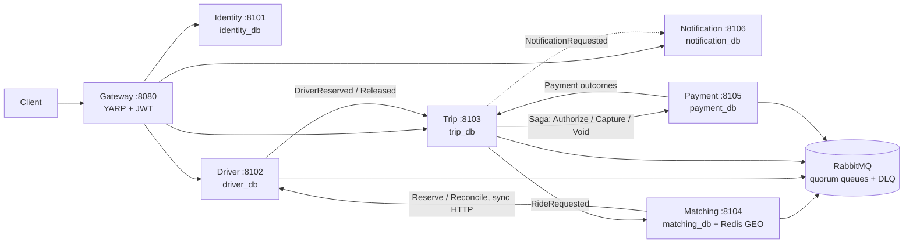

# Distributed Ride-Hailing System (DS03)

A microservices ride-hailing platform (Grab/Uber-like) built for the Distributed
Systems course. Five independently deployed business services — Identity,
Driver, Trip, Matching and Payment — plus a Notification worker and an API
Gateway cooperate over HTTP and RabbitMQ. Every service owns its PostgreSQL
database; there is no shared database and no cross-service transaction.

The project studies a specific question: **how do independent services preserve
safety invariants and eventually recover when requests race, reads are stale,
messages duplicate, responses disappear and processes crash?** Correctness is
built from explicit authority, local atomicity, stable identity, guarded state
transitions, durable intent, idempotency, explicit `UNKNOWN` outcomes and
bounded recovery rather than from distributed locks or exactly-once claims.

## What the system does

- User registration, login and Rider/Driver roles (RSA-signed JWTs).
- Driver onboarding, online/offline status and simulated location updates.
- Passenger ride creation with an idempotency key.
- Candidate discovery and deterministic driver matching.
- Driver acceptance and durable rejection with exact reservation fencing.
- Trip lifecycle from matching through start, completion or cancellation.
- Deterministic fare calculation and simulated payment authorization, capture
  and void, with a durable `operationKey` idempotency authority.
- Recipient-addressed in-app notifications for passengers and drivers.
- No driver can be assigned to two trips at the same time.

## Architecture



| Service | Responsibility | Storage | Port |
|---|---|---|---|
| Gateway | Routing, JWT forwarding and edge request limits | none | 8080 |
| Identity | Users, roles, RSA-signed JWTs, service grants | `identity_db` | 8101 |
| Driver | Driver profile, status, location, **exclusive reservation authority** (PostgreSQL OCC) | `driver_db` | 8102 |
| Trip | Trip lifecycle, fare snapshot, persisted Saga, Outbox | `trip_db` | 8103 |
| Matching | Durable matching rounds, deterministic ranking, UNKNOWN reconciliation | `matching_db` + Redis GEO | 8104 |
| Payment | Simulated provider, `operationKey` idempotency, UNKNOWN reconciliation | `payment_db` | 8105 |
| Notification | Asynchronous projection, per-recipient inbox | `notification_db` | 8106 |

Redis is a derived candidate index only: it can nominate a driver, but it can
never grant a reservation. Driver PostgreSQL is the sole reservation authority.

## Distributed-system mechanisms

- **Authority and fencing** — Driver reservation linearizes at a guarded
  `UPDATE ... WHERE status = 'AVAILABLE' AND version = :v`. Trip assignment,
  reservation identity and matching round identity are fenced end to end.
- **Transactional Outbox** — business state and outgoing intent commit in one
  local transaction; a relay publishes with publisher confirms and marks the
  intent `PUBLISHED` only after the broker confirms.
- **Idempotency and deduplication** — stable `messageId`, consumer
  `processed_messages` receipts committed with the business effect, and a
  durable Payment `operationKey`. Same key with a different payload is a
  conflict, not a second effect.
- **Persisted Saga** — Trip owns an explicit Saga with compensation for
  cancellation and driver rejection, forward capture recovery and a
  `REQUIRES_REVIEW` end state when authority cannot be resolved.
- **Bounded retry and DLQ** — finite delivery attempts, `<queue>.dead` queues
  and a quarantine queue; no infinite retry loop.
- **UNKNOWN handling** — lost responses are reconciled against the same
  reservation or payment operation identity; they are never guessed or retried
  blindly.
- **Observability and audit** — W3C trace propagation, correlation IDs,
  OpenTelemetry metrics/traces, and an invariant auditor that checks Trip,
  Driver, Matching and Payment authorities against each other.

## Technology stack

- .NET 10 (ASP.NET Core minimal APIs), xUnit
- PostgreSQL 18.6 (one logical database and role per service)
- RabbitMQ 4.3.6 (quorum queues, publisher confirms, manual acknowledgement)
- Redis 8.10.2 (derived GEO candidate index)
- Docker Compose; OpenTelemetry, Jaeger, Prometheus and Grafana in the optional
  `obs` profile

## Prerequisites

- Docker Engine or Docker Desktop with Compose v2
- Python 3.10+ and OpenSSL for disposable local credential initialization
- No host .NET SDK is required to run the Compose deployment; the full test
  suite runs through the pinned .NET 10 SDK container or a local .NET 10 SDK.

## Quick start

```bash
cp .env.example .env
python3 scripts/security/init-local-auth.py
docker compose up -d --build

curl http://localhost:8080/health/live
curl http://localhost:8101/health/live
curl http://localhost:8102/health/live
curl http://localhost:8103/health/live
curl http://localhost:8104/health/live
curl http://localhost:8105/health/live
curl http://localhost:8106/health/live
```

RabbitMQ management UI: <http://localhost:15672> (development defaults in
`.env.example`; never reuse them outside a disposable environment).

Optional observability stack:

```bash
export OBS_PROMETHEUS_PORT=19090   # only if 9090 is already taken on the host
docker compose --profile obs up -d
# Jaeger :16686, Prometheus :9090 (or $OBS_PROMETHEUS_PORT), Grafana :3000,
# OTLP :4317/:4318. Every published port binds 127.0.0.1 only.
```

Shut down with `docker compose down`; add `-v` only when you intend to delete
the disposable development volumes.

Public business endpoints require a signed Identity grant. Register and log in
through `/auth/register` and `/auth/login`; see
[docs/authentication-runtime.md](docs/authentication-runtime.md) for roles,
service permissions and local key setup.

## Verification

Automated verification covers real PostgreSQL, RabbitMQ and Redis boundaries,
not mocks:

```bash
# Full .NET regression (13 suites) in the pinned SDK container
bash scripts/test/quick.sh

# Compose-level functional, concurrency, security and fault checks
python3 scripts/test/platform-smoke.py
python3 scripts/test/security-gate.py --identity-tests
python3 scripts/test/core-runtime-gate.py
python3 scripts/test/payment-smoke.py
python3 scripts/test/topology-smoke.py

# Full Production overlay: migrations, real JWT journey, reject, notification
# outage isolation and crash replay
python3 scripts/test/release-smoke.py
```

The latest verified results, test counts and evidence bundles are recorded in
[docs/verification.md](docs/verification.md) and [evidence/](evidence/).

## Demonstration

The authoritative presentation runbook is [docs/demo.md](docs/demo.md), written
in Vietnamese for the DS03 defense. It covers preparation and readiness checks,
the architecture and its authority boundaries, a 13-step live ride, ten
extended distributed-systems scenarios (concurrency, idempotency, transactional
outbox, payment `UNKNOWN` reconciliation, Saga compensation, notification
outage, crash recovery, observability, performance and HA scope), speaker
handover for the three members, and examiner Q&A.

Every command in it was executed against a clean deployment of this source
tree, and each scenario's outcome was read back from the owning service's
PostgreSQL, the Redis projection or RabbitMQ. Scenarios the repository does not
actually support are stated as limitations rather than simulated.

## Documentation

| Document | Content |
|---|---|
| [docs/00-project-scope-architecture.md](docs/00-project-scope-architecture.md) | Scope, architecture and design rationale |
| [docs/01-domain-correctness-contract.md](docs/01-domain-correctness-contract.md) | Domain invariants and correctness contract |
| [docs/02-distributed-workflow-engineering.md](docs/02-distributed-workflow-engineering.md) | Messaging, Saga, idempotency and recovery rules |
| [docs/03-verification-experiments-demo.md](docs/03-verification-experiments-demo.md) | Verification method, scenarios and evidence contract |
| [docs/verification.md](docs/verification.md) | Final verified results and evidence index |
| [docs/demo.md](docs/demo.md) | Team demonstration and failure drill |
| [docs/report.pdf](docs/report.pdf) | Final project report |
| [docs/slides.pdf](docs/slides.pdf) | Presentation slides |
| [docs/README.md](docs/README.md) | Full documentation index |
| [evidence/README.md](evidence/README.md) | Evidence bundle index |
| [docs/release.md](docs/release.md) | Release identity, deployment and known limitations |

## Team

| Member | Student ID | Responsibility |
|---|---|---|
| Nguyen Quang Minh | B23DCVT280 | A — Trip/Booking, lifecycle and Saga |
| Nguyen Hoang Khanh | B23DCVT228 | B — Driver, location and Matching |
| Le Anh Viet | B23DCVT453 | C — Payment, messaging and platform |

GitHub: [minhqng](https://github.com/minhqng) (Nguyen Quang Minh),
[Fried-toofuu](https://github.com/Fried-toofuu) (Nguyen Hoang Khanh),
[Nerduckk](https://github.com/Nerduckk) (Le Anh Viet).

Detailed commit and attribution evidence is in
[docs/07-contribution-mapping.md](docs/07-contribution-mapping.md) and
[evidence/](evidence/). The responsibility table describes ownership of the
implemented capabilities; it is not a claim that every historical commit was
originally authored by the displayed Git author.

## Known limitations

- Payment is a **simulated provider** with durable idempotency and
  reconciliation; it is not connected to a real card network or bank.
- Notifications are an in-app inbox. There is no SMS, email or mobile push
  channel.
- The recorded HA evidence covers a single-host RabbitMQ quorum scenario, not
  whole-system or multi-region high availability.
- Performance results describe the recorded single-host workloads; they are
  not production capacity claims.
- The course's live human rehearsal and oral defense remain team activities;
  the repository provides the executable demo path and verified technical
  evidence.

## Release

Final tag: `v1.0.0` — see [docs/release.md](docs/release.md) and the GitHub
Release page for the verified commit SHA, evidence summary and download links.
