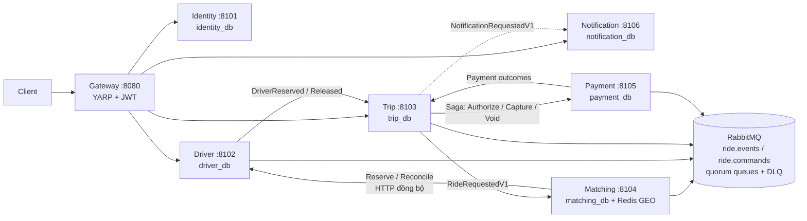

# DS03 — Runbook trình diễn và bảo vệ đồ án

Tài liệu này là **runbook duy nhất** dùng để trình diễn và bảo vệ hệ thống
ride-hailing microservices trước hội đồng. Các kịch bản nền đã được ghi nhận
trong evidence của `v1.0.1`; mọi thay đổi đối với lệnh, assertion hoặc thời lượng
trong runbook phải được rehearsal lại trên đúng commit trước buổi bảo vệ.

Nguyên tắc xuyên suốt: **không diễn lại bằng dữ liệu giả**. Mỗi bước đều chỉ ra
trạng thái thật trong PostgreSQL của service sở hữu, trong Redis projection hoặc
trong RabbitMQ. Nếu một bước không chứng minh được bằng trạng thái thật thì bước
đó không được đưa vào bài trình diễn.

## Luồng trình diễn chuẩn — showcase toàn bộ hệ thống

Phiên chuẩn dành **10 phút cho phần trình bày và demo**, sau đó giữ 5 phút cho
hỏi đáp. Tuyến live chỉ chạy Phần B rút gọn và C.1–C.13; Phần D là bằng chứng
dự phòng để mở đúng tình huống hội đồng hỏi. Đường chạy bắt buộc là:

| Mốc | Nội dung trực tiếp | Thành phần được chứng minh |
|---|---|---|
| 0:00–1:30 | Kiến trúc, readiness và sáu database riêng | Gateway, 6 service/worker, PostgreSQL |
| 1:30–3:00 | Đăng nhập, kiểm tra role; Driver online và cập nhật vị trí | Identity, JWT, Driver, Redis GEO |
| 3:00–7:30 | Tạo chuyến, matching, accept, start, complete và capture | Trip, Matching, Driver, Payment, RabbitMQ, Outbox/Saga |
| 7:30–8:30 | Đọc inbox Rider/Driver | Notification, recipient isolation |
| 8:30–9:30 | Đối soát trạng thái cuối và mở đúng trace | PostgreSQL authorities, OpenTelemetry, Jaeger |
| 9:30–10:00 | Kết luận hoặc dùng làm thời gian dự phòng | Toàn hệ thống |

### Bản đồ phủ toàn hệ thống

| Thành phần | Bước bắt buộc | Điều cần nói |
|---|---|---|
| Gateway | B.1, C.2 | Một cửa vào, chuyển JWT và áp dụng policy ở biên |
| Identity | C.2 | Cấp JWT RSA; Rider gọi route Driver nhận 403 |
| Driver | C.3, C.6–C.7 | PostgreSQL là thẩm quyền giữ chỗ; Redis không quyết định |
| Trip | C.4–C.13 | Sở hữu vòng đời chuyến, Saga và Transactional Outbox |
| Matching | C.5 | Xếp hạng ứng viên nhưng phải xin Driver giữ chỗ |
| Payment | C.8, C.10 | Authorize/capture theo `operationKey`; D.4 dành cho Q&A |
| Notification | C.12 | Projection bất đồng bộ, tách biệt theo người nhận |
| Hạ tầng | C.1, C.3, C.5, D.8 | PostgreSQL, Redis, RabbitMQ và trace đều có bằng chứng thật |

Nếu thời gian bị cắt, vẫn phải giữ C.1–C.13 ở dạng rút gọn. Có thể bỏ thao tác
UI RabbitMQ/Grafana và chỉ mở Jaeger ở cuối; không được bỏ trạng thái cuối C.13
vì đó là bằng chứng các service đã hội tụ. D.1 (concurrency), D.4 (Payment
`UNKNOWN`) và các kịch bản D khác chỉ chạy khi hội đồng yêu cầu hoặc cho thêm
thời gian.

---

## Phần A — Chuẩn bị bảo vệ

### A.1. Thời lượng dự kiến

| Phần | Nội dung | Thời lượng |
|---|---|---|
| Mở đầu | Kiến trúc, ranh giới thẩm quyền và readiness | 1 phút 30 giây |
| Trình diễn chính | Một chuyến hoàn chỉnh qua toàn bộ service | 7 phút |
| Đối soát và kết luận | Trace, trạng thái cuối và thông điệp chính | 1 phút |
| Dự phòng | Độ trễ bất đồng bộ hoặc chuyển màn hình | 30 giây |
| Hỏi đáp | Mở kịch bản Phần D theo câu hỏi hội đồng | 5 phút |

Mốc cứng: phần nói và demo kết thúc ở phút 10. Không chạy Phần D nối tiếp chỉ
để “cho đủ”; chúng là kho bằng chứng cho hỏi đáp.

Toàn bộ phần A (chuẩn bị) **phải xong trước khi đồng hồ trình diễn bắt đầu**.

### A.2. Phần cứng và phần mềm

- Docker Engine hoặc Docker Desktop có Compose v2 (đã kiểm chứng với Docker
  29.7.2 và Compose 5.7.0).
- Python 3.10+ trên máy host (đã kiểm chứng với 3.13).
- OpenSSL (dùng để sinh khoá JWT cục bộ).
- .NET 10 SDK **chỉ cần** nếu chạy migration thủ công cho Production overlay.
  Stack development không cần SDK trên host.
- RAM khuyến nghị: ≥ 8 GB cho stack development; nhiều hơn nếu bật profile
  `obs` cùng lúc.

Mở **một Bash session riêng** tại root repository và chạy toàn bộ các block Bash
trong runbook theo đúng thứ tự trong session đó. Không chạy từng block bằng các
shell tách biệt, vì biến, hàm và recovery trap phải được giữ xuyên suốt:

```bash
set -Eeuo pipefail

# Fault-injection scenario gán tên service vào biến này trước khi stop.
# Mọi exit, kể cả Ctrl+C/TERM, sẽ cố khởi động lại service rồi giữ nguyên exit code.
DEMO_RECOVERY_SERVICE=""
DEMO_SESSION_ID="$(date -u +%Y%m%dT%H%M%SZ)-$$"
wait_demo_service_ready() {
  local service="$1" i
  for i in $(seq 1 40); do
    case "$service" in
      rabbitmq)
        docker compose exec -T rabbitmq sh /etc/rabbitmq/ride-health-ready.sh >/dev/null 2>&1 && return 0 ;;
      payment)
        curl -fsS http://localhost:8105/health/ready >/dev/null 2>&1 && return 0 ;;
      notification)
        curl -fsS http://localhost:8106/health/ready >/dev/null 2>&1 && return 0 ;;
      trip)
        curl -fsS http://localhost:8103/health/ready >/dev/null 2>&1 && return 0 ;;
      *)
        docker compose ps --status running --services | grep -Fxq "$service" && return 0 ;;
    esac
    sleep 1
  done
  echo "Service $service chưa ready sau recovery" >&2
  return 1
}
restore_demo_service() {
  local rc=$?
  if [ -n "${DEMO_RECOVERY_SERVICE:-}" ]; then
    echo "Khôi phục service sau khi scenario kết thúc: $DEMO_RECOVERY_SERVICE" >&2
    docker compose start "$DEMO_RECOVERY_SERVICE" >/dev/null 2>&1 || true
    wait_demo_service_ready "$DEMO_RECOVERY_SERVICE" || true
  fi
  return "$rc"
}
require_demo_session() {
  [ -n "${DEMO_SESSION_ID:-}" ] || { echo "Thiếu DEMO_SESSION_ID" >&2; return 1; }
  trap -p EXIT | grep -q 'restore_demo_service' || {
    echo "Recovery trap không còn trong shell hiện tại" >&2; return 1;
  }
}
abort_demo_on_error() {
  local rc=$?
  echo "Dừng runbook vì lệnh trước thất bại (exit=$rc)." >&2
  exit "$rc"
}
trap restore_demo_service EXIT
trap abort_demo_on_error ERR
trap 'exit 130' INT
trap 'exit 143' TERM
```

`set -Eeuo pipefail` làm lỗi `curl`, SQL hoặc pipeline dừng cả scenario thay vì
tiếp tục bằng dữ liệu rỗng. Các HTTP status dự kiến như `403` và `503` được lấy
bằng `curl` không có `-f`, rồi phân loại tường minh trong assertion tương ứng.
Trước mỗi fault injection, `require_demo_session` xác nhận người vận hành vẫn ở
đúng shell và `EXIT` trap chưa bị mất.

### A.3. Danh tính mã nguồn

Ghi lại chính xác revision đang trình diễn để mọi quan sát quy được về một cây
mã nguồn:

```bash
git rev-parse HEAD
git rev-parse HEAD^{tree}
git describe --tags --always
```

Bản runbook này đi với commit cuối trên `main`. Không checkout tag `v1.0.1` sau
khi đã mở bản này: tag đó có runbook riêng và không chứa các guard mới.

### A.4. Biến môi trường

Không bao giờ commit `.env`. Tạo từ template:

```bash
if [ ! -f .env ]; then
  cp .env.example .env
fi
python3 scripts/security/init-local-auth.py
```

`init-local-auth.py` sinh một cặp khoá RSA dùng một lần và hai client secret
cho Matching/Trip, ghi vào `.env` đang bị gitignore. **Không in các giá trị này
lên màn hình trình chiếu.**

Biến quan trọng nhất cần kiểm tra:

```bash
grep -E '^(TRIP_MESSAGING_ENABLED|TRIP_AUTO_MIGRATE|ASPNETCORE_ENVIRONMENT)=' .env
```

Kỳ vọng:

```text
TRIP_MESSAGING_ENABLED=true
TRIP_AUTO_MIGRATE=true
ASPNETCORE_ENVIRONMENT=Development
```

`TRIP_MESSAGING_ENABLED=true` là **bắt buộc**. Nếu để `false`, Trip sẽ không
phát `RideRequestedV1`, Matching không bao giờ chạy, và chuyến đi sẽ đứng nguyên
ở `CREATED` mãi mãi. Đây là lỗi cấu hình từng tồn tại trong template cũ và đã
được sửa.

### A.5. Tạo dữ liệu trình diễn an toàn

Luôn tạo **một Compose project mới** cho đúng lần chạy hiện tại để không đụng vào
volume của người khác hoặc tái sử dụng project rehearsal:

```bash
export COMPOSE_PROJECT_NAME="ride-defense-$(date -u +%Y%m%d-%H%M%S)"
echo "COMPOSE_PROJECT_NAME=$COMPOSE_PROJECT_NAME"
```

Tên Rider/Driver trong runbook này đều có hậu tố ngẫu nhiên nên chạy lại nhiều
lần không bị trùng. Không xoá volume trong buổi rehearsal hoặc bảo vệ. Khi cần
một môi trường sạch, tạo một Compose project mới có tên riêng thay vì dùng
`down -v` trên project đang tồn tại.

### A.6. Khởi động và dừng

```bash
docker compose up -d --build
docker compose ps
```

Dừng nhưng giữ dữ liệu:

```bash
docker compose stop
```

Dừng và gỡ container/network nhưng giữ volume dữ liệu:

```bash
docker compose down
```

### A.7. Kiểm tra readiness của hạ tầng

```bash
for port in 8080 8101 8102 8103 8104 8105 8106; do
  printf '%s ' "$port"
  curl -fsS "http://localhost:${port}/health/ready" && echo
done
```

Kỳ vọng (đã chạy thật):

```text
8080 {"status":"Ready","scope":"process-only; no database configured"}
8101 {"status":"Ready","scope":"process-and-owned-database"}
8102 {"status":"Ready","scope":"process-and-owned-database"}
8103 {"status":"Ready","dependencies":{"trip-database":"Healthy","trip-messaging":"Healthy"}}
8104 {"status":"Ready","scope":"process-and-owned-database"}
8105 {"status":"Ready","scope":"process-and-owned-database"}
8106 {"status":"Ready","service":"notification-service"}
```

Điểm cần nói với hội đồng: **mỗi service tự báo readiness trên database nó sở
hữu**. Gateway báo `process-only` vì nó không sở hữu database nào — đây là bằng
chứng cho việc không có database dùng chung.

Kiểm tra riêng messaging của Trip (chỉ healthy khi đã nối được RabbitMQ):

```bash
docker compose exec -T rabbitmq rabbitmq-diagnostics -q check_port_connectivity --timeout 5
curl -fsS http://localhost:8103/health/ready
```

Kỳ vọng RabbitMQ báo kết nối được các listener, trong đó có AMQP `5672`, và
Trip có thêm `"trip-messaging":"Healthy"`. Healthcheck của RabbitMQ dùng cùng
phép kiểm tra listener này, nên `depends_on: condition: service_healthy` không
khởi động Payment trong khoảng trống giữa lúc Erlang node đã phản hồi `ping`
và lúc AMQP thực sự nhận kết nối.

### A.8. Chuẩn bị màn hình

| Cửa sổ | Nội dung | Mục đích |
|---|---|---|
| Terminal 1 | Chạy lệnh `curl` của runbook | Thao tác viên |
| Terminal 2 | `docker compose logs -f trip matching driver payment notification` | Cho thấy luồng bất đồng bộ |
| Trình duyệt tab 1 | <http://localhost:15672> → Queues | Bằng chứng message thật |
| Trình duyệt tab 2 | <http://localhost:16686> (Jaeger) | Trace xuyên service |
| Trình duyệt tab 3 | <http://localhost:3000> (Grafana) | Metric và backlog |
| Trình duyệt tab 4 | <http://localhost:19090> (Prometheus) | Truy vấn metric thô |

Bật profile observability trước:

```bash
export OBS_PROMETHEUS_PORT=19090
docker compose --profile obs up -d
```

> Prometheus bind loopback và nhận cổng qua `OBS_PROMETHEUS_PORT`. Nếu 9090
> đang bị chiếm trên máy, đổi biến này thay vì sửa file compose.

RabbitMQ management dùng user `ride_app` và mật khẩu trong `.env`
(`RABBITMQ_PASSWORD`). Không đọc to mật khẩu khi trình chiếu.

### A.9. Phân vai

| Vai | Người | Việc |
|---|---|---|
| Thao tác viên | Một người duy nhất | Gõ lệnh, không vừa nói vừa gõ |
| Người trình bày | Ba thành viên luân phiên | Giải thích theo phần được phân công |
| Người canh thời gian | Một người | Báo khi vượt mốc thời lượng |

Chỉ **một** người điều khiển bàn phím. Người trình bày nói theo script trong
runbook, không đọc lại output lệnh.

### A.10. Checklist trước giờ G

- [ ] `docker compose ps` — tất cả service `running`/`healthy`
- [ ] 7 endpoint `/health/ready` đều trả `Ready`
- [ ] `curl -fsS http://localhost:8103/health/ready` có `trip-messaging`
- [ ] RabbitMQ UI mở được, thấy danh sách queue
- [ ] Jaeger và Grafana mở được
- [ ] Đã chạy thử trên một Compose project dùng riêng; tạo project mới cho buổi
  bảo vệ thay vì xoá volume của project rehearsal
- [ ] Terminal đang dùng tên `COMPOSE_PROJECT_NAME` mới, đã ghi lại trong
  transcript và chưa từng dùng cho rehearsal trước đó
- [ ] `require_demo_session` chạy thành công trong chính terminal sẽ dùng để
  thao tác; không mở shell mới giữa các block
- [ ] Không có `.env` hoặc khoá riêng tư hiện trên màn hình

---

## Phần B — Giới thiệu kiến trúc

### B.1. Sơ đồ thật của hệ thống

Sơ đồ dưới đây khớp với `compose.yaml` và mã nguồn hiện tại:



### B.2. Từng thành phần: việc nó làm và ai sở hữu trạng thái

| Thành phần | Trách nhiệm | Trạng thái do ai sở hữu | Cổng |
|---|---|---|---|
| **Gateway** | Định tuyến và bảo vệ các route phía client; rate limiting nằm tại service tương ứng | Không sở hữu trạng thái nghiệp vụ | 8080 |
| **Identity** | Người dùng, vai trò, JWT ký RSA, service grant | `identity_db` | 8101 |
| **Driver** | Hồ sơ tài xế, trạng thái, vị trí, **thẩm quyền giữ chỗ độc quyền** | `driver_db` (PostgreSQL OCC) | 8102 |
| **Trip** | Vòng đời chuyến đi, snapshot giá cước, Saga bền vững, Outbox | `trip_db` | 8103 |
| **Matching** | Vòng matching bền vững, xếp hạng tất định, đối soát UNKNOWN | `matching_db` + Redis GEO | 8104 |
| **Payment** | Provider mô phỏng, idempotency theo `operationKey`, đối soát UNKNOWN | `payment_db` | 8105 |
| **Notification** | Projection bất đồng bộ, hộp thư theo từng người nhận | `notification_db` | 8106 |

### B.3. Ranh giới lỗi và chủ sở hữu trạng thái

Đây là phần hội đồng hay hỏi nhất, nên nói rõ ngay từ đầu:

- **Driver là thẩm quyền duy nhất** về việc ai đang giữ một tài xế. Chỉ
  PostgreSQL của Driver quyết định điều đó, thông qua optimistic concurrency
  control trên cột `version`.
- **Redis chỉ là projection dẫn xuất.** Nó đề cử ứng viên, nhưng không bao giờ
  là thẩm quyền. Nếu Redis nói sai, Driver vẫn từ chối giữ chỗ sai.
- **Trip là thẩm quyền duy nhất** về trạng thái chuyến đi và về Saga.
- **Payment là thẩm quyền duy nhất** về hiệu ứng thanh toán, khoá theo
  `operationKey`.
- **Matching sở hữu** vòng matching và kết quả cuối cùng của vòng đó.

Nếu một service chết, các service khác vẫn giữ nguyên trạng thái của mình. Đó là
lý do tách database.

### B.4. Đồng bộ và bất đồng bộ

Cần phân biệt rõ hai loại luồng:

**Đồng bộ (HTTP):** Client → Gateway → service. Matching gọi Driver qua HTTP
khi cần giữ chỗ, vì cần câu trả lời ngay: được hay không được.

**Bất đồng bộ (RabbitMQ):** Trip phát `RideRequestedV1`; Driver phát
`DriverReservedV1`; Payment phát kết quả thanh toán; Trip phát
`NotificationRequestedV1`. Các luồng này đi qua **Transactional Outbox**, nên
message chỉ được phát sau khi giao dịch nghiệp vụ đã commit.

Trao đổi (exchanges) và queue thật, lấy từ mã nguồn:

- `ride.events` — sự kiện nghiệp vụ.
- `ride.commands` — lệnh gửi tới một service cụ thể.

Một số binding tiêu biểu:

| Queue | Exchange | Routing key |
|---|---|---|
| `matching.ride-requested.q` | `ride.events` | `trip.ride-requested.v1` |
| `trip.driver-state.q` | `ride.events` | `driver.reserved.v1`, `driver.reservation-released.v1`, `driver.trip-started.v1`, `driver.trip-completed.v1` |
| `trip.payment-outcome.q` | `ride.events` | `payment.authorized.v1`, `payment.captured.v1`, `payment.capture-pending.v1`, … |
| `payment.commands.q` | `ride.commands` | `payment.authorize.v1`, `payment.capture.v1`, `payment.void-authorization.v1` |
| `driver.commands.q` | `ride.commands` | `driver.release-reservation.v1`, `driver.mark-trip-started.v1`, `driver.mark-trip-completed.v1` |
| `matching.commands.q` | `ride.commands` | `matching.cancel-round.v1` |
| `notification.business-events.q` | `ride.events` | `trip.#` |

---

## Phần C — Trình diễn chính (7–10 phút)

Chuẩn bị biến cho cả phần này:

```bash
export API=http://localhost:8080
export RUN=$(date +%s)$RANDOM
export NOW=$(date -u +%Y-%m-%dT%H:%M:%SZ)
```

> `NOW` phải là thời điểm hiện tại. Driver từ chối vị trí cũ hơn 24 giờ
> (`MaxPastAge`), nên **không** dùng mốc thời gian cố định trong tài liệu.

### Bước 1 — Cho thấy các service chạy độc lập và database riêng

```bash
docker compose ps
```

```bash
docker compose exec -T postgres psql -U postgres -c "\l" | grep _db
```

Kỳ vọng: thấy `identity_db`, `driver_db`, `trip_db`, `matching_db`,
`payment_db`, `notification_db`.

**Script thuyết trình:** "Sáu database riêng biệt, mỗi service sở hữu một
database. Không có database dùng chung, nên không thể có transaction phân tán
kiểu ACID xuyên service — đó chính là bài toán đồ án đặt ra."

**Khái niệm:** microservice, database-per-service, ranh giới giao dịch cục bộ.

### Bước 2 — Đăng ký và đăng nhập Rider/Driver thật

```bash
DRIVER_USER=$(curl -fsS -X POST "$API/auth/register" -H 'Content-Type: application/json' \
  -d "{\"username\":\"drv$RUN\",\"password\":\"demo-password-1\",\"role\":\"Driver\"}" \
  | python3 -c 'import json,sys;print(json.load(sys.stdin)["userId"])')

DRIVER_TOKEN=$(curl -fsS -X POST "$API/auth/login" -H 'Content-Type: application/json' \
  -d "{\"username\":\"drv$RUN\",\"password\":\"demo-password-1\"}" \
  | python3 -c 'import json,sys;print(json.load(sys.stdin)["access_token"])')

curl -fsS -X POST "$API/auth/register" -H 'Content-Type: application/json' \
  -d "{\"username\":\"rdr$RUN\",\"password\":\"demo-password-1\",\"role\":\"Rider\"}" >/dev/null

RIDER_TOKEN=$(curl -fsS -X POST "$API/auth/login" -H 'Content-Type: application/json' \
  -d "{\"username\":\"rdr$RUN\",\"password\":\"demo-password-1\"}" \
  | python3 -c 'import json,sys;print(json.load(sys.stdin)["access_token"])')
```

Kiểm tra vai trò được thực thi thật — Rider gọi endpoint của Driver phải bị chặn:

```bash
ROLE_HTTP=$(curl -sS -o /dev/null -w '%{http_code}' \
  -X POST "$API/drivers" -H "Authorization: Bearer $RIDER_TOKEN" \
  -H 'Content-Type: application/json' -d "{\"userId\":\"$DRIVER_USER\"}")
[ "$ROLE_HTTP" = "403" ] || { echo "Rider gọi endpoint Driver nhận HTTP $ROLE_HTTP, cần 403" >&2; exit 1; }
echo "Rider gọi endpoint Driver: HTTP $ROLE_HTTP"
```

Kỳ vọng: `HTTP 403`.

**Script thuyết trình:** "JWT được Identity ký bằng RSA. Vai trò nằm trong
token và được kiểm tra ở biên, nên Rider không thể tự nhận mình là Driver."

**Khái niệm:** xác thực, phân quyền theo vai trò, chữ ký bất đối xứng.

### Bước 3 — Tài xế online và gửi vị trí

```bash
DRIVER=$(curl -fsS -X POST "$API/drivers" -H "Authorization: Bearer $DRIVER_TOKEN" \
  -H 'Content-Type: application/json' -d "{\"userId\":\"$DRIVER_USER\"}")
DRIVER_ID=$(echo "$DRIVER" | python3 -c 'import json,sys;print(json.load(sys.stdin)["driverId"])')
VERSION=$(echo "$DRIVER" | python3 -c 'import json,sys;print(json.load(sys.stdin)["version"])')

curl -fsS -X POST "$API/drivers/$DRIVER_ID/online" -H "Authorization: Bearer $DRIVER_TOKEN" \
  -H 'Content-Type: application/json' -d "{\"expectedVersion\":$VERSION}"
```

```bash
curl -fsS -X POST "$API/drivers/$DRIVER_ID/location" -H "Authorization: Bearer $DRIVER_TOKEN" \
  -H 'Content-Type: application/json' \
  -d "{\"deviceSessionId\":\"sess$RUN\",\"sequenceNo\":1,\"capturedAt\":\"$NOW\",\"latitude\":10.7769,\"longitude\":106.7009}"
```

Kỳ vọng: `online` trả `"status":"AVAILABLE"`; `location` trả `202` với
`accepted.sequenceNo = 1`.

Quan sát projection dẫn xuất trong Redis:

```bash
docker compose exec -T redis redis-cli HGETALL "driver:projection:$(echo $DRIVER_ID | tr -d '-')"
```

Kỳ vọng: hash có `derivedStatus`, `driverAggregateVersion`, `latitude`,
`longitude`, `sequenceNo`.

**Script thuyết trình:** "Vị trí đi vào Redis dưới dạng projection dẫn xuất để
Matching tìm ứng viên theo khoảng cách. Nhưng quyền quyết định vẫn ở PostgreSQL
của Driver — Redis chỉ đề cử."

**Khái niệm:** CQRS nhẹ, projection dẫn xuất so với thẩm quyền, eventual
consistency.

### Bước 4 — Rider tạo chuyến đi với idempotency key

```bash
IDEM=$(python3 -c 'import uuid;print(uuid.uuid4())')
TRIP_ID=$(curl -fsS -X POST "$API/trips" -H "Authorization: Bearer $RIDER_TOKEN" \
  -H 'Content-Type: application/json' -H "Idempotency-Key: $IDEM" \
  -d '{"pickup":{"latitude":10.7769,"longitude":106.7009},"dropoff":{"latitude":10.78,"longitude":106.71}}' \
  | python3 -c 'import json,sys;print(json.load(sys.stdin)["tripId"])')
echo "trip=$TRIP_ID"
```

Chứng minh idempotency ngay tại chỗ — gửi lại cùng key:

```bash
curl -fsS -X POST "$API/trips" -H "Authorization: Bearer $RIDER_TOKEN" \
  -H 'Content-Type: application/json' -H "Idempotency-Key: $IDEM" \
  -d '{"pickup":{"latitude":10.7769,"longitude":106.7009},"dropoff":{"latitude":10.78,"longitude":106.71}}'
```

Kỳ vọng: **cùng một `tripId`**, không tạo chuyến thứ hai.

**Script thuyết trình:** "Cùng một idempotency key trả về cùng một chuyến. Đây
là điều kiện để client có thể retry an toàn khi mạng chập chờn."

**Khái niệm:** idempotency, khoá idempotency, retry an toàn.

### Bước 5 — Matching chọn tài xế

```bash
ST=""
for i in $(seq 1 25); do
  ST=$(curl -fsS "$API/trips/$TRIP_ID" -H "Authorization: Bearer $RIDER_TOKEN" \
    | python3 -c 'import json,sys;print(json.load(sys.stdin)["status"])')
  echo "  lần $i: $ST"
  case "$ST" in
    DRIVER_RESERVED) break ;;
    CREATED|MATCHING) sleep 1 ;;
    *) echo "Matching kết thúc ngoài dự kiến: $ST" >&2; exit 1 ;;
  esac
done
[ "$ST" = "DRIVER_RESERVED" ] || { echo "Timeout chờ DRIVER_RESERVED" >&2; exit 1; }
```

Kỳ vọng: `CREATED` → `MATCHING` → `DRIVER_RESERVED` (thường trong 3–5 giây).

Xem trạng thái đầy đủ:

```bash
curl -fsS "$API/trips/$TRIP_ID" -H "Authorization: Bearer $RIDER_TOKEN"
```

Kỳ vọng có `assignedDriverId` và `reservationId`.

**Script thuyết trình:** "Trip phát `RideRequestedV1` qua Outbox. Matching nhận,
chụp danh sách ứng viên, xếp hạng tất định rồi gọi Driver để giữ chỗ."

**Khái niệm:** giao tiếp bất đồng bộ, transactional outbox, xếp hạng tất định.

### Bước 6 — Chứng minh thẩm quyền giữ chỗ nằm ở Driver

```bash
docker compose exec -T postgres psql -U postgres -d driver_db \
  -c "select driver_id, status, reserved_trip_id, reservation_id, version from drivers where driver_id='$DRIVER_ID';"
```

Kỳ vọng: `status = RESERVED`, `reserved_trip_id` đúng bằng `$TRIP_ID`,
`reservation_id` có giá trị.

So sánh với projection:

```bash
PG_VERSION=$(docker compose exec -T postgres psql -U postgres -d driver_db -tAc \
  "select version from drivers where driver_id='$DRIVER_ID';")
REDIS_KEY="driver:projection:$(echo "$DRIVER_ID" | tr -d '-')"
REDIS_STATUS=""; REDIS_VERSION=""
for i in $(seq 1 20); do
  REDIS_STATUS=$(docker compose exec -T redis redis-cli --raw HGET "$REDIS_KEY" derivedStatus)
  REDIS_VERSION=$(docker compose exec -T redis redis-cli --raw HGET "$REDIS_KEY" driverAggregateVersion)
  [ "$REDIS_STATUS" = "RESERVED" ] && [ "$REDIS_VERSION" = "$PG_VERSION" ] && break
  sleep 1
done
[ "$REDIS_STATUS" = "RESERVED" ] && [ "$REDIS_VERSION" = "$PG_VERSION" ] || {
  echo "Redis projection chưa hội tụ: status=$REDIS_STATUS version=$REDIS_VERSION pg=$PG_VERSION" >&2
  exit 1
}
docker compose exec -T redis redis-cli HGETALL "$REDIS_KEY"
```

Kỳ vọng: `derivedStatus = RESERVED` và `driverAggregateVersion` **bằng đúng**
`version` trong PostgreSQL.

**Script thuyết trình:** "Đây là điểm quan trọng nhất của đồ án. PostgreSQL của
Driver là thẩm quyền: nó ghi chính xác chuyến nào đang giữ tài xế này. Redis chỉ
phản chiếu lại. Nếu hai nguồn lệch nhau, PostgreSQL thắng."

**Khái niệm:** thẩm quyền so với projection, linearization point, row-level
locking kết hợp kiểm tra version.

### Bước 7 — Tài xế chấp nhận

```bash
RES=$(curl -fsS "$API/trips/$TRIP_ID" -H "Authorization: Bearer $RIDER_TOKEN" \
  | python3 -c 'import json,sys;print(json.load(sys.stdin)["reservationId"])')

curl -fsS -X POST "$API/trips/$TRIP_ID/accept" -H "Authorization: Bearer $DRIVER_TOKEN" \
  -H 'Content-Type: application/json' -d "{\"driverId\":\"$DRIVER_ID\",\"reservationId\":\"$RES\"}"
```

Kỳ vọng: `{"state":"DRIVER_ACCEPTED","replayed":false}`.

Chờ Payment authorize và Saga cho phép bắt đầu; không gọi `/start` chỉ vì
request accept đã thành công:

```bash
TRIP_STATUS=""; SAGA_STEP=""
for i in $(seq 1 30); do
  TRIP_STATUS=$(curl -fsS "$API/trips/$TRIP_ID" -H "Authorization: Bearer $RIDER_TOKEN" \
    | python3 -c 'import json,sys;print(json.load(sys.stdin)["status"])')
  SAGA_STEP=$(docker compose exec -T postgres psql -U postgres -d trip_db -tAc \
    "select current_step from ride_sagas where trip_id='$TRIP_ID';")
  echo "  trip=$TRIP_STATUS saga=$SAGA_STEP"
  [ "$TRIP_STATUS" = "READY_TO_START" ] && [ "$SAGA_STEP" = "AUTHORIZED" ] && break
  case "$TRIP_STATUS" in CANCELLED|MATCH_FAILED) exit 1 ;; esac
  sleep 1
done
[ "$TRIP_STATUS" = "READY_TO_START" ] && [ "$SAGA_STEP" = "AUTHORIZED" ] || {
  echo "Timeout chờ READY_TO_START/AUTHORIZED" >&2; exit 1;
}
```

**Script thuyết trình:** "Accept phải kèm đúng `reservationId`. Nếu chuyến đã bị
huỷ và tài xế được giữ cho chuyến khác, reservation cũ sẽ bị từ chối — đó là
fencing token."

**Khái niệm:** fencing token, kiểm tra danh tính chính xác, chuyển trạng thái có
bảo vệ.

### Bước 8 — Saga yêu cầu Payment uỷ quyền

```bash
docker compose exec -T postgres psql -U postgres -d payment_db \
  -c "select operation_key, operation_type, state, provider_effect_id is not null as has_effect, amount_minor from payment_operations where trip_id='$TRIP_ID' order by created_at;"
```

Kỳ vọng: một dòng `$TRIP_ID:authorize:v1` với `state = SUCCEEDED` và
`has_effect = t`.

Xem Saga trong Trip:

```bash
docker compose exec -T postgres psql -U postgres -d trip_db \
  -c "select status, current_step, step_version, authorize_operation_key from ride_sagas where trip_id='$TRIP_ID';"
```

Kỳ vọng: `status = ACTIVE`, `current_step = AUTHORIZED`, và
`authorize_operation_key` đúng bằng `$TRIP_ID:authorize:v1`.

**Script thuyết trình:** "Saga trong Trip điều phối thanh toán. `operationKey`
được sinh tất định từ `tripId`, nên dù Saga chạy lại bao nhiêu lần, Payment vẫn
chỉ tạo đúng một hiệu ứng."

**Khái niệm:** Saga orchestration, khoá thao tác tất định, hiệu ứng
effectively-once.

### Bước 9 — Tài xế bắt đầu và hoàn thành chuyến

```bash
curl -fsS -X POST "$API/trips/$TRIP_ID/start" -H "Authorization: Bearer $DRIVER_TOKEN" \
  -H 'Content-Type: application/json' -d "{\"driverId\":\"$DRIVER_ID\",\"reservationId\":\"$RES\"}"
```

Kỳ vọng: `{"state":"IN_PROGRESS"}`.

```bash
curl -fsS -X POST "$API/trips/$TRIP_ID/complete" -H "Authorization: Bearer $DRIVER_TOKEN" \
  -H 'Content-Type: application/json' -d "{\"driverId\":\"$DRIVER_ID\",\"reservationId\":\"$RES\"}"
```

Kỳ vọng: `{"state":"COMPLETED"}`.

**Khái niệm:** máy trạng thái hữu hạn (FSM), tính đơn điệu của trạng thái kết
thúc.

### Bước 10 — Payment capture hoàn tất

```bash
SAGA_STATUS=""; SAGA_STEP=""; PAYMENT_OK=""
for i in $(seq 1 30); do
  SAGA_ROW=$(docker compose exec -T postgres psql -U postgres -d trip_db -tA -F '|' \
    -c "select status, current_step from ride_sagas where trip_id='$TRIP_ID';")
  IFS='|' read -r SAGA_STATUS SAGA_STEP <<< "$SAGA_ROW"
  PAYMENT_OK=$(docker compose exec -T postgres psql -U postgres -d payment_db -tAc \
    "select count(*) from payment_operations where trip_id='$TRIP_ID' and operation_type in ('AUTHORIZE','CAPTURE') and state='SUCCEEDED';")
  [ "$SAGA_STATUS" = "COMPLETED" ] && [ "$SAGA_STEP" = "CAPTURED" ] && [ "$PAYMENT_OK" = "2" ] && break
  sleep 1
done
[ "$SAGA_STATUS" = "COMPLETED" ] && [ "$SAGA_STEP" = "CAPTURED" ] && [ "$PAYMENT_OK" = "2" ] || {
  echo "Timeout chờ CAPTURED: saga=$SAGA_STATUS/$SAGA_STEP payment_ok=$PAYMENT_OK" >&2
  exit 1
}
docker compose exec -T postgres psql -U postgres -d payment_db \
  -c "select operation_key, operation_type, state from payment_operations where trip_id='$TRIP_ID' order by created_at;"
```

Kỳ vọng: hai dòng — `:authorize:v1` và `:capture:v1`, **cả hai** `SUCCEEDED`.

```bash
docker compose exec -T postgres psql -U postgres -d trip_db \
  -c "select status, current_step, step_version from ride_sagas where trip_id='$TRIP_ID';"
```

Kỳ vọng: `status = COMPLETED`, `current_step = CAPTURED`.

**Script thuyết trình:** "Saga kết thúc ở CAPTURED. Bước uỷ quyền và bước capture
là hai thao tác riêng biệt; trong provider mô phỏng, `operationKey` ổn định làm
cho lệnh capture phát lại vẫn quy về cùng một hiệu ứng nghiệp vụ."

### Bước 11 — Tài xế trở lại trạng thái sẵn sàng

```bash
DRIVER_JSON=""; DRIVER_STATUS=""
for i in $(seq 1 20); do
  DRIVER_JSON=$(curl -fsS "$API/drivers/$DRIVER_ID" -H "Authorization: Bearer $DRIVER_TOKEN")
  DRIVER_STATUS=$(echo "$DRIVER_JSON" | python3 -c 'import json,sys;print(json.load(sys.stdin)["status"])')
  [ "$DRIVER_STATUS" = "AVAILABLE" ] && break
  sleep 1
done
[ "$DRIVER_STATUS" = "AVAILABLE" ] || { echo "Timeout chờ Driver AVAILABLE" >&2; exit 1; }
echo "$DRIVER_JSON" | python3 -c '
import json,sys
d=json.load(sys.stdin)
assert d["status"]=="AVAILABLE"
assert d.get("reservedTripId") is None
assert d.get("reservationId") is None
assert d.get("activeTripId") is None
print(json.dumps(d, indent=2))
'
```

Kỳ vọng: `"status":"AVAILABLE"`, `"reservedTripId":null`,
`"reservationId":null`, `"activeTripId":null`.

**Script thuyết trình:** "Dù command có thể được giao lại, hiệu ứng giải phóng
theo reservation chỉ xảy ra một lần. `version` tăng cho thấy thay đổi trạng thái
đã đi qua kiểm soát đồng thời."

### Bước 12 — Rider và Driver nhận thông báo riêng

```bash
RIDER_TYPES=""; DRIVER_TYPES=""
for i in $(seq 1 30); do
  RIDER_TYPES=$(curl -fsS "$API/notifications/me" -H "Authorization: Bearer $RIDER_TOKEN" \
    | python3 -c 'import json,sys; tid=sys.argv[1].lower(); print(",".join(sorted(x["notificationType"] for x in json.load(sys.stdin) if x["tripId"].lower()==tid)))' "$TRIP_ID")
  DRIVER_TYPES=$(curl -fsS "$API/notifications/me" -H "Authorization: Bearer $DRIVER_TOKEN" \
    | python3 -c 'import json,sys; tid=sys.argv[1].lower(); print(",".join(sorted(x["notificationType"] for x in json.load(sys.stdin) if x["tripId"].lower()==tid)))' "$TRIP_ID")
  [ "$RIDER_TYPES" = "RIDER_DRIVER_ASSIGNED,RIDER_RIDE_REQUESTED,RIDER_TRIP_COMPLETED" ] \
    && [ "$DRIVER_TYPES" = "DRIVER_TRIP_ASSIGNED" ] && break
  sleep 1
done
[ "$RIDER_TYPES" = "RIDER_DRIVER_ASSIGNED,RIDER_RIDE_REQUESTED,RIDER_TRIP_COMPLETED" ] \
  && [ "$DRIVER_TYPES" = "DRIVER_TRIP_ASSIGNED" ] || {
    echo "Notification chưa hội tụ: rider=$RIDER_TYPES driver=$DRIVER_TYPES" >&2
    exit 1
  }
echo "rider=$RIDER_TYPES"
echo "driver=$DRIVER_TYPES"
```

Kỳ vọng (đã chạy thật): 3 thông báo —
`RIDER_RIDE_REQUESTED`, `RIDER_DRIVER_ASSIGNED`, `RIDER_TRIP_COMPLETED`.

Kỳ vọng: 1 thông báo — `DRIVER_TRIP_ASSIGNED`.

**Script thuyết trình:** "Hộp thư lấy danh tính từ `sub` trong JWT, không nhận
`userId` từ client. Rider chỉ thấy thông báo của Rider, Driver chỉ thấy của
Driver."

**Khái niệm:** cô lập dữ liệu theo chủ sở hữu, projection bất đồng bộ.

### Bước 13 — Đối soát trạng thái cuối giữa bốn nguồn

Đây là bước kết luận của phần trình diễn chính:

```bash
TRIP_FINAL=$(docker compose exec -T postgres psql -U postgres -d trip_db -tAc \
  "select state from trips where trip_id='$TRIP_ID';")
DRIVER_FINAL=$(docker compose exec -T postgres psql -U postgres -d driver_db -tAc \
  "select status || '|' || coalesce(reserved_trip_id::text,'') from drivers where driver_id='$DRIVER_ID';")
MATCHING_FINAL=$(docker compose exec -T postgres psql -U postgres -d matching_db -tAc \
  "select status || '|' || coalesce(selected_driver_id::text,'') from matching_rounds where trip_id='$TRIP_ID' order by matching_round desc limit 1;")
PAYMENT_FINAL=$(docker compose exec -T postgres psql -U postgres -d payment_db -tAc \
  "select string_agg(operation_type || ':' || state, ',' order by case operation_type when 'AUTHORIZE' then 1 when 'CAPTURE' then 2 else 3 end) from payment_operations where trip_id='$TRIP_ID';")

[ "$TRIP_FINAL" = "COMPLETED" ] \
  && [ "$DRIVER_FINAL" = "AVAILABLE|" ] \
  && [ "$MATCHING_FINAL" = "RESERVED|$DRIVER_ID" ] \
  && [ "$PAYMENT_FINAL" = "AUTHORIZE:SUCCEEDED,CAPTURE:SUCCEEDED" ] || {
    echo "C.13 mismatch: trip=$TRIP_FINAL driver=$DRIVER_FINAL matching=$MATCHING_FINAL payment=$PAYMENT_FINAL" >&2
    exit 1
  }
printf 'trip=%s\ndriver=%s\nmatching=%s\npayment=%s\n' \
  "$TRIP_FINAL" "$DRIVER_FINAL" "$MATCHING_FINAL" "$PAYMENT_FINAL"
```

Kỳ vọng:

| Nguồn | Trạng thái |
|---|---|
| Trip | `COMPLETED` |
| Driver | `AVAILABLE`, không giữ chuyến nào |
| Matching | `RESERVED`, chọn đúng `$DRIVER_ID` |
| Payment | `AUTHORIZE` + `CAPTURE` đều `SUCCEEDED` |

Kiểm tra Outbox đã phát hết:

```bash
docker compose exec -T postgres psql -U postgres -d trip_db \
  -c "select message_type, status, attempt_count from outbox_messages where aggregate_id='$TRIP_ID' order by occurred_at;"
OUTBOX_OPEN=$(docker compose exec -T postgres psql -U postgres -d trip_db -tAc \
  "select count(*) from outbox_messages where aggregate_id='$TRIP_ID' and status <> 'PUBLISHED';")
OUTBOX_MISSING=$(docker compose exec -T postgres psql -U postgres -d trip_db -tAc \
  "select coalesce(string_agg(required_type, ',' order by required_type),'') from (values ('RideRequestedV1'),('AuthorizePaymentV1'),('CapturePaymentV1'),('MarkDriverTripStartedV1'),('MarkDriverTripCompletedV1'),('NotificationRequestedV1')) required(required_type) where not exists (select 1 from outbox_messages o where o.aggregate_id='$TRIP_ID' and o.message_type=required.required_type);")
[ "$OUTBOX_OPEN" = "0" ] && [ -z "$OUTBOX_MISSING" ] || {
  echo "C.13 Outbox sai: open=$OUTBOX_OPEN missing=$OUTBOX_MISSING" >&2; exit 1;
}
echo "outbox_open=$OUTBOX_OPEN required_types_missing=${OUTBOX_MISSING:-none}"
```

Kỳ vọng: đủ sáu loại intent bắt buộc của happy path và tất cả `PUBLISHED`.
`attempt_count` chỉ là dữ liệu chẩn đoán; nó có thể lớn hơn 0 nếu relay từng
retry rồi hội tụ thành công.

**Script thuyết trình:** "Bốn service, bốn database, không có transaction chung.
Snapshot cuối cho thấy trạng thái của bốn authority tương thích với cùng một
chuyến đi. Đó là kết quả hội tụ có kiểm soát, không phải một transaction chung."

**Khái niệm:** eventual consistency và đối soát snapshot trạng thái cuối. Các
truy vấn này không thay thế kiểm thử invariant xuyên toàn bộ lịch sử chuyển
trạng thái.

---

## Phần D — Trình diễn mở rộng

Evidence `v1.0.1` ghi nhận các kịch bản gốc đã chạy trên stack sạch. Sau mỗi
thay đổi guard hoặc assertion trong runbook, phải rehearsal lại đúng kịch bản
trước khi đưa vào phần live. Chỉ chạy từng kịch bản một và hoàn tất phần dọn
dẹp của nó trước khi chuyển sang kịch bản tiếp theo.

Các scenario dùng Driver gọi hai hàm sau. Hàm đầu làm mới vị trí bằng **đúng
location session hiện tại** và sequence tăng dần; không tự tạo session mới vì
projection cố ý từ chối session lạ bằng `stale-session`. Hàm thứ hai kiểm tra
đồng thời authority PostgreSQL/API, projection Redis và độ mới của vị trí.
Matching dùng cửa sổ freshness 5 phút; runbook chặn ở 4 phút để còn biên an
toàn khi thao tác:

```bash
refresh_driver_location() {
  local label="$1" redis_key session sequence next_sequence captured_at projected_sequence
  redis_key="driver:projection:$(echo "$DRIVER_ID" | tr -d '-')"
  session=$(docker compose exec -T redis redis-cli --raw HGET "$redis_key" locationSessionId)
  sequence=$(docker compose exec -T redis redis-cli --raw HGET "$redis_key" sequenceNo)
  [ -n "$session" ] && echo "$sequence" | grep -Eq '^[0-9]+$' || {
    echo "$label: projection thiếu location session/sequence" >&2
    return 1
  }
  next_sequence=$((sequence + 1))
  captured_at=$(date -u +%Y-%m-%dT%H:%M:%SZ)
  curl -fsS -X POST "$API/drivers/$DRIVER_ID/location" \
    -H "Authorization: Bearer $DRIVER_TOKEN" -H 'Content-Type: application/json' \
    -d "{\"deviceSessionId\":\"$session\",\"sequenceNo\":$next_sequence,\"capturedAt\":\"$captured_at\",\"latitude\":10.7769,\"longitude\":106.7009}" >/dev/null
  projected_sequence=""
  for i in $(seq 1 20); do
    projected_sequence=$(docker compose exec -T redis redis-cli --raw HGET "$redis_key" sequenceNo)
    [ "$projected_sequence" = "$next_sequence" ] && break
    sleep 1
  done
  [ "$projected_sequence" = "$next_sequence" ] || {
    echo "$label: location projection chưa nhận sequence=$next_sequence" >&2
    return 1
  }
}

assert_driver_ready() {
  local label="$1" api_json pg_version redis_key redis_status redis_version redis_captured
  api_json=$(curl -fsS "$API/drivers/$DRIVER_ID" -H "Authorization: Bearer $DRIVER_TOKEN")
  echo "$api_json" | python3 -c '
import json,sys
d=json.load(sys.stdin)
assert d["status"]=="AVAILABLE"
assert d.get("reservedTripId") is None
assert d.get("reservationId") is None
assert d.get("activeTripId") is None
'
  pg_version=$(docker compose exec -T postgres psql -U postgres -d driver_db -tAc \
    "select version from drivers where driver_id='$DRIVER_ID' and status='AVAILABLE' and reserved_trip_id is null and reservation_id is null and active_trip_id is null;")
  [ -n "$pg_version" ] || { echo "$label: Driver authority không AVAILABLE/sạch" >&2; return 1; }
  redis_key="driver:projection:$(echo "$DRIVER_ID" | tr -d '-')"
  redis_status=""; redis_version=""; redis_captured=""
  for i in $(seq 1 20); do
    redis_status=$(docker compose exec -T redis redis-cli --raw HGET "$redis_key" derivedStatus)
    redis_version=$(docker compose exec -T redis redis-cli --raw HGET "$redis_key" driverAggregateVersion)
    [ "$redis_status" = "AVAILABLE" ] && [ "$redis_version" = "$pg_version" ] && break
    sleep 1
  done
  [ "$redis_status" = "AVAILABLE" ] && [ "$redis_version" = "$pg_version" ] || {
    echo "$label: projection chưa sẵn sàng status=$redis_status redisVersion=$redis_version pgVersion=$pg_version" >&2
    return 1
  }
  redis_captured=$(docker compose exec -T redis redis-cli --raw HGET "$redis_key" capturedAt)
  python3 - "$label" "$redis_captured" <<'PY'
from datetime import datetime, timezone
import sys

label, raw = sys.argv[1], sys.argv[2]
try:
    captured = datetime.fromisoformat(raw.replace("Z", "+00:00"))
except ValueError:
    raise SystemExit(f"{label}: capturedAt không hợp lệ: {raw!r}")
age = (datetime.now(timezone.utc) - captured).total_seconds()
if age < 0 or age > 240:
    raise SystemExit(f"{label}: vị trí không còn fresh, age={age:.1f}s")
PY
}
```

### D.1. Concurrency — hai Rider tranh một tài xế

**Mục tiêu:** trong failure model của phép thử, chứng minh hai request cạnh tranh
không làm hai chuyến cùng giữ một tài xế.

**Điều kiện:** đúng **một** tài xế `AVAILABLE` trong toàn hệ thống. Phần C kết
thúc với tài xế `$DRIVER_ID` đã trở lại `AVAILABLE`, nên kịch bản dùng lại chính
tài xế đó. Không tạo thêm tài xế thứ hai: khi có hai người cùng sẵn sàng thì cả
hai chuyến đều có thể thắng, và phép thử mất đi tính tranh chấp.

```bash
refresh_driver_location "D.1"
assert_driver_ready "D.1"
AVAILABLE_DRIVERS=$(docker compose exec -T postgres psql -U postgres -d driver_db -tAc \
  "select count(*) from drivers where status='AVAILABLE';")
echo "available_drivers=$AVAILABLE_DRIVERS"
[ "$AVAILABLE_DRIVERS" = "1" ] || {
  echo "D.1 yêu cầu chính xác một Driver AVAILABLE" >&2; exit 1;
}
```

Kỳ vọng: `available_drivers = 1`. Nếu lớn hơn 1, đưa các tài xế thừa về
`OFFLINE` trước khi tiếp tục — đây là điều kiện của phép thử, không phải mẹo.
Lời gọi `refresh_driver_location` ở đầu scenario phải hội tụ trước khi tạo hai
chuyến; không đổi sang một `deviceSessionId` mới.

Hai Rider cùng tạo chuyến:

```bash
for n in 1 2; do
  curl -fsS -X POST "$API/auth/register" -H 'Content-Type: application/json' \
    -d "{\"username\":\"cr${n}$RUN\",\"password\":\"demo-password-1\",\"role\":\"Rider\"}" >/dev/null
done
R1=$(curl -fsS -X POST "$API/auth/login" -H 'Content-Type: application/json' \
  -d "{\"username\":\"cr1$RUN\",\"password\":\"demo-password-1\"}" \
  | python3 -c 'import json,sys;print(json.load(sys.stdin)["access_token"])')
R2=$(curl -fsS -X POST "$API/auth/login" -H 'Content-Type: application/json' \
  -d "{\"username\":\"cr2$RUN\",\"password\":\"demo-password-1\"}" \
  | python3 -c 'import json,sys;print(json.load(sys.stdin)["access_token"])')

mk() { curl -fsS -X POST "$API/trips" -H "Authorization: Bearer $1" \
  -H 'Content-Type: application/json' -H "Idempotency-Key: $(python3 -c 'import uuid;print(uuid.uuid4())')" \
  -d '{"pickup":{"latitude":10.7769,"longitude":106.7009},"dropoff":{"latitude":10.78,"longitude":106.71}}' \
  | python3 -c 'import json,sys;print(json.load(sys.stdin)["tripId"])'; }

GATE=$(mktemp)
rm -f "$GATE" "/tmp/t1-$RUN" "/tmp/t2-$RUN"
(while [ ! -e "$GATE" ]; do sleep 0.01; done; mk "$R1") > "/tmp/t1-$RUN" & P1=$!
(while [ ! -e "$GATE" ]; do sleep 0.01; done; mk "$R2") > "/tmp/t2-$RUN" & P2=$!
touch "$GATE"
WAIT_DEADLINE=$((SECONDS + 20))
while kill -0 "$P1" 2>/dev/null || kill -0 "$P2" 2>/dev/null; do
  if [ "$SECONDS" -ge "$WAIT_DEADLINE" ]; then
    kill "$P1" "$P2" 2>/dev/null || true
    wait "$P1" 2>/dev/null || true
    wait "$P2" 2>/dev/null || true
    rm -f "$GATE"
    echo "Timeout 20s khi chờ hai request cạnh tranh" >&2
    exit 1
  fi
  sleep 0.1
done
RC=0
wait "$P1" || RC=$?
wait "$P2" || RC=$?
rm -f "$GATE"
[ "$RC" = "0" ] || { echo "Một request tạo chuyến thất bại" >&2; exit 1; }
T1=$(cat "/tmp/t1-$RUN"); T2=$(cat "/tmp/t2-$RUN")

S1=""; S2=""
for i in $(seq 1 35); do
  S1=$(curl -fsS "$API/trips/$T1" -H "Authorization: Bearer $R1" \
    | python3 -c 'import json,sys;print(json.load(sys.stdin)["status"])')
  S2=$(curl -fsS "$API/trips/$T2" -H "Authorization: Bearer $R2" \
    | python3 -c 'import json,sys;print(json.load(sys.stdin)["status"])')
  case "$S1/$S2" in
    DRIVER_RESERVED/MATCH_FAILED|MATCH_FAILED/DRIVER_RESERVED) break ;;
  esac
  sleep 1
done
case "$S1/$S2" in
  DRIVER_RESERVED/MATCH_FAILED|MATCH_FAILED/DRIVER_RESERVED) ;;
  *) echo "Kết quả concurrency ngoài dự kiến: T1=$S1 T2=$S2" >&2; exit 1 ;;
esac
if [ "$S1" = "MATCH_FAILED" ]; then LOSER=$T1; LOSER_TOKEN=$R1; else LOSER=$T2; LOSER_TOKEN=$R2; fi
LOSER_REASON=$(curl -fsS "$API/trips/$LOSER" -H "Authorization: Bearer $LOSER_TOKEN" \
  | python3 -c 'import json,sys;print(json.load(sys.stdin)["failureReason"])')
[ "$LOSER_REASON" = "NO_DRIVER_AVAILABLE" ] || {
  echo "Lý do thất bại ngoài dự kiến: $LOSER_REASON" >&2; exit 1;
}
printf 'T1=%s %s\nT2=%s %s\n' "$T1" "$S1" "$T2" "$S2"
```

Kỳ vọng: chính xác một chuyến `DRIVER_RESERVED`; chuyến còn lại `MATCH_FAILED`
với `failureReason = NO_DRIVER_AVAILABLE`. Không giả định `$T1` hay `$T2` thắng.

Tài xế giữ đúng một chuyến:

```bash
docker compose exec -T postgres psql -U postgres -d driver_db \
  -c "select status, reserved_trip_id, reservation_id from drivers where driver_id='$DRIVER_ID';"
```

Kỳ vọng: `RESERVED`, `reserved_trip_id` bằng đúng chuyến thắng.

Vòng matching cũng ghi nhận kết quả khác nhau:

```bash
docker compose exec -T postgres psql -U postgres -d matching_db \
  -c "select trip_id, matching_round, status, selected_driver_id is not null as picked from matching_rounds where trip_id in ('$T1','$T2') order by trip_id;"
```

Kỳ vọng: một vòng `RESERVED` (`picked = t`), một vòng `NO_DRIVER`
(`picked = f`).

**Script thuyết trình:** "Hai chuyến, một tài xế. Driver dùng optimistic
concurrency: chỉ một lệnh giữ chỗ thắng. Chuyến thua không bị treo — nó kết thúc
hẳn với `NO_DRIVER_AVAILABLE`, nên Rider biết ngay phải làm gì."

**Khái niệm:** tranh chấp, optimistic concurrency control, linearization point,
kết quả cuối cùng (terminal result).

Phép thử này chứng minh **không double-booking đầu cuối** dưới hai yêu cầu phát
gần đồng thời. Barrier ở client không tự chứng minh hai transaction cùng chờ
một row lock; muốn chứng minh lock contention bên trong database phải dùng log
hoặc integration test có fault barrier tại Driver Repository.

**Dọn dẹp:** huỷ chuyến thắng nếu muốn giải phóng tài xế. Chuyến thắng là chuyến
đang được tài xế giữ, không phải lúc nào cũng là `$T1`:

```bash
WINNER=$(docker compose exec -T postgres psql -U postgres -d driver_db -tAc \
  "select reserved_trip_id from drivers where driver_id='$DRIVER_ID';")
if [ "$WINNER" = "$T1" ]; then WIN_RIDER=$R1; else WIN_RIDER=$R2; fi
echo "winner=$WINNER"
curl -fsS -X POST "$API/trips/$WINNER/cancel" -H "Authorization: Bearer $WIN_RIDER" \
  -H 'Content-Type: application/json' -d '{}'
for i in $(seq 1 30); do
  OPEN=$(docker compose exec -T postgres psql -U postgres -d trip_db -tAc \
    "select count(*) from trip_cleanup_intents where trip_id='$WINNER' and completed_at is null;")
  TOTAL=$(docker compose exec -T postgres psql -U postgres -d trip_db -tAc \
    "select count(*) from trip_cleanup_intents where trip_id='$WINNER';")
  [ "$OPEN" = "0" ] && [ "$TOTAL" = "2" ] && break
  sleep 1
done
KINDS=$(docker compose exec -T postgres psql -U postgres -d trip_db -tAc \
  "select string_agg(kind, ',' order by kind) from trip_cleanup_intents where trip_id='$WINNER' and completed_at is not null;")
[ "$OPEN" = "0" ] && [ "$TOTAL" = "2" ] \
  && [ "$KINDS" = "CancelMatching,ReleaseReservation" ] || {
    echo "Cleanup sai: open=$OPEN total=$TOTAL kinds=$KINDS" >&2; exit 1;
  }
echo "open_cleanup=$OPEN total_cleanup=$TOTAL kinds=$KINDS"
docker compose exec -T postgres psql -U postgres -d trip_db \
  -c "select kind, completed_at is not null as da_xong from trip_cleanup_intents where trip_id='$WINNER' order by kind;"
```

Kỳ vọng: đúng **hai** dòng — `CancelMatching` và `ReleaseReservation`, cả hai
`da_xong = t`, `open_cleanup = 0`. Không có `ReconcilePayment` vì chuyến mới ở
`DRIVER_RESERVED`: authorize chỉ được gửi khi tài xế accept, nên huỷ ở đây
không có hiệu ứng Payment nào cần đối soát. Vòng matching đã thắng giữ
`RESERVED`; các ứng viên chưa được gửi đi được đóng bằng `CANCELLED` với mã
`NOT_SELECTED`, nên không còn ứng viên "treo" nào chặn việc xác nhận dọn dẹp.

### D.2. Idempotency — phát lại cùng một danh tính

**Mục tiêu:** cùng một yêu cầu, chỉ một hiệu ứng nghiệp vụ.

```bash
KEY="idem-$RUN"
BODY='{"pickup":{"latitude":10.7769,"longitude":106.7009},"dropoff":{"latitude":10.78,"longitude":106.71}}'

A=$(curl -fsS -X POST "$API/trips" -H "Authorization: Bearer $R1" \
  -H 'Content-Type: application/json' -H "Idempotency-Key: $KEY" -d "$BODY")
B=$(curl -fsS -X POST "$API/trips" -H "Authorization: Bearer $R1" \
  -H 'Content-Type: application/json' -H "Idempotency-Key: $KEY" -d "$BODY")
echo "lần 1: $A"
echo "lần 2: $B"
```

Kỳ vọng: hai `tripId` **giống nhau**.

Kiểm chứng ở tầng database:

```bash
IDEM_TRIP=$(echo "$A" | python3 -c 'import json,sys;print(json.load(sys.stdin)["tripId"])')
docker compose exec -T postgres psql -U postgres -d trip_db \
  -c "select count(*) as so_chuyen from trips where trip_id='$IDEM_TRIP';"
docker compose exec -T postgres psql -U postgres -d trip_db \
  -c "select message_type, count(*) from outbox_messages where aggregate_id='$IDEM_TRIP' group by 1;"
```

Kỳ vọng: `so_chuyen = 1`; chỉ **một** `RideRequestedV1`.

**Script thuyết trình:** "Hai lần gọi, một chuyến, một intent. Nếu client bị mất
kết nối và retry, hệ thống không tạo chuyến thứ hai."

**Khái niệm:** idempotency, deduplication, at-least-once delivery với hiệu ứng
effectively-once.

Dọn chuyến của D.2 để không giữ Driver cho kịch bản sau:

```bash
IDEM_STATE=""
for i in $(seq 1 30); do
  IDEM_STATE=$(curl -fsS "$API/trips/$IDEM_TRIP" -H "Authorization: Bearer $R1" \
    | python3 -c 'import json,sys;print(json.load(sys.stdin)["status"])')
  case "$IDEM_STATE" in DRIVER_RESERVED|MATCH_FAILED) break ;; esac
  sleep 1
done
if [ "$IDEM_STATE" = "DRIVER_RESERVED" ]; then
  curl -fsS -X POST "$API/trips/$IDEM_TRIP/cancel" -H "Authorization: Bearer $R1" \
    -H 'Content-Type: application/json' -d '{}' >/dev/null
  for i in $(seq 1 30); do
    OPEN=$(docker compose exec -T postgres psql -U postgres -d trip_db -tAc \
      "select count(*) from trip_cleanup_intents where trip_id='$IDEM_TRIP' and completed_at is null;")
    [ "$OPEN" = "0" ] && break
    sleep 1
  done
  [ "$OPEN" = "0" ] || { echo "D.2 cleanup chưa hoàn tất" >&2; exit 1; }
elif [ "$IDEM_STATE" != "MATCH_FAILED" ]; then
  echo "D.2 kết thúc ngoài dự kiến: $IDEM_STATE" >&2; exit 1
fi
```

### D.3. Transactional Outbox — commit trước, phát sau

**Mục tiêu:** chứng minh transition `CREATED → MATCHING` và intent
`RideRequestedV1` được lưu atomically; relay phát message sau transaction đó.

```bash
docker compose exec -T postgres psql -U postgres -d trip_db \
  -c "select message_type, status, attempt_count, published_at is not null as da_phat from outbox_messages order by occurred_at desc limit 8;"
```

Kỳ vọng: mọi dòng đã hội tụ về `PUBLISHED`; `attempt_count` được hiển thị để
chẩn đoán, không bắt buộc bằng 0 sau một lần phục hồi.

Chuẩn bị một Rider riêng để phép thử không phụ thuộc active trip của D.1/D.2:

```bash
curl -fsS -X POST "$API/auth/register" -H 'Content-Type: application/json' \
  -d "{\"username\":\"obr$RUN\",\"password\":\"demo-password-1\",\"role\":\"Rider\"}" >/dev/null
OUTBOX_TOKEN=$(curl -fsS -X POST "$API/auth/login" -H 'Content-Type: application/json' \
  -d "{\"username\":\"obr$RUN\",\"password\":\"demo-password-1\"}" \
  | python3 -c 'import json,sys;print(json.load(sys.stdin)["access_token"])')
```

Chứng minh Outbox bền vững khi broker chết — dừng RabbitMQ rồi tạo chuyến:

> Đây là phép thử runtime: endpoint tạo chuyến phải vẫn nhận request khi broker
> tắt. Nếu readiness policy của bản build chặn write trong trạng thái này, lệnh
> kiểm tra HTTP ngay bên dưới sẽ fail thay vì biến giả định thành kết luận.

```bash
type require_demo_session >/dev/null 2>&1 && require_demo_session || {
  echo "D.3 phải chạy trong Bash session đã cài recovery trap" >&2; exit 1;
}
DEMO_RECOVERY_SERVICE="rabbitmq"
docker compose stop rabbitmq
```

Tạo chuyến mới và đọc chính xác intent của chuyến đó:

```bash
D3_KEY=$(python3 -c 'import uuid;print(uuid.uuid4())')
D3_BODY='{"pickup":{"latitude":10.7769,"longitude":106.7009},"dropoff":{"latitude":10.78,"longitude":106.71}}'
OUTBOX_HTTP=$(curl -sS -o /tmp/outbox-trip.json -w '%{http_code}' -X POST "$API/trips" \
  -H "Authorization: Bearer $OUTBOX_TOKEN" -H 'Content-Type: application/json' \
  -H "Idempotency-Key: $D3_KEY" -d "$D3_BODY")
OUTBOX_TRIP=$(python3 -c 'import json;print(json.load(open("/tmp/outbox-trip.json")).get("tripId", ""))')
D3_CREATE_PATH=""
case "$OUTBOX_HTTP" in
  201)
    [ -n "$OUTBOX_TRIP" ] || { echo "HTTP 201 nhưng thiếu tripId" >&2; exit 1; }
    D3_CREATE_PATH="fresh-201"
    ;;
  503)
    D3_CODE=$(python3 -c 'import json;print(json.load(open("/tmp/outbox-trip.json")).get("code", ""))')
    [ "$D3_CODE" = "MATCHING_INTENT_PENDING" ] && [ -n "$OUTBOX_TRIP" ] || {
      echo "HTTP 503 không đúng MATCHING_INTENT_PENDING/tripId" >&2
      python3 -m json.tool /tmp/outbox-trip.json >&2 || true
      exit 1
    }
    TRIP_COMMIT_STATE=$(docker compose exec -T postgres psql -U postgres -d trip_db -tAc \
      "select state from trips where trip_id='$OUTBOX_TRIP';")
    INTENT_COUNT=$(docker compose exec -T postgres psql -U postgres -d trip_db -tAc \
      "select count(*) from outbox_messages where aggregate_id='$OUTBOX_TRIP' and message_type='RideRequestedV1';")
    [ -n "$TRIP_COMMIT_STATE" ] || { echo "503 có tripId nhưng không thấy Trip đã commit" >&2; exit 1; }
    echo "503 diagnostic: trip=$OUTBOX_TRIP state=$TRIP_COMMIT_STATE rideRequestedIntents=$INTENT_COUNT" >&2

    # Phục hồi local intent bằng đúng key/body; broker vẫn tắt nên thành công
    # vẫn phải tạo một Outbox row PENDING, không dựa vào publish tức thời.
    RETRY_HTTP=$(curl -sS -o /tmp/outbox-trip-retry.json -w '%{http_code}' -X POST "$API/trips" \
      -H "Authorization: Bearer $OUTBOX_TOKEN" -H 'Content-Type: application/json' \
      -H "Idempotency-Key: $D3_KEY" -d "$D3_BODY")
    RETRY_TRIP=$(python3 -c 'import json;print(json.load(open("/tmp/outbox-trip-retry.json")).get("tripId", ""))')
    [ "$RETRY_HTTP" = "200" ] && [ "$RETRY_TRIP" = "$OUTBOX_TRIP" ] || {
      echo "Retry cùng key/body không phục hồi intent: HTTP $RETRY_HTTP trip=$RETRY_TRIP" >&2
      exit 1
    }
    D3_CREATE_PATH="recovered-after-503"
    ;;
  *)
    echo "Create khi broker tắt trả HTTP ngoài dự kiến: $OUTBOX_HTTP" >&2
    python3 -m json.tool /tmp/outbox-trip.json >&2 || true
    exit 1
    ;;
esac
echo "create_path=$D3_CREATE_PATH trip=$OUTBOX_TRIP"
OUTBOX_MESSAGE=$(docker compose exec -T postgres psql -U postgres -d trip_db -tAc \
  "select message_id from outbox_messages where aggregate_id='$OUTBOX_TRIP' and message_type='RideRequestedV1';")
[ -n "$OUTBOX_MESSAGE" ] || { echo "Không tìm thấy RideRequestedV1" >&2; exit 1; }
docker compose exec -T postgres psql -U postgres -d trip_db \
  -c "select message_id, message_type, status, attempt_count, published_at from outbox_messages where message_id='$OUTBOX_MESSAGE';"
OUTBOX_STATUS=$(docker compose exec -T postgres psql -U postgres -d trip_db -tAc \
  "select status from outbox_messages where message_id='$OUTBOX_MESSAGE';")
[ "$OUTBOX_STATUS" = "PENDING" ] || { echo "Kỳ vọng PENDING, nhận $OUTBOX_STATUS" >&2; exit 1; }
```

Kỳ vọng thông thường: `create_path=fresh-201` và dòng mới ở trạng thái `PENDING`
— nghiệp vụ cùng intent đã commit, message chưa phát. Nếu API trả đúng
`503/MATCHING_INTENT_PENDING`, script không kết luận Trip thất bại: nó đọc
`tripId`, xác nhận row đã commit, báo số intent, rồi retry **cùng key/body** để
phục hồi intent trước khi tiếp tục. Trường hợp đó được ghi riêng thành
`create_path=recovered-after-503` trong transcript.

Bật lại broker và quan sát message được phát với **cùng `message_id`**:

```bash
docker compose start rabbitmq
wait_demo_service_ready rabbitmq || { echo "RabbitMQ chưa ready sau restart" >&2; exit 1; }
for i in $(seq 1 40); do
  OUTBOX_STATUS=$(docker compose exec -T postgres psql -U postgres -d trip_db -tAc \
    "select status from outbox_messages where message_id='$OUTBOX_MESSAGE';")
  [ "$OUTBOX_STATUS" = "PUBLISHED" ] && break
  sleep 1
done
[ "$OUTBOX_STATUS" = "PUBLISHED" ] || { echo "Timeout chờ Outbox publish" >&2; exit 1; }
docker compose exec -T postgres psql -U postgres -d trip_db \
  -c "select message_id, message_type, status, attempt_count, published_at from outbox_messages where message_id='$OUTBOX_MESSAGE';"
```

Kỳ vọng: chuyển sang `PUBLISHED`.

Dọn chuyến D.3 nếu nó đã giữ Driver sau khi broker phục hồi:

```bash
OUTBOX_TRIP_STATE=""
for i in $(seq 1 30); do
  OUTBOX_TRIP_STATE=$(curl -fsS "$API/trips/$OUTBOX_TRIP" -H "Authorization: Bearer $OUTBOX_TOKEN" \
    | python3 -c 'import json,sys;print(json.load(sys.stdin)["status"])')
  case "$OUTBOX_TRIP_STATE" in DRIVER_RESERVED|MATCH_FAILED) break ;; esac
  sleep 1
done
if [ "$OUTBOX_TRIP_STATE" = "DRIVER_RESERVED" ]; then
  curl -fsS -X POST "$API/trips/$OUTBOX_TRIP/cancel" -H "Authorization: Bearer $OUTBOX_TOKEN" \
    -H 'Content-Type: application/json' -d '{}' >/dev/null
  for i in $(seq 1 30); do
    OPEN=$(docker compose exec -T postgres psql -U postgres -d trip_db -tAc \
      "select count(*) from trip_cleanup_intents where trip_id='$OUTBOX_TRIP' and completed_at is null;")
    [ "$OPEN" = "0" ] && break
    sleep 1
  done
  [ "$OPEN" = "0" ] || { echo "D.3 cleanup chưa hoàn tất" >&2; exit 1; }
elif [ "$OUTBOX_TRIP_STATE" != "MATCH_FAILED" ]; then
  echo "D.3 kết thúc ngoài dự kiến: $OUTBOX_TRIP_STATE" >&2; exit 1
fi
DEMO_RECOVERY_SERVICE=""
```

**Script thuyết trình:** "Nếu hệ thống phát message trước rồi mới commit, một cú
crash ở giữa sẽ làm mất message. Outbox đảo ngược lại: ghi ý định vào cùng
transaction, rồi một relay riêng phát sau. Crash thì message vẫn còn đó."

**Khái niệm:** transactional outbox, dual-write problem, relay, stable message
identity.

**Lưu ý trung thực:** đây là *at-least-once delivery*. Hệ thống **không** hứa
exactly-once ở tầng vận chuyển; nó bảo đảm hiệu ứng nghiệp vụ effectively-once
nhờ idempotency.

### D.4. Payment UNKNOWN và đối soát

**Mục tiêu:** một kết quả không rõ ràng phải được đối soát, không được đoán.

Simulator chỉ mở ở môi trường Development. Tạo một thao tác mà provider đã ghi
nhận hiệu ứng nhưng phản hồi bị mất:

```bash
PTRIP=$(python3 -c 'import uuid;print(uuid.uuid4())')
PKEY="$PTRIP:authorize:v1"

UNKNOWN_HTTP=$(curl -sS -o /tmp/unknown.json -w '%{http_code}' \
  -X POST "http://localhost:8105/simulator/operations" -H 'Content-Type: application/json' \
  -d "{\"operationKey\":\"$PKEY\",\"tripId\":\"$PTRIP\",\"type\":\"Authorize\",\"amountMinor\":15260,\"currency\":\"VND\",\"mode\":\"TimeoutAfterEffect\"}")
[ "$UNKNOWN_HTTP" = "504" ] || { echo "TimeoutAfterEffect trả HTTP $UNKNOWN_HTTP, cần 504" >&2; exit 1; }
python3 -c '
import json
d=json.load(open("/tmp/unknown.json"))
assert d["state"]=="Unknown"
assert d["resultCode"]=="PROVIDER_RESPONSE_LOST"
'
```

Kỳ vọng: `HTTP 504`, và body có `"state":"Unknown"`,
`"resultCode":"PROVIDER_RESPONSE_LOST"`.

Đối soát bằng **cùng `operationKey`**:

```bash
OPID=$(python3 -c 'import json;print(json.load(open("/tmp/unknown.json"))["id"])')
RECONCILE_HTTP=$(curl -sS -X POST "http://localhost:8105/simulator/operations/$OPID/reconcile" \
  -o /tmp/reconciled.json -w '%{http_code}')
[ "$RECONCILE_HTTP" = "200" ] || { echo "Reconcile trả HTTP $RECONCILE_HTTP, cần 200" >&2; exit 1; }
python3 -c '
import json
d=json.load(open("/tmp/reconciled.json"))
assert d["state"]=="Succeeded"
assert d["providerEffectOccurred"] is True
assert d["resultCode"]=="APPROVED"
print(json.dumps(d, indent=2))
'
```

Kỳ vọng: `"state":"Succeeded"`, `"providerEffectOccurred":true`,
`"resultCode":"APPROVED"`.

Chứng minh **chỉ một** hiệu ứng provider tồn tại:

```bash
PROVIDER_EFFECTS=$(docker compose exec -T postgres psql -U postgres -d payment_db -tAc \
  "select count(*) from provider_effects where operation_key='$PKEY';")
[ "$PROVIDER_EFFECTS" = "1" ] || { echo "Có $PROVIDER_EFFECTS provider effects, cần đúng 1" >&2; exit 1; }
echo "so_hieu_ung=$PROVIDER_EFFECTS"
```

Kỳ vọng: `so_hieu_ung = 1`.

**Script thuyết trình:** "Provider đã trừ tiền nhưng phản hồi bị mất. Hệ thống
không đoán là thất bại — nó ghi UNKNOWN rồi đối soát bằng cùng một
`operationKey`. Kết quả: đúng một hiệu ứng, không trừ hai lần."

**Khái niệm:** kết quả không xác định (UNKNOWN), đối soát, idempotency theo khoá
thao tác, phân biệt UNKNOWN với FAILED.

### D.5. Saga compensation — tài xế từ chối

**Mục tiêu:** huỷ bỏ phải giải phóng đúng giữ chỗ, không giải phóng nhầm.

Tạo một chuyến mới (chuyến ở Phần C đã `COMPLETED`, không còn giữ chỗ để từ
chối):

```bash
refresh_driver_location "D.5"
assert_driver_ready "D.5"
RT=$(curl -fsS -X POST "$API/trips" -H "Authorization: Bearer $RIDER_TOKEN" \
  -H 'Content-Type: application/json' -H "Idempotency-Key: $(python3 -c 'import uuid;print(uuid.uuid4())')" \
  -d '{"pickup":{"latitude":10.7769,"longitude":106.7009},"dropoff":{"latitude":10.78,"longitude":106.71}}' \
  | python3 -c 'import json,sys;print(json.load(sys.stdin)["tripId"])')

for i in $(seq 1 25); do
  ST=$(curl -fsS "$API/trips/$RT" -H "Authorization: Bearer $RIDER_TOKEN" \
    | python3 -c 'import json,sys;print(json.load(sys.stdin)["status"])')
  [ "$ST" = "DRIVER_RESERVED" ] && break
  case "$ST" in MATCH_FAILED|CANCELLED) exit 1 ;; esac
  sleep 1
done
[ "$ST" = "DRIVER_RESERVED" ] || { echo "D.5 timeout chờ DRIVER_RESERVED" >&2; exit 1; }
RRES=$(curl -fsS "$API/trips/$RT" -H "Authorization: Bearer $RIDER_TOKEN" \
  | python3 -c 'import json,sys;print(json.load(sys.stdin)["reservationId"])')

curl -fsS -X POST "$API/trips/$RT/reject" -H "Authorization: Bearer $DRIVER_TOKEN" \
  -H 'Content-Type: application/json' -d "{\"driverId\":\"$DRIVER_ID\",\"reservationId\":\"$RRES\"}"
```

Kỳ vọng: `{"state":"MATCH_FAILED","failureReason":"DRIVER_REJECTED","cleanupPending":true}`.

Kiểm tra nghĩa vụ dọn dẹp đã hoàn tất:

```bash
for i in $(seq 1 30); do
  OPEN=$(docker compose exec -T postgres psql -U postgres -d trip_db -tAc \
    "select count(*) from trip_cleanup_intents where trip_id='$RT' and completed_at is null;")
  TOTAL=$(docker compose exec -T postgres psql -U postgres -d trip_db -tAc \
    "select count(*) from trip_cleanup_intents where trip_id='$RT';")
  [ "$OPEN" = "0" ] && [ "$TOTAL" = "2" ] && break
  sleep 1
done
KINDS=$(docker compose exec -T postgres psql -U postgres -d trip_db -tAc \
  "select string_agg(kind, ',' order by kind) from trip_cleanup_intents where trip_id='$RT' and completed_at is not null;")
RELEASE_RES=$(docker compose exec -T postgres psql -U postgres -d trip_db -tAc \
  "select reservation_id from trip_cleanup_intents where trip_id='$RT' and kind='ReleaseReservation';")
[ "$OPEN" = "0" ] && [ "$TOTAL" = "2" ] \
  && [ "$KINDS" = "CancelMatching,ReleaseReservation" ] \
  && [ "$RELEASE_RES" = "$RRES" ] || {
    echo "D.5 cleanup sai: open=$OPEN total=$TOTAL kinds=$KINDS reservation=$RELEASE_RES" >&2
    exit 1
  }
docker compose exec -T postgres psql -U postgres -d trip_db \
  -c "select kind, key, reservation_id, completed_at is not null as da_xong from trip_cleanup_intents where trip_id='$RT';"
```

Kỳ vọng: hai dòng — `CancelMatching` và `ReleaseReservation`, cả hai
`da_xong = t`, và `reservation_id` **đúng bằng** `$RRES`.

Tài xế trở lại sẵn sàng:

```bash
for i in $(seq 1 20); do
  DRIVER_JSON=$(curl -fsS "$API/drivers/$DRIVER_ID" -H "Authorization: Bearer $DRIVER_TOKEN")
  DRIVER_STATUS=$(echo "$DRIVER_JSON" | python3 -c 'import json,sys;print(json.load(sys.stdin)["status"])')
  [ "$DRIVER_STATUS" = "AVAILABLE" ] && break
  sleep 1
done
[ "$DRIVER_STATUS" = "AVAILABLE" ] || { echo "D.5 timeout chờ Driver AVAILABLE" >&2; exit 1; }
echo "$DRIVER_JSON" | python3 -c '
import json,sys
d=json.load(sys.stdin)
assert d["status"]=="AVAILABLE"
assert d.get("reservedTripId") is None
assert d.get("reservationId") is None
print(json.dumps(d, indent=2))
'
```

Kỳ vọng: `AVAILABLE`, không còn `reservedTripId`.

**Script thuyết trình:** "Compensation không phải rollback. Rollback là huỷ một
transaction chưa commit. Ở đây giao dịch đã commit rồi, nên phải bù trừ bằng một
hành động ngược lại — và hành động đó phải nhắm đúng reservation cụ thể."

**Khái niệm:** Saga compensation, nghĩa vụ bù trừ, fencing theo danh tính chính
xác.

### D.6. Notification outage — nghiệp vụ không bị chặn

**Mục tiêu:** dịch vụ thông báo chết không được làm hỏng chuyến đi.

```bash
refresh_driver_location "D.6"
assert_driver_ready "D.6"
type require_demo_session >/dev/null 2>&1 && require_demo_session || {
  echo "D.6 phải chạy trong Bash session đã cài recovery trap" >&2; exit 1;
}
DEMO_RECOVERY_SERVICE="notification"
docker compose stop notification
```

Chạy một chuyến hoàn chỉnh trong lúc Notification đang tắt:

```bash
NT=$(curl -fsS -X POST "$API/trips" -H "Authorization: Bearer $RIDER_TOKEN" \
  -H 'Content-Type: application/json' -H "Idempotency-Key: $(python3 -c 'import uuid;print(uuid.uuid4())')" \
  -d '{"pickup":{"latitude":10.7769,"longitude":106.7009},"dropoff":{"latitude":10.78,"longitude":106.71}}' \
  | python3 -c 'import json,sys;print(json.load(sys.stdin)["tripId"])')

for i in $(seq 1 25); do
  ST=$(curl -fsS "$API/trips/$NT" -H "Authorization: Bearer $RIDER_TOKEN" \
    | python3 -c 'import json,sys;print(json.load(sys.stdin)["status"])')
  [ "$ST" = "DRIVER_RESERVED" ] && break
  case "$ST" in MATCH_FAILED|CANCELLED) exit 1 ;; esac
  sleep 1
done
[ "$ST" = "DRIVER_RESERVED" ] || { echo "D.6 timeout chờ DRIVER_RESERVED" >&2; exit 1; }
NRES=$(curl -fsS "$API/trips/$NT" -H "Authorization: Bearer $RIDER_TOKEN" \
  | python3 -c 'import json,sys;print(json.load(sys.stdin)["reservationId"])')
curl -fsS -X POST "$API/trips/$NT/accept" -H "Authorization: Bearer $DRIVER_TOKEN" \
  -H 'Content-Type: application/json' -d "{\"driverId\":\"$DRIVER_ID\",\"reservationId\":\"$NRES\"}" >/dev/null
for i in $(seq 1 25); do
  ST=$(curl -fsS "$API/trips/$NT" -H "Authorization: Bearer $RIDER_TOKEN" \
    | python3 -c 'import json,sys;print(json.load(sys.stdin)["status"])')
  [ "$ST" = "READY_TO_START" ] && break
  case "$ST" in MATCH_FAILED|CANCELLED) exit 1 ;; esac
  sleep 1
done
[ "$ST" = "READY_TO_START" ] || { echo "D.6 timeout chờ READY_TO_START" >&2; exit 1; }
curl -fsS -X POST "$API/trips/$NT/start" -H "Authorization: Bearer $DRIVER_TOKEN" \
  -H 'Content-Type: application/json' -d "{\"driverId\":\"$DRIVER_ID\",\"reservationId\":\"$NRES\"}" >/dev/null
curl -fsS -X POST "$API/trips/$NT/complete" -H "Authorization: Bearer $DRIVER_TOKEN" \
  -H 'Content-Type: application/json' -d "{\"driverId\":\"$DRIVER_ID\",\"reservationId\":\"$NRES\"}" >/dev/null
for i in $(seq 1 40); do
  ST=$(curl -fsS "$API/trips/$NT" -H "Authorization: Bearer $RIDER_TOKEN" \
    | python3 -c 'import json,sys;print(json.load(sys.stdin)["status"])')
  [ "$ST" = "COMPLETED" ] && break
  sleep 1
done
echo "trip=$ST"
[ "$ST" = "COMPLETED" ] || { echo "D.6 timeout chờ COMPLETED" >&2; exit 1; }
```

Kỳ vọng: chuyến vẫn `COMPLETED` bình thường.

Kiểm tra chưa có thông báo nào:

```bash
NOTIFICATION_BEFORE=$(docker compose exec -T postgres psql -U postgres -d notification_db -tAc \
  "select count(*) from notifications where trip_id='$NT';")
[ "$NOTIFICATION_BEFORE" = "0" ] || {
  echo "D.6 có $NOTIFICATION_BEFORE notification khi service vẫn tắt" >&2; exit 1;
}
echo "notification_before_restart=$NOTIFICATION_BEFORE"
```

Kỳ vọng: `0`.

Bật lại và chờ phục hồi:

```bash
docker compose start notification
for i in $(seq 1 40); do
  curl -fsS http://localhost:8106/health/ready >/dev/null 2>&1 && break
  sleep 1
done
curl -fsS http://localhost:8106/health/ready >/dev/null || {
  echo "Notification chưa ready" >&2; exit 1;
}
for i in $(seq 1 40); do
  NOTIFICATION_COUNT=$(docker compose exec -T postgres psql -U postgres -d notification_db -tAc \
    "select count(*) from notifications where trip_id='$NT';")
  [ "$NOTIFICATION_COUNT" = "4" ] && break
  sleep 1
done
TYPES=$(docker compose exec -T postgres psql -U postgres -d notification_db -tAc \
  "select string_agg(notification_type, ',' order by notification_type) from notifications where trip_id='$NT';")
[ "$NOTIFICATION_COUNT" = "4" ] \
  && [ "$TYPES" = "DRIVER_TRIP_ASSIGNED,RIDER_DRIVER_ASSIGNED,RIDER_RIDE_REQUESTED,RIDER_TRIP_COMPLETED" ] || {
    echo "D.6 notification sai: count=$NOTIFICATION_COUNT types=$TYPES" >&2; exit 1;
  }
docker compose exec -T postgres psql -U postgres -d notification_db \
  -c "select notification_type, recipient_user_id from notifications where trip_id='$NT' order by created_at;"
```

Kỳ vọng (đã chạy thật): 4 thông báo —
`RIDER_RIDE_REQUESTED`, `DRIVER_TRIP_ASSIGNED`, `RIDER_DRIVER_ASSIGNED`,
`RIDER_TRIP_COMPLETED`.

Kiểm tra **không có bản trùng**:

```bash
DUPLICATE_NOTIFICATIONS=$(docker compose exec -T postgres psql -U postgres -d notification_db -tAc \
  "select count(*) from (select 1 from notifications where trip_id='$NT' group by source_message_id,recipient_user_id,notification_type having count(*) > 1) d;")
[ "$DUPLICATE_NOTIFICATIONS" = "0" ] || {
  echo "D.6 có $DUPLICATE_NOTIFICATIONS business key thông báo bị trùng" >&2; exit 1;
}
echo "duplicate_business_keys=$DUPLICATE_NOTIFICATIONS"
DEMO_RECOVERY_SERVICE=""
```

Kỳ vọng: `duplicate_business_keys=0`.

**Script thuyết trình:** "Notification chết, chuyến đi vẫn xong. Khi nó sống lại,
nó tự đọc lại các message còn tồn và bù đủ thông báo — không thiếu, không trùng."

**Khái niệm:** cô lập lỗi, eventual consistency, durable receipt, phục hồi sau
outage.

### D.7. Crash và phục hồi

**Mục tiêu:** chứng minh process Trip có thể restart và đọc lại trạng thái bền
vững đã commit. Kịch bản này không tự chứng minh replay một Outbox item đang
dang dở; replay khi broker outage được kiểm tra riêng ở D.3.

```bash
type require_demo_session >/dev/null 2>&1 && require_demo_session || {
  echo "D.7 phải chạy trong Bash session đã cài recovery trap" >&2; exit 1;
}
DEMO_RECOVERY_SERVICE="trip"
docker compose kill -s SIGKILL trip
sleep 2
docker compose ps trip
```

Kỳ vọng: container ở trạng thái `exited`/`Killed` — đây là **kill thật**, không
phải stop bình thường.

```bash
docker compose start trip
for i in $(seq 1 40); do
  curl -fsS http://localhost:8103/health/ready >/dev/null 2>&1 && break
  sleep 1
done
curl -fsS http://localhost:8103/health/ready || {
  echo "Trip chưa ready sau restart" >&2; exit 1;
}
DEMO_RECOVERY_SERVICE=""
```

Kỳ vọng: `"trip-messaging":"Healthy"`.

Đối chiếu Outbox sau restart:

```bash
docker compose exec -T postgres psql -U postgres -d trip_db \
  -c "select status, count(*) from outbox_messages group by 1;"
```

Kỳ vọng: các dòng đã `PUBLISHED` trước crash vẫn còn. Không suy ra khả năng
replay pending chỉ từ snapshot này.

Sau đó chạy lại một chuyến hoàn chỉnh để chứng minh hệ thống làm việc bình
thường trở lại.

**Script thuyết trình:** "Process chết nhưng trạng thái đã commit vẫn nằm trong
PostgreSQL. Khởi động lại, Trip đọc lại trạng thái đó và tiếp tục phục vụ. D.3
mới là kịch bản chứng minh intent `PENDING` được relay phát lại."

**Khái niệm:** crash recovery, trạng thái bền vững, phục hồi từ durable state
chứ không từ bộ nhớ.

### D.8. Quan sát — trace và metric

Lấy trace context gắn với đúng chuyến đã demo, rồi xác nhận Jaeger có đủ service
trong chuỗi **create → matching → reserve**. Các thao tác accept/start/complete là
HTTP request mới nên không được gộp giả tạo vào trace ban đầu này:

```bash
TRACEPARENT=$(docker compose exec -T postgres psql -U postgres -d matching_db -tAc \
  "select intake_traceparent from matching_rounds where trip_id='$TRIP_ID' order by matching_round desc limit 1;")
TRACE_ID=$(echo "$TRACEPARENT" | cut -d- -f2)
echo "trace_id=$TRACE_ID"
echo "$TRACE_ID" | grep -Eq '^[0-9a-f]{32}$' || { echo "Trace ID không hợp lệ" >&2; exit 1; }
curl -fsS "http://localhost:16686/api/traces/$TRACE_ID" -o /tmp/trace.json
python3 -c '
import json
traces=json.load(open("/tmp/trace.json"))["data"]
assert traces, "Jaeger không có trace"
coverage={}
operations={}
for trace in traces:
    processes=trace.get("processes", {})
    for span in trace.get("spans", []):
        service=processes.get(span.get("processID"), {}).get("serviceName", "<unknown>")
        coverage[service]=coverage.get(service, 0)+1
        operations.setdefault(service, set()).add(span.get("operationName", "<unnamed>"))
expected={"gateway-service","trip-service","matching-service","driver-service"}
missing=expected-coverage.keys()
assert not missing, f"trace thiếu service: {sorted(missing)}; observed={sorted(coverage)}"
for service in sorted(coverage):
    print(service, "spans=", coverage[service], "operations=", sorted(operations[service]))
'
```

Mở <http://localhost:16686>, chọn service `trip-service` và tìm theo `$TRACE_ID`
để trình chiếu chuỗi span. Kỳ vọng assertion thấy tối thiểu `gateway-service`,
`trip-service`, `matching-service`, `driver-service`; output liệt kê cả số span
và operation thực tế của từng service.

Prometheus (qua cổng đã cấu hình):

```bash
curl -sS "http://127.0.0.1:19090/api/v1/targets?state=active" \
  -o /tmp/targets.json -w 'HTTP %{http_code}\n'
python3 -c "
import json
d=json.load(open('/tmp/targets.json'))
targets={t['labels'].get('job'):t['health'] for t in d['data']['activeTargets']}
expected={'application-otel','prometheus','rabbitmq','rabbitmq-detailed'}
missing=expected-targets.keys()
bad={k:targets.get(k) for k in expected if targets.get(k)!='up'}
assert not missing and not bad, f'missing={missing}, unhealthy={bad}'
for job in sorted(expected): print(' ', job, '->', targets[job])
"
```

Kỳ vọng (đã chạy thật): bốn target đều `up` — `application-otel`, `prometheus`,
`rabbitmq`, `rabbitmq-detailed`.

**Script thuyết trình:** "Metric của ứng dụng đi qua OTLP tới collector rồi
Prometheus scrape collector. Service không tự mở endpoint metric riêng, nên bề
mặt tấn công không tăng."

**Khái niệm:** distributed tracing, correlation id, metric có chiều bounded.

### D.9. Hiệu năng — phạm vi trung thực

Số liệu hiệu năng đã trình bày được đo một lần trên **một máy** với tải tổng
hợp. Harness đo và dữ liệu thô không nằm trong bản bàn giao cuối; chỉ giữ lại
kết luận và giới hạn của phép đo.

**Điều phải nói rõ với hội đồng:** đây là đo trên **một máy**, với tải tổng hợp.
Nó không phải tuyên bố năng lực sản xuất, và không chứng minh khả năng mở rộng
tuyến tính. Con số latency chỉ có nghĩa trong bối cảnh thí nghiệm đó.

### D.10. High availability — chỉ trong phạm vi đã làm

Repo có cấu hình RabbitMQ quorum queue (`deploy/compose/compose.ha.yaml`) và
tài liệu về cơ chế quorum **trên một máy**. Điều đó chứng minh cấu hình quorum
hợp lệ, **không** chứng minh HA đa máy hay đa vùng.

Không được nói "hệ thống chịu được mất N node" nếu chưa đo đúng N node thật.

### D.11. Huỷ khi Payment unavailable — đối soát trước khi bù trừ

**Mục tiêu:** chứng minh compensation chạy được khi Payment consumer unavailable
và Trip chưa nhận được kết quả authorize.
Chỉ yêu cầu `VOID` nếu đối soát chứng minh provider đã tạo hiệu ứng authorize;
không bao giờ được `CAPTURE` một chuyến đã huỷ.

**Điều kiện:** tài xế duy nhất vẫn `AVAILABLE`; Payment bị dừng để authorize
không thể hoàn tất.

```bash
refresh_driver_location "D.11"
assert_driver_ready "D.11"
type require_demo_session >/dev/null 2>&1 && require_demo_session || {
  echo "D.11 phải chạy trong Bash session đã cài recovery trap" >&2; exit 1;
}
DEMO_RECOVERY_SERVICE="payment"
docker compose stop payment
```

Tạo chuyến, giữ chỗ, rồi accept — Trip chuyển sang `DRIVER_ACCEPTED` nhưng Saga
chưa nhận được xác nhận authorize:

```bash
VT=$(curl -fsS -X POST "$API/trips" -H "Authorization: Bearer $RIDER_TOKEN" \
  -H 'Content-Type: application/json' -H "Idempotency-Key: $(python3 -c 'import uuid;print(uuid.uuid4())')" \
  -d '{"pickup":{"latitude":10.7769,"longitude":106.7009},"dropoff":{"latitude":10.78,"longitude":106.71}}' \
  | python3 -c 'import json,sys;print(json.load(sys.stdin)["tripId"])')

for i in $(seq 1 25); do
  ST=$(curl -fsS "$API/trips/$VT" -H "Authorization: Bearer $RIDER_TOKEN" \
    | python3 -c 'import json,sys;print(json.load(sys.stdin)["status"])')
  [ "$ST" = "DRIVER_RESERVED" ] && break
  case "$ST" in MATCH_FAILED|CANCELLED) exit 1 ;; esac
  sleep 1
done
[ "$ST" = "DRIVER_RESERVED" ] || { echo "D.11 timeout chờ DRIVER_RESERVED" >&2; exit 1; }
VT_RES=$(curl -fsS "$API/trips/$VT" -H "Authorization: Bearer $RIDER_TOKEN" \
  | python3 -c 'import json,sys;print(json.load(sys.stdin)["reservationId"])')

curl -fsS -X POST "$API/trips/$VT/accept" -H "Authorization: Bearer $DRIVER_TOKEN" \
  -H 'Content-Type: application/json' -d "{\"driverId\":\"$DRIVER_ID\",\"reservationId\":\"$VT_RES\"}"
```

Kỳ vọng: `"state":"DRIVER_ACCEPTED"`.

Rider huỷ ngay trong lúc Payment còn tắt:

```bash
curl -fsS -X POST "$API/trips/$VT/cancel" -H "Authorization: Bearer $RIDER_TOKEN" \
  -H 'Content-Type: application/json' -d '{}'
```

Kỳ vọng: `"status":"CANCELLED"`.

Bật lại Payment và chờ Saga kết luận:

```bash
docker compose start payment
for i in $(seq 1 40); do
  curl -fsS http://localhost:8105/health/ready >/dev/null 2>&1 && break
  sleep 2
done
curl -fsS http://localhost:8105/health/ready >/dev/null || {
  echo "Payment chưa ready sau restart" >&2; exit 1;
}
for i in $(seq 1 60); do
  SAGA=$(docker compose exec -T postgres psql -U postgres -d trip_db -tAc \
    "select status from ride_sagas where trip_id='$VT';")
  [ "$SAGA" = "COMPENSATED" ] && break
  sleep 1
done
echo "saga=$SAGA"
[ "$SAGA" = "COMPENSATED" ] || {
  echo "D.11 không hội tụ COMPENSATED: $SAGA" >&2; exit 1;
}
```

Kiểm tra Payment theo hiệu ứng có thẩm quyền, không giả định trước nhánh kết quả:

```bash
docker compose exec -T postgres psql -U postgres -d payment_db \
  -c "select operation_key, operation_type, state, amount_minor from payment_operations where trip_id='$VT' order by created_at;"
AUTH_EFFECT=$(docker compose exec -T postgres psql -U postgres -d payment_db -tAc \
  "select count(*) from provider_effects where operation_key='$VT:authorize:v1';")
VOID_OK=$(docker compose exec -T postgres psql -U postgres -d payment_db -tAc \
  "select count(*) from payment_operations where trip_id='$VT' and operation_type='VOID' and state='SUCCEEDED';")
CAPTURE_COUNT=$(docker compose exec -T postgres psql -U postgres -d payment_db -tAc \
  "select count(*) from payment_operations where trip_id='$VT' and operation_type='CAPTURE';")
[ "$CAPTURE_COUNT" = "0" ] || { echo "Chuyến đã huỷ nhưng có CAPTURE" >&2; exit 1; }
if [ "$AUTH_EFFECT" = "1" ]; then
  [ "$VOID_OK" = "1" ] || { echo "Authorize có effect nhưng VOID chưa thành công" >&2; exit 1; }
elif [ "$AUTH_EFFECT" = "0" ]; then
  [ "$VOID_OK" = "0" ] || { echo "Không có authorize effect nhưng lại có VOID" >&2; exit 1; }
else
  echo "Sai invariant: authorize có $AUTH_EFFECT provider effects" >&2; exit 1
fi
echo "authorize_effect=$AUTH_EFFECT void_succeeded=$VOID_OK capture_count=$CAPTURE_COUNT"
```

Kỳ vọng: luôn không có `CAPTURE`. Nếu `authorize_effect = 1` thì có đúng một
`VOID SUCCEEDED`; nếu effect chưa từng tồn tại thì không tạo `VOID` giả.

Kiểm tra nghĩa vụ dọn dẹp và tài xế:

```bash
for i in $(seq 1 30); do
  CLEANUP_OPEN=$(docker compose exec -T postgres psql -U postgres -d trip_db -tAc \
    "select count(*) from trip_cleanup_intents where trip_id='$VT' and completed_at is null;")
  CLEANUP_TOTAL=$(docker compose exec -T postgres psql -U postgres -d trip_db -tAc \
    "select count(*) from trip_cleanup_intents where trip_id='$VT';")
  [ "$CLEANUP_OPEN" = "0" ] && [ "$CLEANUP_TOTAL" = "3" ] && break
  sleep 1
done
CLEANUP_KINDS=$(docker compose exec -T postgres psql -U postgres -d trip_db -tAc \
  "select string_agg(kind, ',' order by kind) from trip_cleanup_intents where trip_id='$VT' and completed_at is not null;")
[ "$CLEANUP_OPEN" = "0" ] && [ "$CLEANUP_TOTAL" = "3" ] \
  && [ "$CLEANUP_KINDS" = "CancelMatching,ReconcilePayment,ReleaseReservation" ] || {
    echo "D.11 cleanup sai: open=$CLEANUP_OPEN total=$CLEANUP_TOTAL kinds=$CLEANUP_KINDS" >&2
    exit 1
  }
docker compose exec -T postgres psql -U postgres -d trip_db \
  -c "select kind, completed_at is not null as da_xong from trip_cleanup_intents where trip_id='$VT' order by kind;"
DRIVER_JSON=$(curl -fsS "$API/drivers/$DRIVER_ID" -H "Authorization: Bearer $DRIVER_TOKEN")
echo "$DRIVER_JSON" | python3 -c '
import json,sys
d=json.load(sys.stdin)
assert d["status"]=="AVAILABLE" and d["reservedTripId"] is None and d["reservationId"] is None
'
DEMO_RECOVERY_SERVICE=""
```

Kỳ vọng: `CancelMatching`, `ReconcilePayment`, `ReleaseReservation` đều
`da_xong = t`; tài xế `AVAILABLE`, không còn `reservedTripId`.

**Script thuyết trình:** "Payment consumer không sẵn sàng khi Saga cần authorize.
Trip không đoán là thất bại: nó huỷ chuyến và để compensation đối soát. Nếu
provider đã tạo hiệu ứng thì hệ thống `VOID`; nếu chưa có hiệu ứng thì không bịa
ra một `VOID`. Cả hai nhánh đều không capture chuyến đã huỷ."

**Khái niệm:** compensation khi kết quả chưa biết, `VOID` so với `CAPTURE`,
nghĩa vụ dọn dẹp bền vững.

### D.12. Authorize bị từ chối — huỷ chuyến và release đúng reservation

**Mục tiêu:** một authorize bị từ chối phải kết thúc chuyến một cách xác định,
giải phóng **đúng** reservation đã giữ, không để tài xế treo.

**Điều kiện:** tài xế duy nhất vẫn `AVAILABLE`; simulator chỉ mở ở Development.

```bash
refresh_driver_location "D.12"
assert_driver_ready "D.12"
DT_ID=$(curl -fsS -X POST "$API/trips" -H "Authorization: Bearer $RIDER_TOKEN" \
  -H 'Content-Type: application/json' -H "Idempotency-Key: $(python3 -c 'import uuid;print(uuid.uuid4())')" \
  -d '{"pickup":{"latitude":10.7769,"longitude":106.7009},"dropoff":{"latitude":10.78,"longitude":106.71}}' \
  | python3 -c 'import json,sys;print(json.load(sys.stdin)["tripId"])')

for i in $(seq 1 25); do
  ST=$(curl -fsS "$API/trips/$DT_ID" -H "Authorization: Bearer $RIDER_TOKEN" \
    | python3 -c 'import json,sys;print(json.load(sys.stdin)["status"])')
  [ "$ST" = "DRIVER_RESERVED" ] && break
  case "$ST" in MATCH_FAILED|CANCELLED) exit 1 ;; esac
  sleep 1
done
[ "$ST" = "DRIVER_RESERVED" ] || { echo "D.12 timeout chờ DRIVER_RESERVED" >&2; exit 1; }
DT_RES=$(curl -fsS "$API/trips/$DT_ID" -H "Authorization: Bearer $RIDER_TOKEN" \
  | python3 -c 'import json,sys;print(json.load(sys.stdin)["reservationId"])')
```

Đặt trước kết quả từ chối cho đúng `operationKey` mà Saga sẽ dùng. Số tiền phải
khớp chính xác fare của chuyến, làm tròn half-even sang minor unit:

```bash
FARE=$(docker compose exec -T postgres psql -U postgres -d trip_db -tAc \
  "select fare_amount from trips where trip_id='$DT_ID';")
CUR=$(docker compose exec -T postgres psql -U postgres -d trip_db -tAc \
  "select fare_currency from trips where trip_id='$DT_ID';")
AMT=$(python3 -c "from decimal import Decimal,ROUND_HALF_EVEN;print(int(Decimal('$FARE').quantize(Decimal('1'),rounding=ROUND_HALF_EVEN)))")
echo "fare=$FARE currency=$CUR amountMinor=$AMT"

DECLINE_HTTP=$(curl -sS -o /tmp/decline.json -w '%{http_code}' -X POST \
  "http://localhost:8105/simulator/operations" -H 'Content-Type: application/json' \
  -d "{\"operationKey\":\"$DT_ID:authorize:v1\",\"tripId\":\"$DT_ID\",\"type\":\"Authorize\",\"amountMinor\":$AMT,\"currency\":\"$CUR\",\"mode\":\"Decline\"}")
[ "$DECLINE_HTTP" = "200" ] || { echo "Pre-seed decline HTTP $DECLINE_HTTP" >&2; exit 1; }
python3 -c '
import json
d=json.load(open("/tmp/decline.json"))
assert d["state"]=="Declined"
assert d["providerEffectOccurred"] is False
assert d["resultCode"]=="DECLINED"
'
```

Kỳ vọng: `"state":"Declined"`, `"providerEffectOccurred":false`,
`"resultCode":"DECLINED"`.

Driver accept để Saga thực sự gọi authorize:

```bash
curl -fsS -X POST "$API/trips/$DT_ID/accept" -H "Authorization: Bearer $DRIVER_TOKEN" \
  -H 'Content-Type: application/json' -d "{\"driverId\":\"$DRIVER_ID\",\"reservationId\":\"$DT_RES\"}"
```

Chuyến phải kết thúc `CANCELLED`, không phải `READY_TO_START`:

```bash
for i in $(seq 1 40); do
  ST=$(curl -fsS "$API/trips/$DT_ID" -H "Authorization: Bearer $RIDER_TOKEN" \
    | python3 -c 'import json,sys;print(json.load(sys.stdin)["status"])')
  [ "$ST" = "CANCELLED" ] && break
  sleep 1
done
echo "trip=$ST"
[ "$ST" = "CANCELLED" ] || { echo "D.12 timeout chờ CANCELLED" >&2; exit 1; }
```

Kiểm tra Payment và release intent mang **đúng** reservation. Chờ các nghĩa vụ
dọn dẹp hoàn tất (release và matching đi qua RabbitMQ, nên có độ trễ):

```bash
for i in $(seq 1 30); do
  OPEN=$(docker compose exec -T postgres psql -U postgres -d trip_db -tAc \
    "select count(*) from trip_cleanup_intents where trip_id='$DT_ID' and completed_at is null;")
  TOTAL=$(docker compose exec -T postgres psql -U postgres -d trip_db -tAc \
    "select count(*) from trip_cleanup_intents where trip_id='$DT_ID';")
  [ "$OPEN" = "0" ] && [ "$TOTAL" = "3" ] && break
  sleep 1
done
KINDS=$(docker compose exec -T postgres psql -U postgres -d trip_db -tAc \
  "select string_agg(kind, ',' order by kind) from trip_cleanup_intents where trip_id='$DT_ID' and completed_at is not null;")
PAYMENT_DECLINED=$(docker compose exec -T postgres psql -U postgres -d payment_db -tAc \
  "select count(*) from payment_operations where trip_id='$DT_ID' and operation_type='AUTHORIZE' and state='DECLINED' and result_code='DECLINED';")
RELEASE_IDENTITY=$(docker compose exec -T postgres psql -U postgres -d trip_db -tAc \
  "select (payload_json->>'driverId') || '|' || (payload_json->>'reservationId') from outbox_messages where aggregate_id='$DT_ID' and message_type='ReleaseDriverReservationV1';")
[ "$OPEN" = "0" ] && [ "$TOTAL" = "3" ] \
  && [ "$KINDS" = "CancelMatching,ReconcilePayment,ReleaseReservation" ] \
  && [ "$PAYMENT_DECLINED" = "1" ] \
  && [ "$RELEASE_IDENTITY" = "$DRIVER_ID|$DT_RES" ] || {
    echo "D.12 assertion fail: open=$OPEN total=$TOTAL kinds=$KINDS payment=$PAYMENT_DECLINED release=$RELEASE_IDENTITY" >&2
    exit 1
  }
echo "open_cleanup=$OPEN total_cleanup=$TOTAL kinds=$KINDS"
docker compose exec -T postgres psql -U postgres -d payment_db \
  -c "select operation_type, state, result_code from payment_operations where trip_id='$DT_ID';"
docker compose exec -T postgres psql -U postgres -d trip_db \
  -c "select payload_json->>'driverId' as driver_id, payload_json->>'reservationId' as reservation_id from outbox_messages where aggregate_id='$DT_ID' and message_type='ReleaseDriverReservationV1';"
docker compose exec -T postgres psql -U postgres -d trip_db \
  -c "select kind, completed_at is not null as da_xong from trip_cleanup_intents where trip_id='$DT_ID' order by kind;"
DRIVER_JSON=$(curl -fsS "$API/drivers/$DRIVER_ID" -H "Authorization: Bearer $DRIVER_TOKEN")
echo "$DRIVER_JSON" | python3 -c '
import json,sys
d=json.load(sys.stdin)
assert d["status"]=="AVAILABLE"
assert d.get("reservedTripId") is None
assert d.get("reservationId") is None
print(json.dumps(d, indent=2))
'
```

Kỳ vọng: `AUTHORIZE` ở trạng thái `DECLINED`; `ReleaseDriverReservationV1`
mang `driver_id = $DRIVER_ID` và `reservation_id = $DT_RES`; cả ba nghĩa vụ
`da_xong = t` với `open_cleanup = 0`; tài xế `AVAILABLE`.

**Script thuyết trình:** "Authorize bị từ chối là kết quả xác định, không phải
UNKNOWN. Vì vậy chuyến đóng hẳn ở `CANCELLED`, và compensation giải phóng đúng
reservation đã giữ — không phải reservation mới nhất, không phải reservation
của chuyến khác."

**Khái niệm:** terminal decline, fencing theo reservation identity, giải phóng
tài nguyên chính xác.

---

## Phần E — Cách ba thành viên trình bày

### Phân chia

| Thành viên | MSSV | Phụ trách trình bày |
|---|---|---|
| **Nguyễn Quang Minh** | B23DCVT280 | Vòng đời Trip, Saga, Outbox, tính nhất quán nghiệp vụ |
| **Nguyễn Hoàng Khánh** | B23DCVT228 | Thẩm quyền Driver, Matching, tranh chấp, fencing |
| **Lê Anh Việt** | B23DCVT453 | Idempotency Payment, RabbitMQ, độ tin cậy, quan sát, triển khai |

### Nhịp chuyển vai

1. **Minh** — Phần B: kiến trúc, vì sao tách database, vì sao cần Outbox.
2. **Khánh** — Phần C bước 1–7: tài xế, vị trí, matching, giữ chỗ, accept.
3. **Việt** — Phần C bước 8–13: Saga thanh toán, capture, thông báo, tổng kết
   bốn nguồn.
4. **Khánh** — Phần D.1 (concurrency) và D.5 (compensation).
5. **Việt** — Phần D.3 (outbox), D.4 (UNKNOWN), D.6 (outage), D.7 (crash),
   D.11 và D.12 (VOID/decline).
6. **Minh** — Phần D.2 (idempotency) và kết luận.

### Câu nói nên dùng khi giải thích khái niệm

- **Microservice là gì:** "Một đơn vị triển khai độc lập, sở hữu dữ liệu của
  riêng nó, và chỉ giao tiếp qua hợp đồng đã công bố. Ở đây mỗi service có
  database riêng — đó là điều kiện cần, không phải chi tiết phụ."
- **Transaction cục bộ so với phân tán:** "Trong một service, chúng em dùng
  transaction ACID bình thường. Xuyên service thì không có transaction chung,
  nên phải dùng Saga và Outbox."
- **Eventual consistency:** "Không phải 'cuối cùng rồi cũng xong một cách may
  mắn'. Trong failure model đã nêu, nghĩa vụ được ghi bền vững và có cơ chế phát
  lại; lỗi không tự phục hồi vẫn phải được quan sát và can thiệp."
- **Linearization point:** "Điểm mà tại đó thao tác trở thành sự thật. Với giữ
  chỗ tài xế, đó là lúc PostgreSQL của Driver commit — không phải lúc Redis được
  cập nhật."
- **Kiểm soát đồng thời của Driver:** "Repository khoá row bằng `FOR UPDATE`
  trong transaction ngắn, rồi kiểm tra `version` trên dữ liệu mới nhất. Một
  reservation commit trước; contender còn lại nhận kết quả xung đột."
- **Projection dẫn xuất so với thẩm quyền:** "Redis đề cử, PostgreSQL quyết
  định. Redis sai thì hệ thống vẫn đúng, chỉ chậm hơn."
- **At-least-once:** "Message có thể tới hai lần. Trong phạm vi cùng business key
  và storage bền vững, idempotency làm các lần giao lại quy về một hiệu ứng
  nghiệp vụ."
- **Publisher confirm so với consumer ACK:** "Confirm là broker xác nhận đã nhận
  message. ACK là consumer xác nhận đã xử lý xong. Hai việc khác nhau, ở hai
  thời điểm khác nhau."
- **Transactional Outbox:** "Ghi ý định phát message vào cùng transaction với
  thay đổi nghiệp vụ. Khi database authority còn bền vững, transition và intent
  cùng commit hoặc cùng rollback."
- **Saga và compensation:** "Saga là chuỗi bước có bù trừ. Compensation không
  phải rollback — dữ liệu đã commit rồi, phải bù bằng hành động ngược lại."
- **UNKNOWN so với FAILED:** "FAILED là biết chắc đã thất bại. UNKNOWN là không
  biết. Hai thứ này phải xử lý khác nhau: UNKNOWN thì đối soát, không được đoán."
- **Fencing token:** "Một danh tính phiên bản để chặn thao tác cũ. Reservation
  cũ không thể giải phóng reservation mới."
- **Crash recovery:** "Trạng thái nằm trên đĩa, không nằm trong RAM. Process
  chết thì khởi động lại và đọc lại đúng những gì đã commit."
- **Quorum và giới hạn khả dụng:** "Quorum đánh đổi khả dụng lấy nhất quán.
  Mất quá nửa số node thì không ghi được — đó là thiết kế, không phải lỗi."
- **Correlation và tracing:** "Một `traceId` đi xuyên service, nên khi có sự cố
  ta lần được toàn bộ đường đi của một chuyến."

### Tuyệt đối không nói

- Không nói "exactly once" cho RabbitMQ. Chỉ nói "at-least-once delivery,
  effectively-once business effect".
- Không nói "hệ thống chịu được mất bất kỳ node nào".
- Không nói "đã đo hiệu năng production".

---

## Phần F — Câu hỏi hội đồng thường hỏi

**1. Vì sao tách database?**
Vì mỗi service phải sở hữu dữ liệu của mình thì mới triển khai và tiến hoá độc
lập được. Database chung sẽ tạo coupling ngầm qua schema, và mọi thay đổi schema
thành thay đổi xuyên team. Đánh đổi là mất transaction phân tán — và đó chính là
phần đồ án giải quyết bằng Saga và Outbox.

**2. Vì sao dùng RabbitMQ thay vì chỉ REST?**
REST đồng bộ buộc hai service phải sống cùng lúc. Nếu Payment chết, Trip sẽ
không hoàn tất được chuyến. Với messaging, Trip commit rồi phát intent; Payment
sống lại thì xử lý tiếp. Nó cũng cho phép nhiều consumer và chịu tải tốt hơn.

**3. Nếu RabbitMQ chết ngay sau khi Trip commit thì sao?**
Trong failure model PostgreSQL còn bền vững và broker quay lại, intent không bị
mất: nó nằm trong `outbox_messages` cùng transaction với transition nghiệp vụ,
ở trạng thái `PENDING`. Relay phát lại với **cùng `message_id`**. Nếu chính
storage authority bị mất ngoài giả định durability thì runbook không tuyên bố
khôi phục được. Xem Phần D.3.

**4. Hai Rider có thể nhận cùng một tài xế không?**
Trong ranh giới Driver authority, một row được khoá bằng `FOR UPDATE` và kiểm tra
`version`, nên chỉ một reservation commit được. D.1 chứng minh không
double-booking đầu cuối: một chuyến `DRIVER_RESERVED`, chuyến kia
`MATCH_FAILED`/`NO_DRIVER_AVAILABLE`; integration test mới đặt barrier chính
xác tại repository để chứng minh contention bên trong.

**5. Nếu Redis bị cũ (stale) thì sao?**
Redis chỉ đề cử ứng viên. Driver mới là nơi quyết định. Nếu Redis đề cử một tài
xế đã bận, Driver từ chối giữ chỗ và Matching thử ứng viên kế tiếp. Kết quả là
chậm hơn, không phải sai.

**6. Nếu publisher không nhận được confirm?**
Đó là kết quả không xác định ở tầng phát. Relay không đánh dấu `PUBLISHED`, mà
để nguyên `PENDING` và phát lại với cùng `message_id`. Consumer deduplicate theo
`message_id`, nên hiệu ứng vẫn chỉ một lần.

**7. Nếu consumer crash sau khi commit database nhưng trước khi ACK?**
Broker sẽ redeliver. Consumer thấy `message_id` đã có trong bảng
`processed_messages` (ghi trong cùng transaction với hiệu ứng), nên bỏ qua và
ACK. Điều này ngăn hiệu ứng thứ hai trong phạm vi cùng `message_id`, consumer
scope và storage bền vững.

**8. Nếu Payment đã thành công nhưng phản hồi bị mất?**
Payment ghi `UNKNOWN`, không ghi `FAILED`. Worker đối soát gọi lại provider bằng
cùng `operationKey`; nếu provider đã có hiệu ứng thì trả về hiệu ứng đó. Đã
chứng minh trong simulator ở Phần D.4: đúng một dòng `provider_effects`. Đây
không phải claim về cổng thanh toán thật.

**9. Vì sao không dùng transaction phân tán (2PC)?**
2PC cần coordinator và khoá tài nguyên xuyên service, làm giảm khả dụng và tạo
điểm chết đơn. Nó cũng không giúp gì khi một service đã commit rồi mới chết. Với
nghiệp vụ đặt xe, eventual consistency có bù trừ là lựa chọn phù hợp hơn.

**10. Compensation khác rollback thế nào?**
Rollback huỷ một transaction **chưa** commit — dữ liệu như chưa từng tồn tại.
Compensation bù trừ một thay đổi **đã** commit, bằng một hành động ngược lại có
ghi nhận. Ở Phần D.5, giữ chỗ đã commit thật, nên phải phát lệnh giải phóng.

**11. Nếu compensation cũng thất bại?**
Nghĩa vụ dọn dẹp vẫn nằm trong `trip_cleanup_intents` với `completed_at` rỗng.
Một reconciler nền đọc lại và thử tiếp. Nếu vẫn không xong, nó ở lại trạng thái
cần can thiệp — hệ thống **không** giả vờ là đã xong.

**12. Điều gì xảy ra với một reservation UNKNOWN?**
Nó không bị coi là thành công cũng không bị coi là thất bại. Matching gọi đối
soát với đúng danh tính reservation. Chỉ khi có câu trả lời dứt khoát thì vòng
matching mới đi tiếp.

**13. Quorum có bảo đảm khả dụng với mọi số lỗi không?**
Không. Quorum cần đa số node còn sống mới ghi được. Mất quá nửa thì từ chối ghi
— đó là đánh đổi có chủ đích để giữ nhất quán.

**14. Làm sao biết test là thật?**
Test chạy trên PostgreSQL và RabbitMQ thật qua Testcontainers, không mock tầng
lưu trữ. Cổng TRX kiểm tra số lượng test thực thi được, không chỉ "build xanh".
Evidence `v1.0.1` ghi lại các kịch bản release đã chạy trên stack thật và trạng
thái cuối đọc từ database sở hữu. Mọi guard/assertion mới trong runbook phải có
rehearsal transcript riêng trước khi được gọi là runtime PASS.

**15. Thí nghiệm hiệu năng đo tính đúng đắn thế nào?**
Sau mỗi lần chạy tải, bộ kiểm toán đọc database sở hữu để xác nhận bất biến:
không có hai chuyến cùng giữ một tài xế, không có hiệu ứng thanh toán mồ côi,
Outbox không còn item chưa `PUBLISHED`. Throughput không được tính là thành công
nếu bất biến bị vi phạm.

**16. Giới hạn đã biết của đồ án?**
Payment là provider mô phỏng, không nối cổng thanh toán thật. Thông báo là hộp
thư trong ứng dụng, không có SMS/email/push. Bằng chứng HA chỉ ở mức một máy.
Số liệu hiệu năng là đo một máy, không phải năng lực sản xuất.

### Kết luận hệ thống

Hệ thống gồm sáu database độc lập, bảy tiến trình, giao tiếp qua HTTP và
RabbitMQ. Không có transaction phân tán. Tính đúng đắn đến từ bốn thứ: **thẩm
quyền rõ ràng** (mỗi dữ liệu có đúng một chủ), **tính nguyên tử cục bộ** (mỗi
service commit riêng), **danh tính ổn định** (message id và operation key tất
định), và **phục hồi có giới hạn** (Outbox, reconciler, retry có kiểm soát).

Trong failure model đã kiểm thử và với các storage authority còn bền vững: hai
Rider không cùng giữ một tài xế; cùng `operationKey` không tạo hai provider
effect trong simulator; process restart không xoá giao dịch đã commit; và sau
khi các dependency phục hồi, các authority hội tụ về trạng thái tương thích.

---

## Phụ lục — Lệnh kiểm tra nhanh toàn bộ

```bash
# 1. Readiness
for port in 8080 8101 8102 8103 8104 8105 8106; do
  printf '%s ' "$port"; curl -fsS "http://localhost:${port}/health/ready" && echo
done

# 2. Database riêng biệt
docker compose exec -T postgres psql -U postgres -c "\l" | grep _db

# 3. Outbox của chuyến chính không còn tồn đọng
docker compose exec -T postgres psql -U postgres -d trip_db \
  -c "select count(*) from outbox_messages where aggregate_id='$TRIP_ID' and status <> 'PUBLISHED';"

# 4. Driver row không vi phạm coherence
docker compose exec -T postgres psql -U postgres -d driver_db \
  -c "select count(*) from drivers where (status='RESERVED') <> (reserved_trip_id is not null and reservation_id is not null);"

# 5. Không có một Driver được gán cho hai chuyến đang hoạt động
docker compose exec -T postgres psql -U postgres -d trip_db \
  -c "select assigned_driver_id, count(*) from trips where state in ('DRIVER_RESERVED','DRIVER_ACCEPTED','READY_TO_START','IN_PROGRESS') and assigned_driver_id is not null group by assigned_driver_id having count(*) > 1;"

# 6. Không có thông báo trùng theo đúng business key
docker compose exec -T postgres psql -U postgres -d notification_db \
  -c "select source_message_id, recipient_user_id, notification_type, count(*) from notifications group by 1,2,3 having count(*) > 1;"

# 7. Không có cleanup tồn đọng cho chuyến chính
docker compose exec -T postgres psql -U postgres -d trip_db \
  -c "select count(*) from trip_cleanup_intents where trip_id='$TRIP_ID' and completed_at is null;"

# 8. Không có hiệu ứng thanh toán mồ côi
docker compose exec -T postgres psql -U postgres -d payment_db \
  -c "select count(*) from provider_effects e where not exists (select 1 from payment_operations o where o.operation_key = e.operation_key);"
```

Kỳ vọng: (1) tất cả `Ready`; (2) đủ sáu database; (3), (4), (7), (8) trả `0`;
(5), (6) không trả dòng nào.
