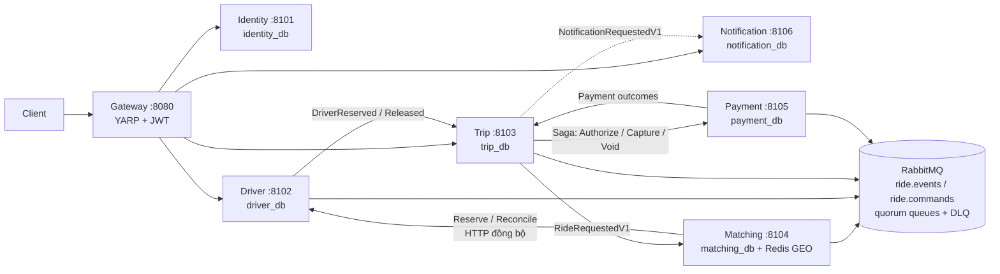

# DS03 — Runbook trình diễn và bảo vệ đồ án

Tài liệu này là **runbook duy nhất** dùng để trình diễn và bảo vệ hệ thống
ride-hailing microservices trước hội đồng. Mọi lệnh trong đây đã được chạy thật
trên một bản triển khai sạch của chính mã nguồn này; không có lệnh nào là "viết
cho đẹp" mà chưa kiểm chứng.

Nguyên tắc xuyên suốt: **không diễn lại bằng dữ liệu giả**. Mỗi bước đều chỉ ra
trạng thái thật trong PostgreSQL của service sở hữu, trong Redis projection hoặc
trong RabbitMQ. Nếu một bước không chứng minh được bằng trạng thái thật thì bước
đó không được đưa vào bài trình diễn.

---

## Phần A — Chuẩn bị bảo vệ

### A.1. Thời lượng dự kiến

| Phần | Nội dung | Thời lượng |
|---|---|---|
| Mở đầu | Kiến trúc và phân chia service | 2–3 phút |
| Trình diễn chính | Một chuyến đi hoàn chỉnh, quan sát từng tầng | 7–10 phút |
| Trình diễn mở rộng | Concurrency, idempotency, outage, compensation | 5–8 phút mỗi kịch bản |
| Hỏi đáp | Câu hỏi kỹ thuật của hội đồng | 5–10 phút |

Toàn bộ phần A (chuẩn bị) **phải xong trước khi đồng hồ trình diễn bắt đầu**.

### A.2. Phần cứng và phần mềm

- Docker Engine hoặc Docker Desktop có Compose v2 (đã kiểm chứng với Docker
  29.7.2 và Compose 5.7.0).
- Python 3.10+ trên máy host (đã kiểm chứng với 3.13).
- OpenSSL (dùng để sinh khoá JWT cục bộ).
- .NET 10 SDK **chỉ cần** nếu chạy migration thủ công cho Production overlay.
  Stack development không cần SDK trên host.
- RAM khuyến nghị: ≥ 8 GB cho stack development; nhiều hơn nếu bật profile
  `obs` cùng lúc.

### A.3. Danh tính mã nguồn

Ghi lại chính xác revision đang trình diễn để mọi quan sát quy được về một cây
mã nguồn:

```bash
git rev-parse HEAD
git rev-parse HEAD^{tree}
git describe --tags --always
```

Nếu trình diễn từ tag phát hành:

```bash
git fetch --tags
git checkout v1.0.0
```

### A.4. Biến môi trường

Không bao giờ commit `.env`. Tạo từ template:

```bash
cp .env.example .env
python3 scripts/security/init-local-auth.py
```

`init-local-auth.py` sinh một cặp khoá RSA dùng một lần và hai client secret
cho Matching/Trip, ghi vào `.env` đang bị gitignore. **Không in các giá trị này
lên màn hình trình chiếu.**

Biến quan trọng nhất cần kiểm tra:

```bash
grep -E '^(TRIP_MESSAGING_ENABLED|TRIP_AUTO_MIGRATE|ASPNETCORE_ENVIRONMENT)=' .env
```

Kỳ vọng:

```text
TRIP_MESSAGING_ENABLED=true
TRIP_AUTO_MIGRATE=true
ASPNETCORE_ENVIRONMENT=Development
```

`TRIP_MESSAGING_ENABLED=true` là **bắt buộc**. Nếu để `false`, Trip sẽ không
phát `RideRequestedV1`, Matching không bao giờ chạy, và chuyến đi sẽ đứng nguyên
ở `CREATED` mãi mãi. Đây là lỗi cấu hình từng tồn tại trong template cũ và đã
được sửa.

### A.5. Tạo dữ liệu trình diễn an toàn

Luôn dùng **một Compose project riêng** để không đụng vào volume của người khác:

```bash
export COMPOSE_PROJECT_NAME=ride-demo
```

Tên Rider/Driver trong runbook này đều có hậu tố ngẫu nhiên nên chạy lại nhiều
lần không bị trùng. Không cần xoá dữ liệu cũ; nếu muốn bắt đầu lại hoàn toàn:

```bash
docker compose down -v      # chỉ xoá volume của $COMPOSE_PROJECT_NAME
```

> Cảnh báo: `down -v` xoá dữ liệu. Chỉ chạy khi biến `COMPOSE_PROJECT_NAME`
> trỏ đúng project dùng một lần cho buổi demo.

### A.6. Khởi động và dừng

```bash
docker compose up -d --build
docker compose ps
```

Dừng nhưng giữ dữ liệu:

```bash
docker compose stop
```

Dừng và xoá sạch:

```bash
docker compose down -v
```

### A.7. Kiểm tra readiness của hạ tầng

```bash
for port in 8080 8101 8102 8103 8104 8105 8106; do
  printf '%s ' "$port"
  curl -fsS "http://localhost:${port}/health/ready" && echo
done
```

Kỳ vọng (đã chạy thật):

```text
8080 {"status":"Ready","scope":"process-only; no database configured"}
8101 {"status":"Ready","scope":"process-and-owned-database"}
8102 {"status":"Ready","scope":"process-and-owned-database"}
8103 {"status":"Ready","dependencies":{"trip-database":"Healthy"}}
8104 {"status":"Ready","scope":"process-and-owned-database"}
8105 {"status":"Ready","scope":"process-and-owned-database"}
8106 {"status":"Ready","service":"notification-service"}
```

Điểm cần nói với hội đồng: **mỗi service tự báo readiness trên database nó sở
hữu**. Gateway báo `process-only` vì nó không sở hữu database nào — đây là bằng
chứng cho việc không có database dùng chung.

Kiểm tra riêng messaging của Trip (chỉ healthy khi đã nối được RabbitMQ):

```bash
curl -fsS http://localhost:8103/health/ready
```

Kỳ vọng có thêm `"trip-messaging":"Healthy"`.

### A.8. Chuẩn bị màn hình

| Cửa sổ | Nội dung | Mục đích |
|---|---|---|
| Terminal 1 | Chạy lệnh `curl` của runbook | Thao tác viên |
| Terminal 2 | `docker compose logs -f trip matching driver payment notification` | Cho thấy luồng bất đồng bộ |
| Trình duyệt tab 1 | <http://localhost:15672> → Queues | Bằng chứng message thật |
| Trình duyệt tab 2 | <http://localhost:16686> (Jaeger) | Trace xuyên service |
| Trình duyệt tab 3 | <http://localhost:3000> (Grafana) | Metric và backlog |
| Trình duyệt tab 4 | <http://localhost:19090> (Prometheus) | Truy vấn metric thô |

Bật profile observability trước:

```bash
export OBS_PROMETHEUS_PORT=19090
docker compose --profile obs up -d
```

> Prometheus bind loopback và nhận cổng qua `OBS_PROMETHEUS_PORT`. Nếu 9090
> đang bị chiếm trên máy, đổi biến này thay vì sửa file compose.

RabbitMQ management dùng user `ride_app` và mật khẩu trong `.env`
(`RABBITMQ_PASSWORD`). Không đọc to mật khẩu khi trình chiếu.

### A.9. Phân vai

| Vai | Người | Việc |
|---|---|---|
| Thao tác viên | Một người duy nhất | Gõ lệnh, không vừa nói vừa gõ |
| Người trình bày | Ba thành viên luân phiên | Giải thích theo phần được phân công |
| Người canh thời gian | Một người | Báo khi vượt mốc thời lượng |

Chỉ **một** người điều khiển bàn phím. Người trình bày nói theo script trong
runbook, không đọc lại output lệnh.

### A.10. Checklist trước giờ G

- [ ] `docker compose ps` — tất cả service `running`/`healthy`
- [ ] 7 endpoint `/health/ready` đều trả `Ready`
- [ ] `curl -fsS http://localhost:8103/health/ready` có `trip-messaging`
- [ ] RabbitMQ UI mở được, thấy danh sách queue
- [ ] Jaeger và Grafana mở được
- [ ] Đã chạy thử một chuyến hoàn chỉnh và xoá dữ liệu thử
- [ ] Terminal đã `export COMPOSE_PROJECT_NAME=ride-demo`
- [ ] Không có `.env` hoặc khoá riêng tư hiện trên màn hình

---

## Phần B — Giới thiệu kiến trúc

### B.1. Sơ đồ thật của hệ thống

Sơ đồ dưới đây khớp với `compose.yaml` và mã nguồn hiện tại:



### B.2. Từng thành phần: việc nó làm và ai sở hữu trạng thái

| Thành phần | Trách nhiệm | Trạng thái do ai sở hữu | Cổng |
|---|---|---|---|
| **Gateway** | Định tuyến, chuyển JWT, giới hạn request ở biên | Không sở hữu trạng thái nghiệp vụ | 8080 |
| **Identity** | Người dùng, vai trò, JWT ký RSA, service grant | `identity_db` | 8101 |
| **Driver** | Hồ sơ tài xế, trạng thái, vị trí, **thẩm quyền giữ chỗ độc quyền** | `driver_db` (PostgreSQL OCC) | 8102 |
| **Trip** | Vòng đời chuyến đi, snapshot giá cước, Saga bền vững, Outbox | `trip_db` | 8103 |
| **Matching** | Vòng matching bền vững, xếp hạng tất định, đối soát UNKNOWN | `matching_db` + Redis GEO | 8104 |
| **Payment** | Provider mô phỏng, idempotency theo `operationKey`, đối soát UNKNOWN | `payment_db` | 8105 |
| **Notification** | Projection bất đồng bộ, hộp thư theo từng người nhận | `notification_db` | 8106 |

### B.3. Ranh giới lỗi và chủ sở hữu trạng thái

Đây là phần hội đồng hay hỏi nhất, nên nói rõ ngay từ đầu:

- **Driver là thẩm quyền duy nhất** về việc ai đang giữ một tài xế. Chỉ
  PostgreSQL của Driver quyết định điều đó, thông qua optimistic concurrency
  control trên cột `version`.
- **Redis chỉ là projection dẫn xuất.** Nó đề cử ứng viên, nhưng không bao giờ
  là thẩm quyền. Nếu Redis nói sai, Driver vẫn từ chối giữ chỗ sai.
- **Trip là thẩm quyền duy nhất** về trạng thái chuyến đi và về Saga.
- **Payment là thẩm quyền duy nhất** về hiệu ứng thanh toán, khoá theo
  `operationKey`.
- **Matching sở hữu** vòng matching và kết quả cuối cùng của vòng đó.

Nếu một service chết, các service khác vẫn giữ nguyên trạng thái của mình. Đó là
lý do tách database.

### B.4. Đồng bộ và bất đồng bộ

Cần phân biệt rõ hai loại luồng:

**Đồng bộ (HTTP):** Client → Gateway → service. Matching gọi Driver qua HTTP
khi cần giữ chỗ, vì cần câu trả lời ngay: được hay không được.

**Bất đồng bộ (RabbitMQ):** Trip phát `RideRequestedV1`; Driver phát
`DriverReservedV1`; Payment phát kết quả thanh toán; Trip phát
`NotificationRequestedV1`. Các luồng này đi qua **Transactional Outbox**, nên
message chỉ được phát sau khi giao dịch nghiệp vụ đã commit.

Trao đổi (exchanges) và queue thật, lấy từ mã nguồn:

- `ride.events` — sự kiện nghiệp vụ.
- `ride.commands` — lệnh gửi tới một service cụ thể.

Một số binding tiêu biểu:

| Queue | Exchange | Routing key |
|---|---|---|
| `matching.ride-requested.q` | `ride.events` | `trip.ride-requested.v1` |
| `trip.driver-state.q` | `ride.events` | `driver.reserved.v1`, `driver.reservation-released.v1`, `driver.trip-started.v1`, `driver.trip-completed.v1` |
| `trip.payment-outcome.q` | `ride.events` | `payment.authorized.v1`, `payment.captured.v1`, `payment.capture-pending.v1`, … |
| `payment.commands.q` | `ride.commands` | `payment.authorize.v1`, `payment.capture.v1`, `payment.void-authorization.v1` |
| `driver.commands.q` | `ride.commands` | `driver.release-reservation.v1`, `driver.mark-trip-started.v1`, `driver.mark-trip-completed.v1` |
| `matching.commands.q` | `ride.commands` | `matching.cancel-round.v1` |
| `notification.business-events.q` | `ride.events` | `trip.#` |

---

## Phần C — Trình diễn chính (7–10 phút)

Chuẩn bị biến cho cả phần này:

```bash
export API=http://localhost:8080
export RUN=$(date +%s)$RANDOM
export NOW=$(date -u +%Y-%m-%dT%H:%M:%SZ)
```

> `NOW` phải là thời điểm hiện tại. Driver từ chối vị trí cũ hơn 24 giờ
> (`MaxPastAge`), nên **không** dùng mốc thời gian cố định trong tài liệu.

### Bước 1 — Cho thấy các service chạy độc lập và database riêng

```bash
docker compose ps
```

```bash
docker compose exec -T postgres psql -U postgres -c "\l" | grep _db
```

Kỳ vọng: thấy `identity_db`, `driver_db`, `trip_db`, `matching_db`,
`payment_db`, `notification_db`.

**Script thuyết trình:** "Sáu database riêng biệt, mỗi service sở hữu một
database. Không có database dùng chung, nên không thể có transaction phân tán
kiểu ACID xuyên service — đó chính là bài toán đồ án đặt ra."

**Khái niệm:** microservice, database-per-service, ranh giới giao dịch cục bộ.

### Bước 2 — Đăng ký và đăng nhập Rider/Driver thật

```bash
DRIVER_USER=$(curl -fsS -X POST "$API/auth/register" -H 'Content-Type: application/json' \
  -d "{\"username\":\"drv$RUN\",\"password\":\"demo-password-1\",\"role\":\"Driver\"}" \
  | python3 -c 'import json,sys;print(json.load(sys.stdin)["userId"])')

DRIVER_TOKEN=$(curl -fsS -X POST "$API/auth/login" -H 'Content-Type: application/json' \
  -d "{\"username\":\"drv$RUN\",\"password\":\"demo-password-1\"}" \
  | python3 -c 'import json,sys;print(json.load(sys.stdin)["access_token"])')

curl -fsS -X POST "$API/auth/register" -H 'Content-Type: application/json' \
  -d "{\"username\":\"rdr$RUN\",\"password\":\"demo-password-1\",\"role\":\"Rider\"}" >/dev/null

RIDER_TOKEN=$(curl -fsS -X POST "$API/auth/login" -H 'Content-Type: application/json' \
  -d "{\"username\":\"rdr$RUN\",\"password\":\"demo-password-1\"}" \
  | python3 -c 'import json,sys;print(json.load(sys.stdin)["access_token"])')
```

Kiểm tra vai trò được thực thi thật — Rider gọi endpoint của Driver phải bị chặn:

```bash
curl -sS -o /dev/null -w 'Rider gọi endpoint Driver: HTTP %{http_code}\n' \
  -X POST "$API/drivers" -H "Authorization: Bearer $RIDER_TOKEN" \
  -H 'Content-Type: application/json' -d "{\"userId\":\"$DRIVER_USER\"}"
```

Kỳ vọng: `HTTP 403`.

**Script thuyết trình:** "JWT được Identity ký bằng RSA. Vai trò nằm trong
token và được kiểm tra ở biên, nên Rider không thể tự nhận mình là Driver."

**Khái niệm:** xác thực, phân quyền theo vai trò, chữ ký bất đối xứng.

### Bước 3 — Tài xế online và gửi vị trí

```bash
DRIVER=$(curl -fsS -X POST "$API/drivers" -H "Authorization: Bearer $DRIVER_TOKEN" \
  -H 'Content-Type: application/json' -d "{\"userId\":\"$DRIVER_USER\"}")
DRIVER_ID=$(echo "$DRIVER" | python3 -c 'import json,sys;print(json.load(sys.stdin)["driverId"])')
VERSION=$(echo "$DRIVER" | python3 -c 'import json,sys;print(json.load(sys.stdin)["version"])')

curl -fsS -X POST "$API/drivers/$DRIVER_ID/online" -H "Authorization: Bearer $DRIVER_TOKEN" \
  -H 'Content-Type: application/json' -d "{\"expectedVersion\":$VERSION}"
```

```bash
curl -fsS -X POST "$API/drivers/$DRIVER_ID/location" -H "Authorization: Bearer $DRIVER_TOKEN" \
  -H 'Content-Type: application/json' \
  -d "{\"deviceSessionId\":\"sess$RUN\",\"sequenceNo\":1,\"capturedAt\":\"$NOW\",\"latitude\":10.7769,\"longitude\":106.7009}"
```

Kỳ vọng: `online` trả `"status":"AVAILABLE"`; `location` trả `202` với
`accepted.sequenceNo = 1`.

Quan sát projection dẫn xuất trong Redis:

```bash
docker compose exec -T redis redis-cli HGETALL "driver:projection:$(echo $DRIVER_ID | tr -d '-')"
```

Kỳ vọng: hash có `derivedStatus`, `driverAggregateVersion`, `latitude`,
`longitude`, `sequenceNo`.

**Script thuyết trình:** "Vị trí đi vào Redis dưới dạng projection dẫn xuất để
Matching tìm ứng viên theo khoảng cách. Nhưng quyền quyết định vẫn ở PostgreSQL
của Driver — Redis chỉ đề cử."

**Khái niệm:** CQRS nhẹ, projection dẫn xuất so với thẩm quyền, eventual
consistency.

### Bước 4 — Rider tạo chuyến đi với idempotency key

```bash
IDEM=$(python3 -c 'import uuid;print(uuid.uuid4())')
TRIP_ID=$(curl -fsS -X POST "$API/trips" -H "Authorization: Bearer $RIDER_TOKEN" \
  -H 'Content-Type: application/json' -H "Idempotency-Key: $IDEM" \
  -d '{"pickup":{"latitude":10.7769,"longitude":106.7009},"dropoff":{"latitude":10.78,"longitude":106.71}}' \
  | python3 -c 'import json,sys;print(json.load(sys.stdin)["tripId"])')
echo "trip=$TRIP_ID"
```

Chứng minh idempotency ngay tại chỗ — gửi lại cùng key:

```bash
curl -fsS -X POST "$API/trips" -H "Authorization: Bearer $RIDER_TOKEN" \
  -H 'Content-Type: application/json' -H "Idempotency-Key: $IDEM" \
  -d '{"pickup":{"latitude":10.7769,"longitude":106.7009},"dropoff":{"latitude":10.78,"longitude":106.71}}'
```

Kỳ vọng: **cùng một `tripId`**, không tạo chuyến thứ hai.

**Script thuyết trình:** "Cùng một idempotency key trả về cùng một chuyến. Đây
là điều kiện để client có thể retry an toàn khi mạng chập chờn."

**Khái niệm:** idempotency, khoá idempotency, retry an toàn.

### Bước 5 — Matching chọn tài xế

```bash
for i in $(seq 1 25); do
  ST=$(curl -fsS "$API/trips/$TRIP_ID" -H "Authorization: Bearer $RIDER_TOKEN" \
    | python3 -c 'import json,sys;print(json.load(sys.stdin)["status"])')
  echo "  lần $i: $ST"
  [ "$ST" != "CREATED" ] && [ "$ST" != "MATCHING" ] && break
  sleep 1
done
```

Kỳ vọng: `CREATED` → `MATCHING` → `DRIVER_RESERVED` (thường trong 3–5 giây).

Xem trạng thái đầy đủ:

```bash
curl -fsS "$API/trips/$TRIP_ID" -H "Authorization: Bearer $RIDER_TOKEN"
```

Kỳ vọng có `assignedDriverId` và `reservationId`.

**Script thuyết trình:** "Trip phát `RideRequestedV1` qua Outbox. Matching nhận,
chụp danh sách ứng viên, xếp hạng tất định rồi gọi Driver để giữ chỗ."

**Khái niệm:** giao tiếp bất đồng bộ, transactional outbox, xếp hạng tất định.

### Bước 6 — Chứng minh thẩm quyền giữ chỗ nằm ở Driver

```bash
docker compose exec -T postgres psql -U postgres -d driver_db \
  -c "select driver_id, status, reserved_trip_id, reservation_id, version from drivers where driver_id='$DRIVER_ID';"
```

Kỳ vọng: `status = RESERVED`, `reserved_trip_id` đúng bằng `$TRIP_ID`,
`reservation_id` có giá trị.

So sánh với projection:

```bash
docker compose exec -T redis redis-cli HGETALL "driver:projection:$(echo $DRIVER_ID | tr -d '-')"
```

Kỳ vọng: `derivedStatus = RESERVED` và `driverAggregateVersion` **bằng đúng**
`version` trong PostgreSQL.

**Script thuyết trình:** "Đây là điểm quan trọng nhất của đồ án. PostgreSQL của
Driver là thẩm quyền: nó ghi chính xác chuyến nào đang giữ tài xế này. Redis chỉ
phản chiếu lại. Nếu hai nguồn lệch nhau, PostgreSQL thắng."

**Khái niệm:** thẩm quyền so với projection, linearization point, optimistic
concurrency control.

### Bước 7 — Tài xế chấp nhận

```bash
RES=$(curl -fsS "$API/trips/$TRIP_ID" -H "Authorization: Bearer $RIDER_TOKEN" \
  | python3 -c 'import json,sys;print(json.load(sys.stdin)["reservationId"])')

curl -fsS -X POST "$API/trips/$TRIP_ID/accept" -H "Authorization: Bearer $DRIVER_TOKEN" \
  -H 'Content-Type: application/json' -d "{\"driverId\":\"$DRIVER_ID\",\"reservationId\":\"$RES\"}"
```

Kỳ vọng: `{"state":"DRIVER_ACCEPTED","replayed":false}`.

Chuyến đi chuyển sang `READY_TO_START`:

```bash
curl -fsS "$API/trips/$TRIP_ID" -H "Authorization: Bearer $RIDER_TOKEN"
```

**Script thuyết trình:** "Accept phải kèm đúng `reservationId`. Nếu chuyến đã bị
huỷ và tài xế được giữ cho chuyến khác, reservation cũ sẽ bị từ chối — đó là
fencing token."

**Khái niệm:** fencing token, kiểm tra danh tính chính xác, chuyển trạng thái có
bảo vệ.

### Bước 8 — Saga yêu cầu Payment uỷ quyền

```bash
docker compose exec -T postgres psql -U postgres -d payment_db \
  -c "select operation_key, operation_type, state, provider_effect_id is not null as has_effect, amount_minor from payment_operations where trip_id='$TRIP_ID' order by created_at;"
```

Kỳ vọng: một dòng `$TRIP_ID:authorize:v1` với `state = SUCCEEDED` và
`has_effect = t`.

Xem Saga trong Trip:

```bash
docker compose exec -T postgres psql -U postgres -d trip_db \
  -c "select status, current_step, step_version, authorize_operation_key from ride_sagas where trip_id='$TRIP_ID';"
```

Kỳ vọng: `status = ACTIVE`, `current_step = AUTHORIZED`, và
`authorize_operation_key` đúng bằng `$TRIP_ID:authorize:v1`.

**Script thuyết trình:** "Saga trong Trip điều phối thanh toán. `operationKey`
được sinh tất định từ `tripId`, nên dù Saga chạy lại bao nhiêu lần, Payment vẫn
chỉ tạo đúng một hiệu ứng."

**Khái niệm:** Saga orchestration, khoá thao tác tất định, hiệu ứng
effectively-once.

### Bước 9 — Tài xế bắt đầu và hoàn thành chuyến

```bash
curl -fsS -X POST "$API/trips/$TRIP_ID/start" -H "Authorization: Bearer $DRIVER_TOKEN" \
  -H 'Content-Type: application/json' -d "{\"driverId\":\"$DRIVER_ID\",\"reservationId\":\"$RES\"}"
```

Kỳ vọng: `{"state":"IN_PROGRESS"}`.

```bash
curl -fsS -X POST "$API/trips/$TRIP_ID/complete" -H "Authorization: Bearer $DRIVER_TOKEN" \
  -H 'Content-Type: application/json' -d "{\"driverId\":\"$DRIVER_ID\",\"reservationId\":\"$RES\"}"
```

Kỳ vọng: `{"state":"COMPLETED"}`.

**Khái niệm:** máy trạng thái hữu hạn (FSM), tính đơn điệu của trạng thái kết
thúc.

### Bước 10 — Payment capture hoàn tất

```bash
docker compose exec -T postgres psql -U postgres -d payment_db \
  -c "select operation_key, operation_type, state from payment_operations where trip_id='$TRIP_ID' order by created_at;"
```

Kỳ vọng: hai dòng — `:authorize:v1` và `:capture:v1`, **cả hai** `SUCCEEDED`.

```bash
docker compose exec -T postgres psql -U postgres -d trip_db \
  -c "select status, current_step, step_version from ride_sagas where trip_id='$TRIP_ID';"
```

Kỳ vọng: `status = COMPLETED`, `current_step = CAPTURED`.

**Script thuyết trình:** "Saga kết thúc ở CAPTURED. Bước uỷ quyền và bước capture
là hai thao tác riêng biệt, mỗi thao tác có `operationKey` riêng, nên không thể
capture hai lần."

### Bước 11 — Tài xế trở lại trạng thái sẵn sàng

```bash
curl -fsS "$API/drivers/$DRIVER_ID" -H "Authorization: Bearer $DRIVER_TOKEN"
```

Kỳ vọng: `"status":"AVAILABLE"`, `"reservedTripId":null`,
`"reservationId":null`, `"activeTripId":null`.

**Script thuyết trình:** "Giữ chỗ được giải phóng đúng một lần. `version` tăng
lên, chứng tỏ mỗi thay đổi trạng thái đều đi qua kiểm soát đồng thời."

### Bước 12 — Rider và Driver nhận thông báo riêng

```bash
curl -fsS "$API/notifications/me" -H "Authorization: Bearer $RIDER_TOKEN"
```

Kỳ vọng (đã chạy thật): 3 thông báo —
`RIDER_RIDE_REQUESTED`, `RIDER_DRIVER_ASSIGNED`, `RIDER_TRIP_COMPLETED`.

```bash
curl -fsS "$API/notifications/me" -H "Authorization: Bearer $DRIVER_TOKEN"
```

Kỳ vọng: 1 thông báo — `DRIVER_TRIP_ASSIGNED`.

**Script thuyết trình:** "Hộp thư lấy danh tính từ `sub` trong JWT, không nhận
`userId` từ client. Rider chỉ thấy thông báo của Rider, Driver chỉ thấy của
Driver."

**Khái niệm:** cô lập dữ liệu theo chủ sở hữu, projection bất đồng bộ.

### Bước 13 — Bốn nguồn trạng thái đồng ý với nhau

Đây là bước kết luận của phần trình diễn chính:

```bash
# Trip
docker compose exec -T postgres psql -U postgres -d trip_db \
  -c "select state from trips where trip_id='$TRIP_ID';"

# Driver
docker compose exec -T postgres psql -U postgres -d driver_db \
  -c "select status, reserved_trip_id from drivers where driver_id='$DRIVER_ID';"

# Matching
docker compose exec -T postgres psql -U postgres -d matching_db \
  -c "select matching_round, status, selected_driver_id from matching_rounds where trip_id='$TRIP_ID';"

# Payment
docker compose exec -T postgres psql -U postgres -d payment_db \
  -c "select operation_type, state from payment_operations where trip_id='$TRIP_ID';"
```

Kỳ vọng:

| Nguồn | Trạng thái |
|---|---|
| Trip | `COMPLETED` |
| Driver | `AVAILABLE`, không giữ chuyến nào |
| Matching | `RESERVED`, chọn đúng `$DRIVER_ID` |
| Payment | `AUTHORIZE` + `CAPTURE` đều `SUCCEEDED` |

Kiểm tra Outbox đã phát hết:

```bash
docker compose exec -T postgres psql -U postgres -d trip_db \
  -c "select message_type, status from outbox_messages where aggregate_id='$TRIP_ID' order by occurred_at;"
```

Kỳ vọng: tất cả `PUBLISHED`, `attempt_count = 0`.

**Script thuyết trình:** "Bốn service, bốn database, không có transaction chung.
Vậy mà cuối cùng cả bốn đều đồng ý về cùng một chuyến đi. Đó là eventual
consistency có kiểm soát — không phải trùng hợp."

**Khái niệm:** eventual consistency, tính nhất quán cuối cùng có bảo đảm, kiểm
toán bất biến.

---

## Phần D — Trình diễn mở rộng

Mỗi kịch bản dưới đây đã được chạy thật trên stack sạch.

### D.1. Concurrency — hai Rider tranh một tài xế

**Mục tiêu:** chứng minh không bao giờ có hai chuyến cùng giữ một tài xế.

**Điều kiện:** đúng **một** tài xế `AVAILABLE` trong toàn hệ thống.

```bash
# Tài xế duy nhất
DU=$(curl -fsS -X POST "$API/auth/register" -H 'Content-Type: application/json' \
  -d "{\"username\":\"cdrv$RUN\",\"password\":\"demo-password-1\",\"role\":\"Driver\"}" \
  | python3 -c 'import json,sys;print(json.load(sys.stdin)["userId"])')
DT=$(curl -fsS -X POST "$API/auth/login" -H 'Content-Type: application/json' \
  -d "{\"username\":\"cdrv$RUN\",\"password\":\"demo-password-1\"}" \
  | python3 -c 'import json,sys;print(json.load(sys.stdin)["access_token"])')
D=$(curl -fsS -X POST "$API/drivers" -H "Authorization: Bearer $DT" \
  -H 'Content-Type: application/json' -d "{\"userId\":\"$DU\"}")
DID=$(echo "$D" | python3 -c 'import json,sys;print(json.load(sys.stdin)["driverId"])')
V=$(echo "$D" | python3 -c 'import json,sys;print(json.load(sys.stdin)["version"])')
curl -fsS -X POST "$API/drivers/$DID/online" -H "Authorization: Bearer $DT" \
  -H 'Content-Type: application/json' -d "{\"expectedVersion\":$V}" >/dev/null
curl -fsS -X POST "$API/drivers/$DID/location" -H "Authorization: Bearer $DT" \
  -H 'Content-Type: application/json' \
  -d "{\"deviceSessionId\":\"cs$RUN\",\"sequenceNo\":1,\"capturedAt\":\"$NOW\",\"latitude\":10.7769,\"longitude\":106.7009}" >/dev/null
sleep 3
```

Hai Rider cùng tạo chuyến:

```bash
for n in 1 2; do
  curl -fsS -X POST "$API/auth/register" -H 'Content-Type: application/json' \
    -d "{\"username\":\"cr${n}$RUN\",\"password\":\"demo-password-1\",\"role\":\"Rider\"}" >/dev/null
done
R1=$(curl -fsS -X POST "$API/auth/login" -H 'Content-Type: application/json' \
  -d "{\"username\":\"cr1$RUN\",\"password\":\"demo-password-1\"}" \
  | python3 -c 'import json,sys;print(json.load(sys.stdin)["access_token"])')
R2=$(curl -fsS -X POST "$API/auth/login" -H 'Content-Type: application/json' \
  -d "{\"username\":\"cr2$RUN\",\"password\":\"demo-password-1\"}" \
  | python3 -c 'import json,sys;print(json.load(sys.stdin)["access_token"])')

mk() { curl -fsS -X POST "$API/trips" -H "Authorization: Bearer $1" \
  -H 'Content-Type: application/json' -H "Idempotency-Key: $(python3 -c 'import uuid;print(uuid.uuid4())')" \
  -d '{"pickup":{"latitude":10.7769,"longitude":106.7009},"dropoff":{"latitude":10.78,"longitude":106.71}}' \
  | python3 -c 'import json,sys;print(json.load(sys.stdin)["tripId"])'; }

T1=$(mk "$R1"); T2=$(mk "$R2")
sleep 10
```

**Kết quả thật đã quan sát:**

| Chuyến | Trạng thái |
|---|---|
| `$T1` | `DRIVER_RESERVED` |
| `$T2` | `MATCH_FAILED`, `failure_reason = NO_DRIVER_AVAILABLE` |

Tài xế giữ đúng một chuyến:

```bash
docker compose exec -T postgres psql -U postgres -d driver_db \
  -c "select status, reserved_trip_id, reservation_id from drivers where driver_id='$DID';"
```

Kỳ vọng: `RESERVED`, `reserved_trip_id` bằng đúng chuyến thắng.

Vòng matching cũng ghi nhận kết quả khác nhau:

```bash
docker compose exec -T postgres psql -U postgres -d matching_db \
  -c "select trip_id, matching_round, status, selected_driver_id is not null as picked from matching_rounds order by created_at desc limit 2;"
```

Kỳ vọng: một vòng `RESERVED` (`picked = t`), một vòng `NO_DRIVER`
(`picked = f`).

**Script thuyết trình:** "Hai chuyến, một tài xế. Driver dùng optimistic
concurrency: chỉ một lệnh giữ chỗ thắng. Chuyến thua không bị treo — nó kết thúc
hẳn với `NO_DRIVER_AVAILABLE`, nên Rider biết ngay phải làm gì."

**Khái niệm:** tranh chấp, optimistic concurrency control, linearization point,
kết quả cuối cùng (terminal result).

**Dọn dẹp:** huỷ chuyến thắng nếu muốn giải phóng tài xế:

```bash
curl -fsS -X POST "$API/trips/$T1/cancel" -H "Authorization: Bearer $R1" \
  -H 'Content-Type: application/json' -d '{}'
```

### D.2. Idempotency — phát lại cùng một danh tính

**Mục tiêu:** cùng một yêu cầu, chỉ một hiệu ứng nghiệp vụ.

```bash
KEY="idem-$RUN"
BODY='{"pickup":{"latitude":10.7769,"longitude":106.7009},"dropoff":{"latitude":10.78,"longitude":106.71}}'

A=$(curl -fsS -X POST "$API/trips" -H "Authorization: Bearer $R1" \
  -H 'Content-Type: application/json' -H "Idempotency-Key: $KEY" -d "$BODY")
B=$(curl -fsS -X POST "$API/trips" -H "Authorization: Bearer $R1" \
  -H 'Content-Type: application/json' -H "Idempotency-Key: $KEY" -d "$BODY")
echo "lần 1: $A"
echo "lần 2: $B"
```

Kỳ vọng: hai `tripId` **giống nhau**.

Kiểm chứng ở tầng database:

```bash
IDEM_TRIP=$(echo "$A" | python3 -c 'import json,sys;print(json.load(sys.stdin)["tripId"])')
docker compose exec -T postgres psql -U postgres -d trip_db \
  -c "select count(*) as so_chuyen from trips where trip_id='$IDEM_TRIP';"
docker compose exec -T postgres psql -U postgres -d trip_db \
  -c "select message_type, count(*) from outbox_messages where aggregate_id='$IDEM_TRIP' group by 1;"
```

Kỳ vọng: `so_chuyen = 1`; chỉ **một** `RideRequestedV1`.

**Script thuyết trình:** "Hai lần gọi, một chuyến, một intent. Nếu client bị mất
kết nối và retry, hệ thống không tạo chuyến thứ hai."

**Khái niệm:** idempotency, deduplication, at-least-once delivery với hiệu ứng
effectively-once.

### D.3. Transactional Outbox — commit trước, phát sau

**Mục tiêu:** chứng minh ý định phát message được lưu **cùng transaction** với
thay đổi nghiệp vụ.

```bash
docker compose exec -T postgres psql -U postgres -d trip_db \
  -c "select message_type, status, attempt_count, published_at is not null as da_phat from outbox_messages order by occurred_at desc limit 8;"
```

Kỳ vọng: mọi dòng `PUBLISHED`, `attempt_count = 0`.

Chứng minh Outbox là bền vững khi broker chết — dừng RabbitMQ rồi tạo chuyến:

```bash
docker compose stop rabbitmq
```

Tạo một chuyến mới (sẽ không match được vì broker chết), rồi xem Outbox:

```bash
docker compose exec -T postgres psql -U postgres -d trip_db \
  -c "select message_type, status, attempt_count from outbox_messages order by occurred_at desc limit 5;"
```

Kỳ vọng: dòng mới ở trạng thái `PENDING` — nghiệp vụ đã commit, message chưa
phát. Đây chính là điểm mấu chốt.

Bật lại broker và quan sát message được phát với **cùng `message_id`**:

```bash
docker compose start rabbitmq
sleep 20
docker compose exec -T postgres psql -U postgres -d trip_db \
  -c "select message_type, status, attempt_count from outbox_messages order by occurred_at desc limit 5;"
```

Kỳ vọng: chuyển sang `PUBLISHED`.

**Script thuyết trình:** "Nếu hệ thống phát message trước rồi mới commit, một cú
crash ở giữa sẽ làm mất message. Outbox đảo ngược lại: ghi ý định vào cùng
transaction, rồi một relay riêng phát sau. Crash thì message vẫn còn đó."

**Khái niệm:** transactional outbox, dual-write problem, relay, stable message
identity.

**Lưu ý trung thực:** đây là *at-least-once delivery*. Hệ thống **không** hứa
exactly-once ở tầng vận chuyển; nó bảo đảm hiệu ứng nghiệp vụ effectively-once
nhờ idempotency.

### D.4. Payment UNKNOWN và đối soát

**Mục tiêu:** một kết quả không rõ ràng phải được đối soát, không được đoán.

Simulator chỉ mở ở môi trường Development. Tạo một thao tác mà provider đã ghi
nhận hiệu ứng nhưng phản hồi bị mất:

```bash
PTRIP=$(python3 -c 'import uuid;print(uuid.uuid4())')
PKEY="$PTRIP:authorize:v1"

curl -sS -o /tmp/unknown.json -w 'HTTP %{http_code}\n' \
  -X POST "http://localhost:8105/simulator/operations" -H 'Content-Type: application/json' \
  -d "{\"operationKey\":\"$PKEY\",\"tripId\":\"$PTRIP\",\"type\":\"Authorize\",\"amountMinor\":15260,\"currency\":\"VND\",\"mode\":\"TimeoutAfterEffect\"}"
```

Kỳ vọng: `HTTP 504`, và body có `"state":"Unknown"`,
`"resultCode":"PROVIDER_RESPONSE_LOST"`.

Đối soát bằng **cùng `operationKey`**:

```bash
OPID=$(python3 -c 'import json;print(json.load(open("/tmp/unknown.json"))["id"])')
curl -sS -X POST "http://localhost:8105/simulator/operations/$OPID/reconcile" \
  -o /tmp/reconciled.json -w 'HTTP %{http_code}\n'
python3 -m json.tool /tmp/reconciled.json
```

Kỳ vọng: `"state":"Succeeded"`, `"providerEffectOccurred":true`,
`"resultCode":"APPROVED"`.

Chứng minh **chỉ một** hiệu ứng provider tồn tại:

```bash
docker compose exec -T postgres psql -U postgres -d payment_db \
  -c "select count(*) as so_hieu_ung from provider_effects where operation_key='$PKEY';"
```

Kỳ vọng: `so_hieu_ung = 1`.

**Script thuyết trình:** "Provider đã trừ tiền nhưng phản hồi bị mất. Hệ thống
không đoán là thất bại — nó ghi UNKNOWN rồi đối soát bằng cùng một
`operationKey`. Kết quả: đúng một hiệu ứng, không trừ hai lần."

**Khái niệm:** kết quả không xác định (UNKNOWN), đối soát, idempotency theo khoá
thao tác, phân biệt UNKNOWN với FAILED.

### D.5. Saga compensation — tài xế từ chối

**Mục tiêu:** huỷ bỏ phải giải phóng đúng giữ chỗ, không giải phóng nhầm.

```bash
# ... tạo chuyến và để nó DRIVER_RESERVED như Phần C bước 5 ...
curl -fsS -X POST "$API/trips/$TRIP_ID/reject" -H "Authorization: Bearer $DRIVER_TOKEN" \
  -H 'Content-Type: application/json' -d "{\"driverId\":\"$DRIVER_ID\",\"reservationId\":\"$RES\"}"
```

Kỳ vọng: `{"state":"MATCH_FAILED","failureReason":"DRIVER_REJECTED","cleanupPending":true}`.

Kiểm tra nghĩa vụ dọn dẹp đã hoàn tất:

```bash
docker compose exec -T postgres psql -U postgres -d trip_db \
  -c "select kind, key, reservation_id, completed_at is not null as da_xong from trip_cleanup_intents where trip_id='$TRIP_ID';"
```

Kỳ vọng: hai dòng — `CancelMatching` và `ReleaseReservation`, cả hai
`da_xong = t`, và `reservation_id` **đúng bằng** reservation ban đầu.

Tài xế trở lại sẵn sàng:

```bash
curl -fsS "$API/drivers/$DRIVER_ID" -H "Authorization: Bearer $DRIVER_TOKEN"
```

Kỳ vọng: `AVAILABLE`, không còn `reservedTripId`.

**Script thuyết trình:** "Compensation không phải rollback. Rollback là huỷ một
transaction chưa commit. Ở đây giao dịch đã commit rồi, nên phải bù trừ bằng một
hành động ngược lại — và hành động đó phải nhắm đúng reservation cụ thể."

**Khái niệm:** Saga compensation, nghĩa vụ bù trừ, fencing theo danh tính chính
xác.

### D.6. Notification outage — nghiệp vụ không bị chặn

**Mục tiêu:** dịch vụ thông báo chết không được làm hỏng chuyến đi.

```bash
docker compose stop notification
```

Chạy một chuyến hoàn chỉnh (như Phần C bước 4–9). Kỳ vọng: chuyến vẫn
`COMPLETED` bình thường.

Kiểm tra chưa có thông báo nào:

```bash
docker compose exec -T postgres psql -U postgres -d notification_db \
  -c "select count(*) from notifications where trip_id='$TRIP_ID';"
```

Kỳ vọng: `0`.

Bật lại và chờ phục hồi:

```bash
docker compose start notification
sleep 15
docker compose exec -T postgres psql -U postgres -d notification_db \
  -c "select notification_type, recipient_user_id from notifications where trip_id='$TRIP_ID' order by created_at;"
```

Kỳ vọng (đã chạy thật): 4 thông báo —
`RIDER_RIDE_REQUESTED`, `DRIVER_TRIP_ASSIGNED`, `RIDER_DRIVER_ASSIGNED`,
`RIDER_TRIP_COMPLETED`.

Kiểm tra **không có bản trùng**:

```bash
docker compose exec -T postgres psql -U postgres -d notification_db \
  -c "select notification_type, count(*) from notifications where trip_id='$TRIP_ID' group by 1 having count(*) > 1;"
```

Kỳ vọng: **0 dòng**.

**Script thuyết trình:** "Notification chết, chuyến đi vẫn xong. Khi nó sống lại,
nó tự đọc lại các message còn tồn và bù đủ thông báo — không thiếu, không trùng."

**Khái niệm:** cô lập lỗi, eventual consistency, durable receipt, phục hồi sau
outage.

### D.7. Crash và phục hồi

**Mục tiêu:** trạng thái sống sót qua cái chết của process.

```bash
docker compose kill -s SIGKILL trip
sleep 2
docker compose ps trip
```

Kỳ vọng: container ở trạng thái `exited`/`Killed` — đây là **kill thật**, không
phải stop bình thường.

```bash
docker compose start trip
sleep 15
curl -fsS http://localhost:8103/health/ready
```

Kỳ vọng: `"trip-messaging":"Healthy"`.

Outbox còn nguyên:

```bash
docker compose exec -T postgres psql -U postgres -d trip_db \
  -c "select status, count(*) from outbox_messages group by 1;"
```

Kỳ vọng: toàn bộ `PUBLISHED`, không mất dòng nào.

Sau đó chạy lại một chuyến hoàn chỉnh để chứng minh hệ thống làm việc bình
thường trở lại.

**Script thuyết trình:** "Process chết không mang theo trạng thái, vì trạng thái
nằm trong PostgreSQL và Outbox. Khởi động lại là nó đọc lại đúng những gì đã
commit."

**Khái niệm:** crash recovery, trạng thái bền vững, phục hồi từ durable state
chứ không từ bộ nhớ.

### D.8. Quan sát — trace và metric

Jaeger: mở <http://localhost:16686>, chọn service `trip`, tìm theo `traceId`.

Prometheus (qua cổng đã cấu hình):

```bash
curl -sS "http://127.0.0.1:19090/api/v1/targets?state=active" \
  -o /tmp/targets.json -w 'HTTP %{http_code}\n'
python3 -c "
import json
d=json.load(open('/tmp/targets.json'))
for t in d['data']['activeTargets']:
    print(' ', t['labels'].get('job'), '->', t['health'])
"
```

Kỳ vọng (đã chạy thật): bốn target đều `up` — `application-otel`, `prometheus`,
`rabbitmq`, `rabbitmq-detailed`.

**Script thuyết trình:** "Metric của ứng dụng đi qua OTLP tới collector rồi
Prometheus scrape collector. Service không tự mở endpoint metric riêng, nên bề
mặt tấn công không tăng."

**Khái niệm:** distributed tracing, correlation id, metric có chiều bounded.

### D.9. Hiệu năng — phạm vi trung thực

Bộ thí nghiệm hiệu năng đầy đủ nằm trong `evidence/team/w13-integration/` với
protocol, raw sample và phân tích. Chạy lại:

```bash
python3 scripts/perf/w13.py analyze --experiment ALL \
  --runs-root evidence/team/w13-integration/runs \
  --out-dir evidence/team/w13-integration/analysis
```

**Điều phải nói rõ với hội đồng:** đây là đo trên **một máy**, với tải tổng hợp.
Nó không phải tuyên bố năng lực sản xuất, và không chứng minh khả năng mở rộng
tuyến tính. Con số latency chỉ có nghĩa trong bối cảnh thí nghiệm đó.

### D.10. High availability — chỉ trong phạm vi đã làm

Repo có cấu hình RabbitMQ quorum queue và kịch bản phục hồi broker **trên một
máy**. Điều đó chứng minh cơ chế quorum hoạt động, **không** chứng minh HA đa
máy hay đa vùng.

Không được nói "hệ thống chịu được mất N node" nếu chưa đo đúng N node thật.

---

## Phần E — Cách ba thành viên trình bày

### Phân chia

| Thành viên | MSSV | Phụ trách trình bày |
|---|---|---|
| **Nguyễn Quang Minh** | B23DCVT280 | Vòng đời Trip, Saga, Outbox, tính nhất quán nghiệp vụ |
| **Nguyễn Hoàng Khánh** | B23DCVT228 | Thẩm quyền Driver, Matching, tranh chấp, fencing |
| **Lê Anh Việt** | B23DCVT453 | Idempotency Payment, RabbitMQ, độ tin cậy, quan sát, triển khai |

### Nhịp chuyển vai

1. **Minh** — Phần B: kiến trúc, vì sao tách database, vì sao cần Outbox.
2. **Khánh** — Phần C bước 1–7: tài xế, vị trí, matching, giữ chỗ, accept.
3. **Việt** — Phần C bước 8–13: Saga thanh toán, capture, thông báo, tổng kết
   bốn nguồn.
4. **Khánh** — Phần D.1 (concurrency) và D.5 (compensation).
5. **Việt** — Phần D.3 (outbox), D.4 (UNKNOWN), D.6 (outage), D.7 (crash).
6. **Minh** — Phần D.2 (idempotency) và kết luận.

### Câu nói nên dùng khi giải thích khái niệm

- **Microservice là gì:** "Một đơn vị triển khai độc lập, sở hữu dữ liệu của
  riêng nó, và chỉ giao tiếp qua hợp đồng đã công bố. Ở đây mỗi service có
  database riêng — đó là điều kiện cần, không phải chi tiết phụ."
- **Transaction cục bộ so với phân tán:** "Trong một service, chúng em dùng
  transaction ACID bình thường. Xuyên service thì không có transaction chung,
  nên phải dùng Saga và Outbox."
- **Eventual consistency:** "Không phải 'cuối cùng rồi cũng xong một cách may
  mắn'. Là có bảo đảm: mọi nghĩa vụ đều được ghi bền vững và có cơ chế phát lại
  cho tới khi hoàn tất."
- **Linearization point:** "Điểm mà tại đó thao tác trở thành sự thật. Với giữ
  chỗ tài xế, đó là lúc PostgreSQL của Driver commit — không phải lúc Redis được
  cập nhật."
- **Optimistic concurrency control:** "Không khoá trước. Đọc `version`, ghi kèm
  điều kiện `version` chưa đổi. Ai commit trước thắng, người sau nhận conflict."
- **Projection dẫn xuất so với thẩm quyền:** "Redis đề cử, PostgreSQL quyết
  định. Redis sai thì hệ thống vẫn đúng, chỉ chậm hơn."
- **At-least-once:** "Message có thể tới hai lần. Đó là bản chất của hệ thống
  nhắn tin. Cái ta bảo đảm là hiệu ứng nghiệp vụ chỉ xảy ra một lần, nhờ
  idempotency."
- **Publisher confirm so với consumer ACK:** "Confirm là broker xác nhận đã nhận
  message. ACK là consumer xác nhận đã xử lý xong. Hai việc khác nhau, ở hai
  thời điểm khác nhau."
- **Transactional Outbox:** "Ghi ý định phát message vào cùng transaction với
  thay đổi nghiệp vụ. Không thể có chuyện nghiệp vụ đã đổi mà message biến mất."
- **Saga và compensation:** "Saga là chuỗi bước có bù trừ. Compensation không
  phải rollback — dữ liệu đã commit rồi, phải bù bằng hành động ngược lại."
- **UNKNOWN so với FAILED:** "FAILED là biết chắc đã thất bại. UNKNOWN là không
  biết. Hai thứ này phải xử lý khác nhau: UNKNOWN thì đối soát, không được đoán."
- **Fencing token:** "Một danh tính phiên bản để chặn thao tác cũ. Reservation
  cũ không thể giải phóng reservation mới."
- **Crash recovery:** "Trạng thái nằm trên đĩa, không nằm trong RAM. Process
  chết thì khởi động lại và đọc lại đúng những gì đã commit."
- **Quorum và giới hạn khả dụng:** "Quorum đánh đổi khả dụng lấy nhất quán.
  Mất quá nửa số node thì không ghi được — đó là thiết kế, không phải lỗi."
- **Correlation và tracing:** "Một `traceId` đi xuyên service, nên khi có sự cố
  ta lần được toàn bộ đường đi của một chuyến."

### Tuyệt đối không nói

- Không nói "exactly once" cho RabbitMQ. Chỉ nói "at-least-once delivery,
  effectively-once business effect".
- Không nói "hệ thống chịu được mất bất kỳ node nào".
- Không nói "đã đo hiệu năng production".

---

## Phần F — Câu hỏi hội đồng thường hỏi

**1. Vì sao tách database?**
Vì mỗi service phải sở hữu dữ liệu của mình thì mới triển khai và tiến hoá độc
lập được. Database chung sẽ tạo coupling ngầm qua schema, và mọi thay đổi schema
thành thay đổi xuyên team. Đánh đổi là mất transaction phân tán — và đó chính là
phần đồ án giải quyết bằng Saga và Outbox.

**2. Vì sao dùng RabbitMQ thay vì chỉ REST?**
REST đồng bộ buộc hai service phải sống cùng lúc. Nếu Payment chết, Trip sẽ
không hoàn tất được chuyến. Với messaging, Trip commit rồi phát intent; Payment
sống lại thì xử lý tiếp. Nó cũng cho phép nhiều consumer và chịu tải tốt hơn.

**3. Nếu RabbitMQ chết ngay sau khi Trip commit thì sao?**
Không mất gì. Ý định phát message đã nằm trong bảng `outbox_messages` cùng
transaction với thay đổi nghiệp vụ, ở trạng thái `PENDING`. Relay sẽ phát lại khi
broker sống lại, với **cùng `message_id`**. Xem Phần D.3.

**4. Hai Rider có thể nhận cùng một tài xế không?**
Không. Driver dùng optimistic concurrency trên cột `version`; chỉ một lệnh giữ
chỗ commit được. Đã chứng minh ở Phần D.1: một chuyến `DRIVER_RESERVED`, chuyến
kia `MATCH_FAILED`/`NO_DRIVER_AVAILABLE`.

**5. Nếu Redis bị cũ (stale) thì sao?**
Redis chỉ đề cử ứng viên. Driver mới là nơi quyết định. Nếu Redis đề cử một tài
xế đã bận, Driver từ chối giữ chỗ và Matching thử ứng viên kế tiếp. Kết quả là
chậm hơn, không phải sai.

**6. Nếu publisher không nhận được confirm?**
Đó là kết quả không xác định ở tầng phát. Relay không đánh dấu `PUBLISHED`, mà
để nguyên `PENDING` và phát lại với cùng `message_id`. Consumer deduplicate theo
`message_id`, nên hiệu ứng vẫn chỉ một lần.

**7. Nếu consumer crash sau khi commit database nhưng trước khi ACK?**
Broker sẽ redeliver. Consumer thấy `message_id` đã có trong bảng
`processed_messages` (ghi trong cùng transaction với hiệu ứng), nên bỏ qua và
ACK. Không có hiệu ứng thứ hai.

**8. Nếu Payment đã thành công nhưng phản hồi bị mất?**
Payment ghi `UNKNOWN`, không ghi `FAILED`. Worker đối soát gọi lại provider bằng
cùng `operationKey`; nếu provider đã có hiệu ứng thì trả về hiệu ứng đó. Đã
chứng minh ở Phần D.4: đúng một dòng `provider_effects`.

**9. Vì sao không dùng transaction phân tán (2PC)?**
2PC cần coordinator và khoá tài nguyên xuyên service, làm giảm khả dụng và tạo
điểm chết đơn. Nó cũng không giúp gì khi một service đã commit rồi mới chết. Với
nghiệp vụ đặt xe, eventual consistency có bù trừ là lựa chọn phù hợp hơn.

**10. Compensation khác rollback thế nào?**
Rollback huỷ một transaction **chưa** commit — dữ liệu như chưa từng tồn tại.
Compensation bù trừ một thay đổi **đã** commit, bằng một hành động ngược lại có
ghi nhận. Ở Phần D.5, giữ chỗ đã commit thật, nên phải phát lệnh giải phóng.

**11. Nếu compensation cũng thất bại?**
Nghĩa vụ dọn dẹp vẫn nằm trong `trip_cleanup_intents` với `completed_at` rỗng.
Một reconciler nền đọc lại và thử tiếp. Nếu vẫn không xong, nó ở lại trạng thái
cần can thiệp — hệ thống **không** giả vờ là đã xong.

**12. Điều gì xảy ra với một reservation UNKNOWN?**
Nó không bị coi là thành công cũng không bị coi là thất bại. Matching gọi đối
soát với đúng danh tính reservation. Chỉ khi có câu trả lời dứt khoát thì vòng
matching mới đi tiếp.

**13. Quorum có bảo đảm khả dụng với mọi số lỗi không?**
Không. Quorum cần đa số node còn sống mới ghi được. Mất quá nửa thì từ chối ghi
— đó là đánh đổi có chủ đích để giữ nhất quán.

**14. Làm sao biết test là thật?**
Test chạy trên PostgreSQL và RabbitMQ thật qua Testcontainers, không mock tầng
lưu trữ. Cổng TRX kiểm tra số lượng test thực thi được, không chỉ "build xanh".
Các kịch bản trong runbook này được chạy tay trên stack thật và trạng thái cuối
được đọc trực tiếp từ database của từng service.

**15. Thí nghiệm hiệu năng đo tính đúng đắn thế nào?**
Sau mỗi lần chạy tải, bộ kiểm toán đọc database sở hữu để xác nhận bất biến:
không có hai chuyến cùng giữ một tài xế, không có hiệu ứng thanh toán mồ côi,
Outbox đã rỗng. Throughput không được tính là thành công nếu bất biến bị vi phạm.

**16. Giới hạn đã biết của đồ án?**
Payment là provider mô phỏng, không nối cổng thanh toán thật. Thông báo là hộp
thư trong ứng dụng, không có SMS/email/push. Bằng chứng HA chỉ ở mức một máy.
Số liệu hiệu năng là đo một máy, không phải năng lực sản xuất.

### Kết luận hệ thống

Hệ thống gồm sáu database độc lập, bảy tiến trình, giao tiếp qua HTTP và
RabbitMQ. Không có transaction phân tán. Tính đúng đắn đến từ bốn thứ: **thẩm
quyền rõ ràng** (mỗi dữ liệu có đúng một chủ), **tính nguyên tử cục bộ** (mỗi
service commit riêng), **danh tính ổn định** (message id và operation key tất
định), và **phục hồi có giới hạn** (Outbox, reconciler, retry có kiểm soát).

Kết quả là: hai Rider không thể nhận cùng một tài xế; một chuyến không thể bị
tính tiền hai lần; một service chết không làm mất giao dịch đã commit; và khi
mọi thứ ổn định lại, bốn service đều đồng ý về cùng một sự thật.

---

## Phụ lục — Lệnh kiểm tra nhanh toàn bộ

```bash
# 1. Readiness
for port in 8080 8101 8102 8103 8104 8105 8106; do
  printf '%s ' "$port"; curl -fsS "http://localhost:${port}/health/ready" && echo
done

# 2. Database riêng biệt
docker compose exec -T postgres psql -U postgres -c "\l" | grep _db

# 3. Outbox không còn tồn đọng
docker compose exec -T postgres psql -U postgres -d trip_db \
  -c "select status, count(*) from outbox_messages group by status;"

# 4. Không có tài xế nào giữ hai chuyến
docker compose exec -T postgres psql -U postgres -d driver_db \
  -c "select count(*) from drivers where status='RESERVED' and reserved_trip_id is null;"

# 5. Không có thông báo trùng
docker compose exec -T postgres psql -U postgres -d notification_db \
  -c "select notification_type, trip_id, count(*) from notifications group by 1,2 having count(*) > 1;"

# 6. Không có hiệu ứng thanh toán mồ côi
docker compose exec -T postgres psql -U postgres -d payment_db \
  -c "select count(*) from provider_effects e where not exists (select 1 from payment_operations o where o.operation_key = e.operation_key);"
```

Kỳ vọng: (1) tất cả `Ready`; (2) đủ sáu database; (3) chỉ `PUBLISHED`;
(4) `0`; (5) không dòng nào; (6) `0`.
