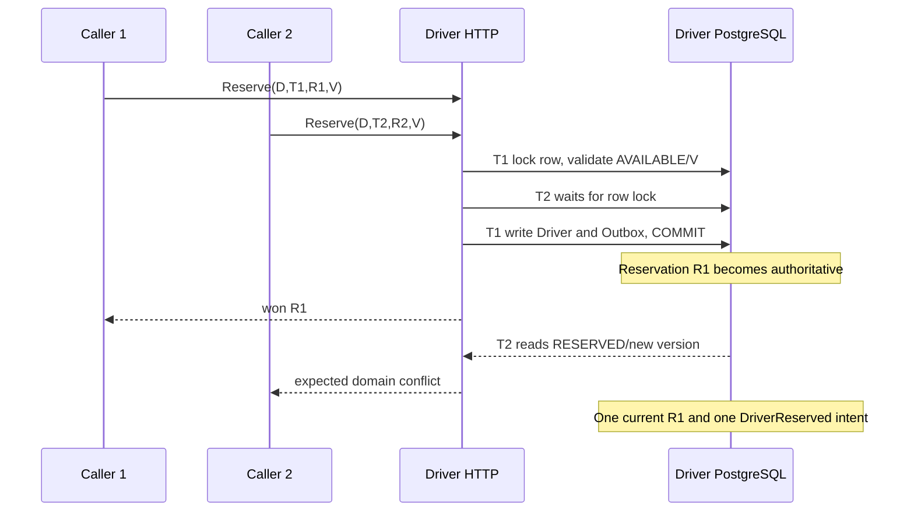

# Driver authority, derived discovery and durable matching

This report covers the integrated implementation at main
`2b1b047b450074bd1d3af5a29e1f6f0e3ce8f07d` (tree
`10e1480cec802fa50603b254e6f430324825550e`). Historical measurements below
retain their own source identities; they are not fresh performance observations
at this revision. Normative requirements remain Docs 00–03, then 04, then 05B.
The [evidence index](../evidence/member-b/final/freeze/manifest.json) records
proof scope, commands and limitations.

## Reservation authority and concurrency

Driver owns OFFLINE, AVAILABLE, RESERVED and ON_TRIP. The legal path is
OFFLINE → AVAILABLE → RESERVED → ON_TRIP → AVAILABLE; exact pre-start release
returns RESERVED to AVAILABLE. GoOffline competes with Reserve at the same
authority. Neither Redis discovery nor Matching selection reserves a Driver.

The actual implementation uses short PostgreSQL transactions with
`SELECT ... FOR UPDATE`, followed by aggregate state/version validation.
This combines row serialization with optimistic expected-version fencing;
it should not be described as an EF concurrency-token implementation.
Two callers can read AVAILABLE before either commits. The first locks and
validates the row, writes the reservation and its Outbox intent, then commits.
The next lock holder sees the committed state/version and returns a domain
conflict. Lock acquisition orders contenders; **successful transaction commit
is the reservation linearization point**. Rollback establishes no reservation.

The stable `(driverId, tripId, reservationId)` identifies the effect.
`matchingRound` is write-once provenance retained from the winning request;
a replay does not replace it, even when its incoming round differs.
A matching current reservation replay returns the existing effect without
incrementing version or adding another Outbox row. Exact identity checks
prevent an idempotency key from legitimizing different work.
A partial unique reservation index provides a cross-row identity backstop.
Only its specific constraint violation maps to a domain conflict; unrelated
database errors remain uncertainty, rather than fabricated rejection.

Release compares the exact Trip and reservation. A delayed Release(R-old)
cannot clear R-new. STARTED/COMPLETED history in `driver_lifecycle_effects`
continues to prove earlier ownership after current fields change; those
identities cannot become fresh work again. DriverReserved publication belongs
to Driver's transaction and relay, not to Matching. Publication is asynchronous:
the local commit is atomic, while the broker and downstream authorities commit
separately.

Implementation: [DriverRepository](../src/Services/Driver/RideHailing.DriverService/Infrastructure/Persistence/DriverRepository.cs),
[lifecycle repository](../src/Services/Driver/RideHailing.DriverService/Infrastructure/Persistence/DriverLifecycleRepository.cs),
[Driver aggregate](../src/Services/Driver/RideHailing.DriverService/Domain/Drivers/Driver.cs).
Proofs: [real PostgreSQL contenders](../tests/Integration/RideHailing.DriverService.IntegrationTests/DriverReserveConcurrencyTests.cs),
[release races](../tests/Integration/RideHailing.DriverService.IntegrationTests/DriverRaceFencingTests.cs),
[lifecycle](../tests/Integration/RideHailing.DriverService.IntegrationTests/DriverLifecycleTests.cs).
These substantiate DSI-001..005 and CON-01/02/04 within one PostgreSQL
authority; they do not prove multi-region or PostgreSQL failover behavior.

## Redis is a derived candidate index

Redis GEO nominates nearby eligible candidates; Driver PostgreSQL decides
whether a nominated Driver can still be reserved. A stale candidate may waste
an HTTP attempt and return an expected conflict. It cannot bypass the Driver
state/version guard. Redis availability does not prove Driver availability.

The [projection function](../src/Services/Matching/RideHailing.MatchingService/Infrastructure/RedisProjection/update_projection.lua)
compares aggregate version and location session/sequence, and atomically
updates metadata and GEO membership. State and location ordering are distinct:
a later location cannot resurrect an older state, and an old session or
sequence cannot overwrite newer accepted coordinates. Eligibility checks
freshness before deterministic ranking. Function atomicity protects one Redis
projection mutation, not a cross-service transaction or reservation lock.

An established Redis connection can reconnect; the updater can reload a lost
function. Complete projection loss needs **explicit authoritative event
replay**. Already ACKed events are not automatically reconstructed. If the
initial Redis connection fails, the current startup path may omit projection
consumer registration, requiring Matching restart after recovery. These are
separate operator/replay boundaries, not automatic full rebuilding.

REL-12/13/14: [real Redis tests](../tests/Integration/RideHailing.MatchingService.IntegrationTests/RedisProjectionTests.cs),
[stale handler proof](../tests/Integration/RideHailing.MatchingService.IntegrationTests/DriverProjectionStalenessHandlerTests.cs),
and [accepted recovery scope](../evidence/team/w14-integration/README.md).
DSI-006/007 do not grant Redis authority over assignments.

## Durable Matching and uncertain outcomes

RideRequested intake commits its envelope identity, pickup, round and
auto-execution intent before ACK. A hosted dispatcher scans PostgreSQL and
takes a per-round session advisory lease. A process crash releases the lease;
another worker resumes persisted work. The lease coordinates Matching workers
and does not substitute for Driver's reservation guard.

Eligibility precedes deterministic candidate ranking. S0/S1/S2 radii are
5/8/12 km in the current configuration. Each stage freezes its candidate
snapshot and READY attempts atomically. The workflow persists reservation
identity and write-ahead IN_FLIGHT with a dispatch-version fence before HTTP.
No stage advances until all relevant attempts are conclusively rejected.
Final-stage completed discovery is required for NO_DRIVER. UNKNOWN prevents
both candidate advance and stage advance (DSI-015..023).

After response loss, Driver may already have committed R and its Outbox.
Timeout proves only that the caller stopped waiting. Matching records UNKNOWN
and queries the **same R** before replay. Historical STARTED/COMPLETED ownership
is a positive result even if Driver is now AVAILABLE or holds later work.
A bare HTTP 404 is ambiguous; structured Driver-domain absence and fenced
negative state are distinguished from proxies and transport failures.
Trying D2 while D1 remains unresolved could create two reservations for one
Trip; it is forbidden. Reconciliation exhaustion leaves visible durable
uncertainty and backoff, never a guessed failure.

Cancellation persists a tombstone even if it precedes intake. It prevents new
attempts and reconciles uncertain dispatched work; Trip owns exact cleanup of
an authoritative committed reservation. NO_DRIVER and its deterministic
MatchingFailed Outbox intent commit together. A reserved round relies on
DriverReserved from Driver, with no second fabricated result event.

A relevant corrected counterexample was a previously dispatched reservation
advancing to STARTED/COMPLETED before Matching recovered. Inferring failure
from only current Driver fields could advance to D2. Exact lifecycle history,
reconcile-before-replay and the dispatch fence now preserve the original
identity. The [safety matrix](../tests/Integration/RideHailing.MatchingService.IntegrationTests/ReservationReconciliationSafetyTests.cs)
and [process lifecycle recovery](../tests/Integration/RideHailing.MatchingService.IntegrationTests/ProductionMatchingLifecycleRecoveryTests.cs)
prove the correction. The [production workflow tests](../tests/Integration/RideHailing.MatchingService.IntegrationTests/ProductionMatchingWorkflowTests.cs)
cover real broker intake, worker restart, multiple workers and response loss.

Implementation: [orchestrator](../src/Services/Matching/RideHailing.MatchingService/Application/Reserve/MatchingReserveOrchestrator.cs),
[dispatcher](../src/Services/Matching/RideHailing.MatchingService/Application/Matching/MatchingWorkDispatcher.cs),
[work repository](../src/Services/Matching/RideHailing.MatchingService/Infrastructure/Persistence/MatchingWorkRepository.cs).

## Editable proof diagrams

CON-01: each transaction is local to Driver. The final oracle reads PostgreSQL
and the exact reservation Outbox, rather than counting HTTP successes alone.



REL-01: Matching's write-ahead transaction, Driver's authority transaction and
Matching's conclusion are separate commits.

```mermaid
sequenceDiagram
    participant M as Matching worker
    participant Q as Matching PostgreSQL
    participant D as Driver HTTP
    participant P as Driver PostgreSQL
    M->>Q: Persist IN_FLIGHT R and dispatch fence
    M->>D: Reserve D1 using R
    D->>P: Commit reservation R plus Outbox
    Note over D: AfterReserveCommitBeforeResponse barrier suppresses response
    M->>Q: Timeout, persist UNKNOWN R
    Note over M,Q: D2 stays READY; no new dispatch or stage advance
    M->>D: Query original reservation R
    D->>P: Read current and exact lifecycle ownership
    D-->>M: OWNED_BY_THIS_RESERVATION
    M->>Q: Conclude attempt and round RESERVED using R
```

## Performance methodology and accepted populations

The accepted [W13 report](../evidence/team/w13-integration/README.md),
[protocol](../evidence/team/w13-integration/protocol.json),
[analysis](../evidence/team/w13-integration/analysis/campaign-analysis.json)
and [W14 E04 analysis](../evidence/team/w14-integration/e04/analysis.json)
retain per-run measurements, configurations, sample counts and ranges.
The accompanying claims validation records recomputed values and hashes.

E01 uses synchronized authenticated Reserve calls at N=1/10/25/50/100,
three repeats each: 558 requests, 15 winners, 543 expected conflicts and zero
system errors. Latency excludes preconnection and includes domain conflicts.
Median per-run P95 at these points is 7.1/20.4/38.7/39.5/76.7 ms;
N=1 has only three observations and supports no latency SLA.

E02 uses real authenticated public intake at 10/25/50/100 offered requests/s,
three 30-second runs per point, with open constant-arrival-rate scheduling.
Report offered rate, actual rate, dropped iterations and success/conflict
quantiles separately. Closed workloads can hide slow responses by reducing
arrivals. Faster aggregate latency in conflict-heavy runs is not greater
business throughput. The bounded no-fleet workload does not measure completed
rides or Payment capacity.

E03 compares 1/2/4 consumer replicas with prefetch 16 and per-instance pool 20
fixed. Aggregate application CPU/pool capacity grows with replicas; throughput
cannot be attributed solely to RabbitMQ. Worker execution is disabled to
isolate durable intake/dedup/ACK; this is not completed Matching throughput.

E04 uses three corrected-source runs at offered 0.5/s with 30-second outages.
There are 104 unique confirmed requests and 3 duplicates; 107 deliveries ACK
and 104 exact NO_DRIVER results. Ready backlog peaks 13/14/14; outstanding
application work peaks 16/16/16. These are different populations. Observed
service rates are 2.105/2.969/3.459 per second; steady recovery is
10.761/7.244/6.413 seconds. `B ≈ λT` and `T_drain ≈ B/(μ−λ)` require compatible
populations, roughly stationary rates and μ>λ. Management polling, reconnect
and variable processing make the formula an approximation, not an SLA.

W13 measurements belong to `d291f0430faa389e4351377ce4db361aa681648b` /
`87222fee80d5ce35cfc351b7a0f5e8c5cdac667d`; corrected W14 belongs to
`724d6c69aa9ee590c3aa4bb4afd1622ae6aa8719` /
`3799ca9a2ea5a19d03949c4d0c4644c81c14a168`. The frozen local host/resources,
images, repetitions, outcome quantiles and raw sample references remain in
their manifests. Rejected image-drift and pre-fix recovery attempts remain
historical counterexamples and are excluded from accepted tables.

REL-15 proves the recorded full-broker work conservation/recovery. REL-16
actually kills a leader in a three-node quorum profile; 19 critical queues
retain two online members and later recover three. Neither proves host HA,
arbitrary partition tolerance, PostgreSQL/Redis HA, production capacity or
zero downtime. Historical G4/G5 acceptance, fresh B tests, human rehearsals
and final release approval remain distinct verdicts.

## Recalculated performance tables

All quantiles below are the median of three per-run quantiles, not a pooled
percentile. Recalculation command:
`python scripts/evidence/validate-driver-matching-claims.py`.
The [calculation record](../evidence/member-b/final/freeze/claims-validation.json)
retains every run, sample count, exact values and hash verdict. E01/E03 and E04
confirmation quantiles use nearest rank `ceil(p*n)`; E02 uses k6 linear
interpolation at zero-based position `(n-1)*p`. W13 complete portable samples
are retained; its 114 original engine streams remain local-only and cannot
be rehashed from this checkout. The 174 digest checks include 12 overlapping
E04 entries, hence 162 distinct artifact checks.

E01, source/configuration above: each point has three winners across three
runs, N−1 conflicts per run, zero unexpected system errors, exact identity
agreement, one reservation intent and exact release afterwards.

| N | Total requests | P50 ms | P95 ms | Per-run P95 range ms |
| ---: | ---: | ---: | ---: | ---: |
| 1 | 3 | 7.1 | 7.1 | 6.9–7.5 |
| 10 | 30 | 14.7 | 20.4 | 19.8–27.9 |
| 25 | 75 | 30.3 | 38.7 | 38.6–44.6 |
| 50 | 150 | 23.4 | 39.5 | 37.6–47.8 |
| 100 | 300 | 46.3 | 76.7 | 67.9–77.1 |

E02, same accepted W13 source: three runs per rate, 30 seconds each; ten
disposable Riders with separate warmup/preflight. Counts cover all samples;
zero dropped iterations, authentication failures or system errors. Quantiles
conditioned on success/conflict below are independently calculated from each
outcome's complete samples and summarized across the three runs.

| Offered/s | Requests | Success / conflict | Actual/s median | All P50/P95 ms | Success P50/P95 ms | Conflict P50/P95 ms |
| ---: | ---: | ---: | ---: | ---: | ---: | ---: |
| 10 | 903 | 429 / 474 | 10.032 | 4.25 / 15.75 | 12.59 / 20.56 | 3.90 / 4.47 |
| 25 | 2253 | 488 / 1765 | 25.024 | 3.98 / 13.03 | 12.41 / 16.04 | 3.89 / 4.49 |
| 50 | 4502 | 475 / 4027 | 50.026 | 3.76 / 12.04 | 12.15 / 15.21 | 3.72 / 4.31 |
| 100 | 9003 | 699 / 8304 | 100.024 | 3.45 / 11.36 | 11.81 / 16.04 | 3.42 / 4.24 |

Aggregate per-run P95 ranges are 14.75–15.80, 12.87–13.35,
11.94–13.05 and 11.07–11.65 ms respectively. Total: 16,661 requests,
2,091 successes and 14,570 expected active-Trip conflicts. Independent
Trip/idempotency and no-fleet final-state checks accompany each run.

E03, same accepted W13 source: each run has 400 unique messages plus 40
deliberate duplicates; three runs per replica count. Every replica observes
nonzero consumption (per-instance observations remain in run manifests).
ACK rate includes observed duration, drain and broker statistics visibility
wait. The creation latency proxy ends at stored `created_at`, **before a
claimed commit/ACK latency endpoint**; it is not end-to-end dispatch latency.

| Replicas | Unique intakes | Deliveries / ACKs | ACK/s median (range) | Creation proxy P50/P95 ms |
| ---: | ---: | ---: | ---: | ---: |
| 1 | 1200 | 1320 / 1320 | 17.52 (17.49–18.25) | 22.91 / 43.22 |
| 2 | 1200 | 1320 / 1320 | 18.21 (17.52–18.25) | 23.03 / 42.51 |
| 4 | 1200 | 1320 / 1320 | 17.51 (17.51–17.52) | 22.44 / 42.43 |

Three queue CSVs finish before final ACK statistics visibility. The final
owning-state `queueAfter.message_stats.ack` supplies the final ACK count;
subtracting only the last CSV observation undercounts completed intake.

E04, corrected W14 source above: three separate empty-volume runs, one real
OFFLINE Driver, unchanged authority and no reservation effects. Counts,
rates and durations below are recalculated from receipts and sampled state.

| Run | Unique / ACKs | Actual outage input/s | Outage s | Peak ready / business | Service/s | Steady s | Final quiescence s |
| ---: | ---: | ---: | ---: | ---: | ---: | ---: | ---: |
| 1 | 36 / 37 | 0.493 | 30.397 | 13 / 16 | 2.105 | 10.761 | 14.927 |
| 2 | 34 / 35 | 0.500 | 30.006 | 14 / 16 | 2.969 | 7.244 | 10.817 |
| 3 | 34 / 35 | 0.493 | 30.438 | 14 / 16 | 3.459 | 6.413 | 10.468 |

Median steady recovery 7.244 s, range 6.413–10.761 s; sample variance
5.327 s². The full E04 analysis retains model predictions using compatible
rate/backlog definitions, per-interval rates and confirmation latency.

All experiments used one physical Docker host (Ryzen 5 6600H, 12 logical
CPUs, roughly 7.9 GB W13 VM memory), pinned PostgreSQL 18.6, RabbitMQ 4.3.6,
Redis 8.10.2; E02 used k6 0.54.0. Every manifest retains actual cgroup CPU,
memory and image observations. Small local samples, management polling,
shared-host contention and replica-dependent total application resources
limit generalization. These are measurements of the stated workloads.
