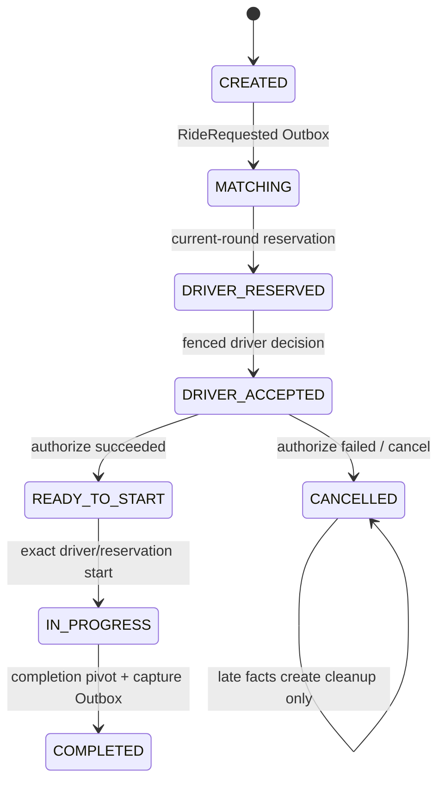

# Member A — Trip, Outbox and persisted Saga report

This report closes the implementation/reporting portion of Member A W9–W16. It separates implemented behavior, observed local results and external team activities that cannot be truthfully self-certified.

## Implemented workflow

The Trip aggregate owns business lifecycle and terminal monotonicity. `RideSaga` owns cross-service progress, stable Payment operation lineage and explicit `REQUIRES_REVIEW`; it does not replace the Trip state machine.

```mermaid
stateDiagram-v2
    [*] --> AUTHORIZE_PENDING
    AUTHORIZE_PENDING --> AUTHORIZED: PaymentAuthorized
    AUTHORIZE_PENDING --> RELEASE_PENDING: decline/cancel
    RELEASE_PENDING --> VOID_PENDING: late authorization succeeded
    RELEASE_PENDING --> [*]: exact release confirmed
    VOID_PENDING --> [*]: exact release + void confirmed
    AUTHORIZED --> CAPTURE_PENDING: Trip completed
    CAPTURE_PENDING --> CAPTURED: PaymentCaptured
    CAPTURE_PENDING --> CAPTURE_PENDING: pending/review; recover forward
```

## Transactional Outbox and crash windows

Every critical local transition and its required integration intent share one PostgreSQL transaction. A stable `messageId` identifies the logical message; `operationKey` identifies the Payment effect. A relay claims pending rows, publishes with confirms, then marks them published.

| Crash window | Durable result | Recovery |
| --- | --- | --- |
| Before commit | no state and no intent | caller/delivery retries |
| After commit, before publish | state and `PENDING` intent | relay restart publishes |
| After publish, before mark | receiver may see a duplicate | stable identity + dedup/state guard |
| After mark | state and `PUBLISHED` evidence | no work remains |

The claim is at-least-once delivery with no silent loss of a committed intent, not exactly-once delivery.

## Compensation and pivot

Before physical start, failures can compensate: cancellation/authorization failure retains the exact `driverId`, `reservationId`, `matchingRound` and Payment lineage needed to release/void only the owned effects. After completion, capture failure cannot roll the ride back; the Saga remains pending or moves to `REQUIRES_REVIEW` and reconciliation uses the same capture key.

## W13–W14 performance and recovery support

- `saga.active{step}` is rebuilt from durable rows after restart.
- Shared `outbox.pending`, `outbox.oldest_pending.age`, publish/ACK/dedup metrics remain the backlog authority.
- `TripInvariantAuditor` checks Trip/Saga/Outbox consistency after controlled runs.
- Grafana dashboard `ride-trip-saga` exposes Saga steps, compensation/review, rejected transitions and Outbox backlog.
- Existing REL-15/16 broker scripts may be followed by the auditor; the allowed claim is “Trip Outbox/Saga recovered under the tested scenario,” never “the entire system is HA.”

## Verification observed on 2026-10-30

| Lane | Result |
| --- | ---: |
| Release solution build (integrated A-W16 + C-W16 head) | 0 warnings, 0 errors |
| Trip unit | 299/299 passed |
| W9/W10 Outbox + Saga with real PostgreSQL/RabbitMQ | 31/31 passed |
| W11 deterministic faultpoint | 11/11 passed |
| W11 real process crash/restart | 5/5 passed |
| W12 telemetry/authz/auditor | 19/19 passed |
| Live compose core + observability | 14 containers; HTTP readiness endpoints 200 |

The live demo also applied migrations through `W10_RideSaga`, attached one consumer to `trip.payment-outcome.q`, and exported a durable mock Saga snapshot to Prometheus/Grafana. The mock rows are presentation data; the integration lanes above are the correctness proof.

## W15–W16 release/demo handoff

1. Start with `TRIP_MESSAGING_ENABLED=true docker compose --profile obs up -d --build`.
2. Run `scripts/demo/member-a-mock-workflow.ps1` for labelled visual data.
3. Open `http://localhost:3000/d/ride-trip-saga/trip-saga-and-outbox`.
4. Use `scripts/evidence/member-a-release-gate.ps1` for deterministic build/unit checks; add `-WithDockerIntegration` where Docker is exposed to the host.
5. Use W11 evidence for the Outbox crash and Saga restart backup demo.

External limitations remain explicit: Identity/Gateway does not yet supply a production JWT client flow, and an independent B/C peer rerun, release tag and human rehearsal cannot be self-issued by Member A code.
