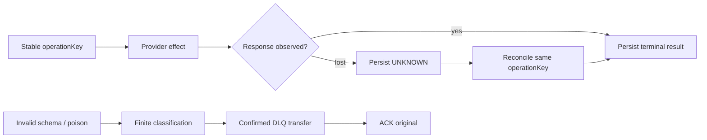
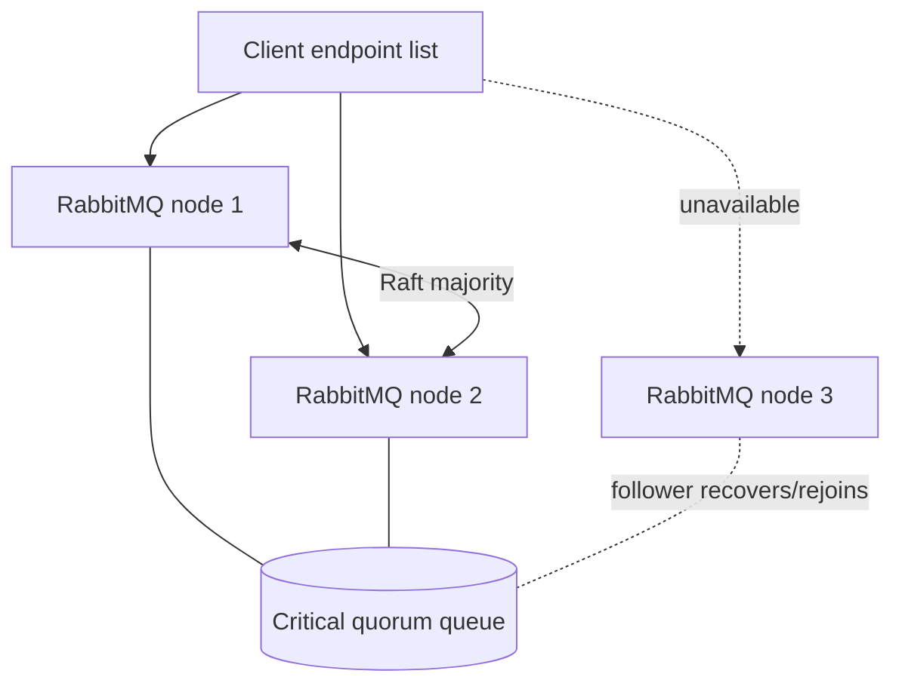

# Member C reliability and release report

Date: 2026-10-28  
Scope: Payment authority, messaging reliability, Notification projection,
observability, broker HA harness, security/release infrastructure.

## Claim boundary

RabbitMQ transport is treated as at-least-once. Publisher confirms protect
broker acceptance; manual consumer acknowledgements transfer responsibility
only after a durable local effect or a confirmed retry/error transfer.
Duplicates remain possible and are handled by stable `messageId`, durable
consumer deduplication, state guards, and Payment `operationKey` idempotency.

The HA harness supports the narrow claim that critical quorum queues can be
validated on a three-node RabbitMQ cluster while one node is unavailable and a
majority remains. It does **not** claim that PostgreSQL, Redis, every service,
or the full ride workflow is highly available.

## REL-05 — publish accepted, local mark lost

```mermaid
sequenceDiagram
    participant DB as Outbox DB
    participant R as Relay
    participant MQ as RabbitMQ
    DB->>R: claim stable messageId
    R->>MQ: mandatory publish + await confirm
    MQ-->>R: publisher ACK
    Note over R: crash/fault before mark
    DB->>R: lease expires; reclaim same messageId
    R->>MQ: republish duplicate
    R->>DB: mark PUBLISHED after confirm
```

## REL-06 — commit before ACK

```mermaid
sequenceDiagram
    participant MQ as RabbitMQ
    participant C as Consumer
    participant DB as Owned DB
    MQ->>C: deliver M
    C->>DB: effect + dedup + local Outbox
    DB-->>C: COMMIT
    Note over C: crash/fault before ACK
    MQ->>C: redeliver M
    C->>DB: dedup hit; no second effect
    C->>MQ: ACK
```

## REL-08 / REL-11 — uncertain Payment and visible poison



## REL-16 — one broker node unavailable



## Metrics and safe telemetry

- RabbitMQ selective detailed scrape: ready, unacked, redelivery, consumers,
  confirms/unroutable outcomes.
- Messaging: delivery, ACK, redelivery, retry, dead-letter, dedup, processing
  duration, Outbox pending/age/publish/confirm.
- Payment: operation type/outcome, idempotency hit, UNKNOWN,
  `REQUIRES_REVIEW`, reconciliation, duration.
- Notification: delivered versus duplicate projection.
- Passwords, tokens, private keys, raw credentials and unnecessary PII are
  forbidden. Business identifiers never become metric dimensions.

## Reproducible gates

```powershell
./scripts/evidence/release-check.ps1
./scripts/evidence/release-check.ps1 -WithDocker
./scripts/fault/ha-up.ps1 -Applications
./scripts/fault/rel15-broker-interruption.ps1 -Execute
./scripts/fault/rel16-one-node-loss.ps1 -Node rabbitmq-3 -Execute
```

Live Docker outputs must be saved as evidence. An unavailable Docker engine is
a blocked run, not a PASS.
