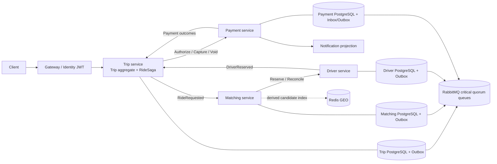

# Team technical report — distributed ride-hailing platform

Status: W15 feature-freeze technical report. This document synthesizes the
member reports and their evidence bundles. The member reports remain
authoritative for their own domains, measurements and limitations.

## Abstract

The project implements a distributed ride-hailing workflow across Trip,
Driver, Matching, Payment, Notification, Identity and Gateway services on
PostgreSQL, RabbitMQ and Redis. Each service owns its database and exposes a
small authenticated API; integration intents are committed transactionally
with a shared Outbox pattern, published with publisher confirms, consumed with
manual acknowledgements after a durable local effect, and deduplicated through
stable message identity.

The implemented claim is at-least-once transport with idempotent processing,
not exactly-once transport. Trip lifecycle and Saga transitions are durable
and terminal-monotonic; Driver reservations are fenced by exact trip,
reservation and matching-round identity; Payment effects are keyed by a stable
operation identity and reconciled rather than guessed. Verification combines
real-provider integration tests, deterministic fault injection, process
termination/restart runs, source-bound evidence bundles and measured
performance campaigns with explicit statistical limits.

## Architecture

Authority boundaries are explicit:

- Trip owns the ride lifecycle, terminal monotonicity, the persisted Saga and
  its Outbox intents.
- Driver owns reservation state and is the only reservation authority. Redis
  is a derived candidate index; it can waste an attempt but cannot grant a
  reservation.
- Matching owns durable intake, deterministic candidate ranking, dispatch
  bookkeeping and uncertain-outcome reconciliation. It never fabricates a
  reservation result.
- Payment owns operation-key idempotency, durable results and reconciliation.
- Notification is a non-authoritative projection.
- Identity issues short-lived RSA-signed JWTs; Gateway and direct services
  validate them. Service credentials are separate from domain fencing.

## Methods

- Each service keeps its own PostgreSQL schema and transaction. Critical state
  changes and outgoing intents commit atomically; a relay publishes with
  confirms and only then records `PUBLISHED`. This closes the committed-intent
  loss window without claiming exactly-once delivery.
- Consumers commit the business effect and a durable deduplication marker in
  one transaction, then acknowledge. A crash between commit and ACK produces a
  redelivery that is deduplicated, not a second effect.
- Driver reservation uses short row-locking transactions plus expected-version
  fencing. Successful commit is the linearization point; a stale release is
  rejected by exact reservation identity.
- Matching persists write-ahead `IN_FLIGHT` work before dispatch and cannot
  advance to another candidate or stage while an attempt is `UNKNOWN`.
  Reconciliation queries the same reservation identity.
- Payment uses `operationKey` (not `messageId`) for the logical money effect;
  same-key different-payload is a conflict, and an effect whose response was
  lost is reconciled under the same key.
- Verification follows Doc 03 §25: source commit/tree, actual run, raw
  evidence, authoritative final-state assertions, manifests and hashes, and
  reproduction instructions.
- Security and release verification use real Identity/Gateway/service
  rejection checks, secret scanning, and a release Compose overlay that fails
  closed when operator secrets are absent.

## Verification

W14 G4/G5 acceptance remains the authoritative failure-window evidence. W15
adds no runtime product/source change: the integrated W15 delta is reports,
evidence, CI and release configuration plus one Matching README correction.
Therefore the accepted W14 invariants and source-bound campaigns remain
applicable; no invariant was relabeled as re-certified by an old run.

Member-level evidence at W15:

- Member A: Trip unit and historical W09–W14 lanes, including the persisted
  Saga, exact compensation/capture recovery, Outbox crash windows, faultpoint
  tests and the invariant auditor. Historical counts and their code commits
  remain in `evidence/member-a/`; they are observations on those sources, not
  fresh W15 performance measurements.
- Member B: fresh full-clone Release build and serial regression (1223 passed,
  zero failed, one opt-in Identity theory skipped), fresh empty-volume runtime
  with three full journeys and AUD-01..08, dedicated security checks, and
  independent recalculation of accepted performance populations with 174
  digest checks. The source-bound manifest and per-artifact hashes are in
  `evidence/member-b/final/freeze/`.
- Member C: reliability report and claim boundaries covering confirms, ACK
  after commit, deduplication, Outbox relay, DLQ, Payment idempotency,
  observability and quorum HA; fail-closed release overlay, secret scanner,
  and deterministic platform checks. Live HA claims retain the W14 evidence
  scope and are not inferred from configuration validation.

W15 integration gates are recorded in
`evidence/team/w15-integration/`: freeze audit, clean-clone technical
verification, evidence-integrity checks, release fail-closed render, secret
scan, anchor portability fixtures, claims validation and exact-tree CI.

Failure-evidence mapping (Member A): REL-04 producer crash →
`evidence/member-a/w11-fault-proofs/final-state/rel-04-producer-crash.md`;
REL-07 Saga restart →
`evidence/member-a/w11-fault-proofs/final-state/rel-07-saga-restart.md`;
REL-09 compensation →
`evidence/member-a/w10-saga/final-state/rel-09-compensation.md`;
REL-10 capture recovery →
`evidence/member-a/w10-saga/final-state/rel-10-capture-recovery.md`;
REL-17 late terminal events →
`evidence/member-a/w11-fault-proofs/final-state/rel-17-late-terminal-events.md`.

Payment idempotency (Member C): `operationKey` is the logical money-effect
identity; same-key different payload is a conflict, and a timeout after the
provider effect is reconciled under the same key rather than treated as
failure. The claim boundary and REL-08/11 diagram are in the Member C report;
the underlying deterministic suites and fault seams remain in the C-owned
W10/W11 evidence.

## Known limitations

- The required "another member performs a clean clone" process step and the
  W16 human rehearsals/oral defenses are not automated artifacts. Independent
  automated clean-clone verification is recorded, but it does not prove a
  separate human member performed the procedure.
- Member A's verification table describes runs on the A stack. It is retained
  as historical member evidence; W15 integration re-validates build, tests,
  release and runtime gates on the integrated tree where feasible.
- Member C does not claim live W15 dashboard export or new live HA runs.
  W14's real-provider recovery evidence remains source-bound to its accepted
  source and is not converted into a configuration-validation PASS.
- Member B's measurements apply to the recorded single-host environment,
  sample sizes and workloads. They do not establish production capacity,
  multi-region behavior or PostgreSQL/Redis failover.
- No final release tag or GitHub Release has been created. Release readiness
  remains distinct from the merged-source state.

## Conclusion

The frozen system has a coherent set of authorities, a bounded at-least-once
messaging model, and evidence that distinguishes observed results from
architecture targets. W15 assembles a release-candidate source with a complete
report chain and fail-closed release configuration. Remaining acceptance work
is exact-tree/post-merge CI and the human/course deliverables that cannot be
manufactured by automation.

## Contribution traceability

| Member | Source PR | Original source head | W15 integrated commits | Primary artifacts |
| --- | --- | --- | --- | --- |
| A | #49 `feature/A-W15-freeze-report` | `c65b1da` | `086b568`, `1f04e09` | `docs/member-a-trip-saga-report.md`; `evidence/member-a/w15-freeze/`; W09–W14 bundles |
| B | #62 `feature/B-W15-freeze-report` | `d2958cf` | `913c262`, `205e3b2`, `d575d5b`, `be877b6`, `1ba0608`, `5b8e88e` | `docs/driver-matching-report.md`; `evidence/member-b/final/freeze/` |
| C | #54 `feature/C-W15-freeze-report` | `d4e9db6` | `17b7504`, `1dd8797`, `ff5e0c3`; portability fix `6ba7c1e` | `docs/member-c-reliability-report.md`; `evidence/member-c/final/`; release overlay/scanner |

A and B W15 commits are patch-identical to their sources apart from cherry-pick
metadata. C's three content commits are byte-identical outside
`.github/workflows/ci.yml`, where the patch was reconciled onto the newer W14
main CI instead of overwriting it. The full mapping, including skipped
already-present changes, is in `evidence/team/w15-integration/source-mapping.json`.
